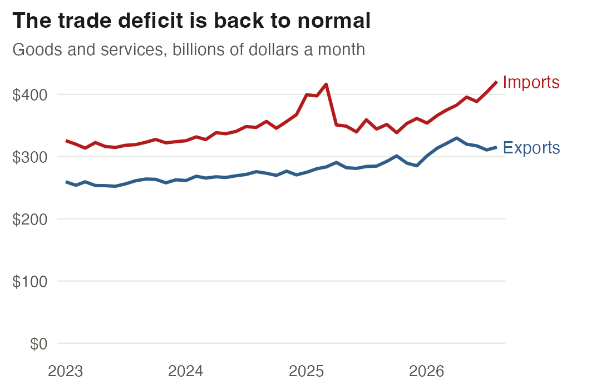
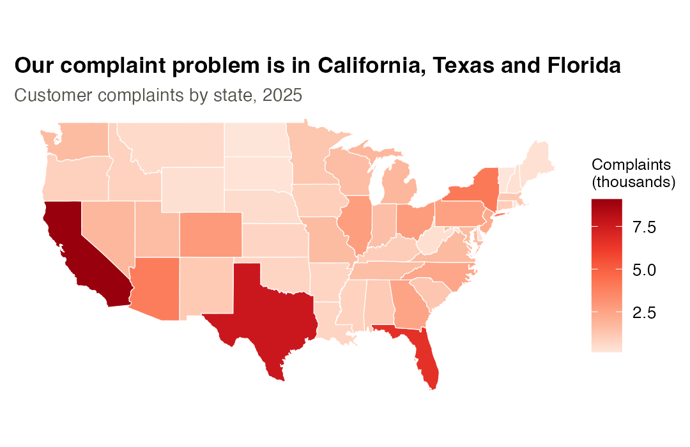
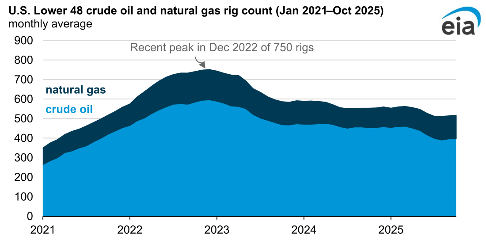
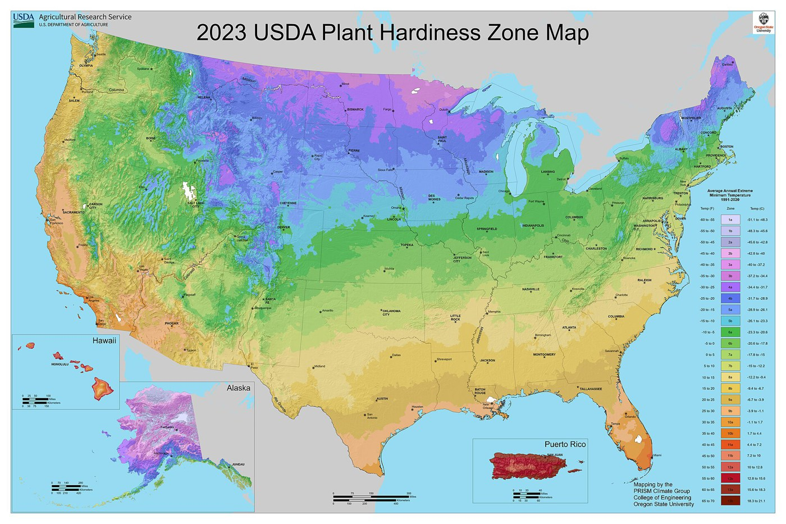
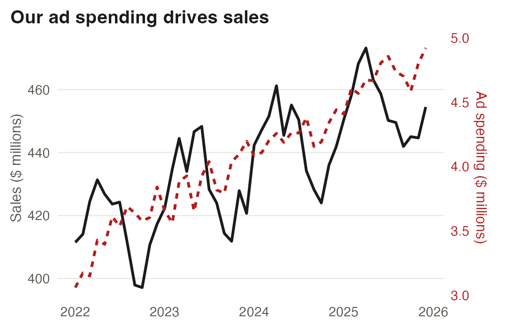
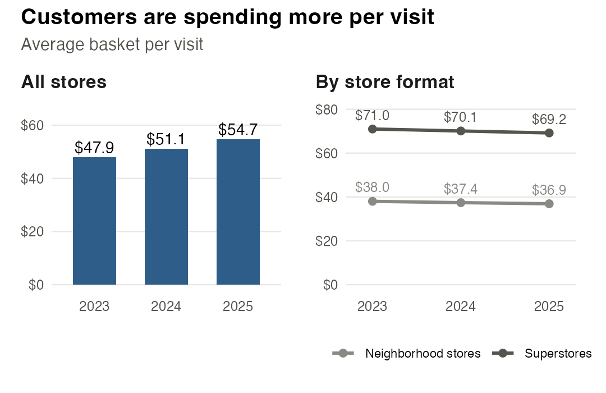
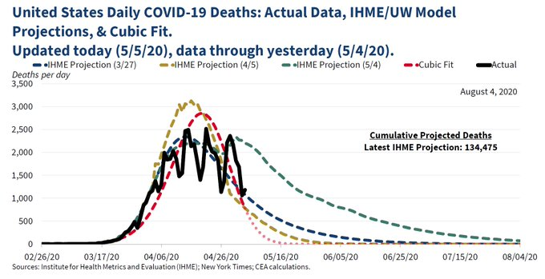
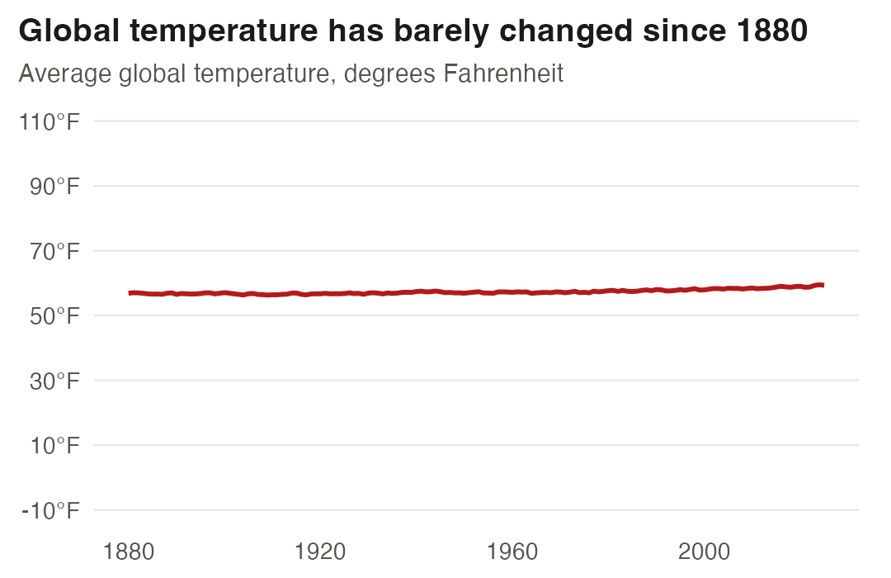
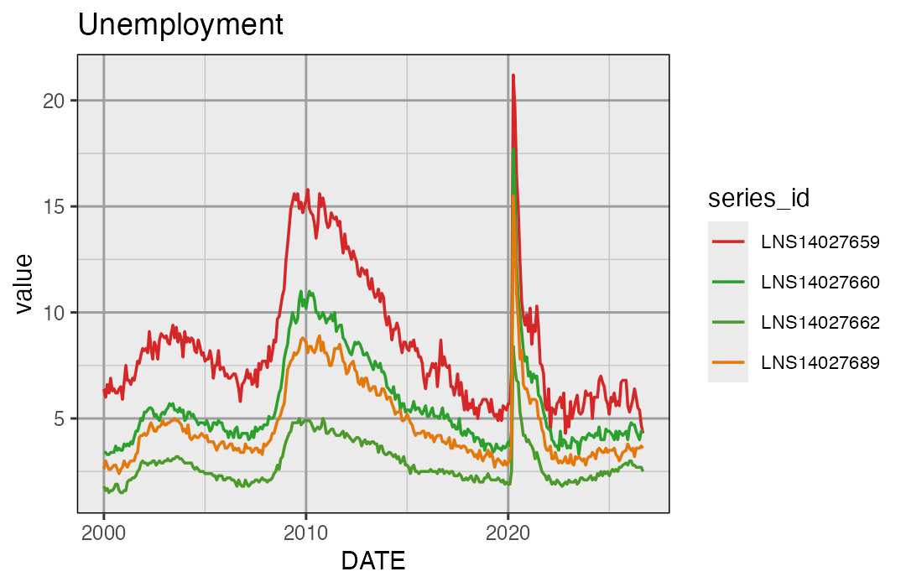

```{=html}
<style>
.fc-note { font-size: 0.85rem; color: #6b6b6b; margin: 0 0 1rem; }
.fc-wrap { max-width: 8in; margin: 0 auto; }
.fc-cards { display: grid; grid-template-columns: repeat(2, 1fr); gap: 0.16in; }
.fc-card { border: 1px dashed #9a9a94; border-radius: 3px; padding: 0.12in 0.14in;
           break-inside: avoid; display: flex; flex-direction: column; }
.fc-card .fc-n { font-size: 0.6rem; letter-spacing: 0.12em; text-transform: uppercase; color: #b31b1b; font-weight: 700; }
.fc-card img { display: block; width: 100%; max-height: 1.85in; object-fit: contain; margin: 0.04in 0 0.05in; }
.fc-card .fc-memo { font-size: 0.74rem; line-height: 1.4; margin: 0 0 0.2rem; font-style: italic;
                    border-left: 3px solid #e3e3de; padding-left: 0.45rem; }
.fc-card .fc-memo b { font-style: normal; font-weight: 600; color: #55554f; }
.fc-card .fc-src { font-size: 0.62rem; color: #6b6b6b; margin: 0 0 0.15rem; }
.fc-card .fc-ask { margin-top: auto; padding-top: 0.22rem; border-top: 1px solid #e3e3de; font-size: 0.7rem; margin-bottom: 0; }
.fc-card .fc-ask b { color: #b31b1b; }
.fc-break { break-before: page; }
.fc-crit { border: 1px solid #55554f; border-radius: 4px; padding: 0.26in; break-inside: avoid; }
.fc-crit h3 { margin: 0 0 0.45rem; font-size: 1rem; border: none; }
.fc-crit .fc-lbl { font-size: 0.68rem; text-transform: uppercase; letter-spacing: 0.08em; color: #6b6b6b; font-weight: 700; margin: 0 0 0.1rem; }
.fc-crit .fc-line { border-bottom: 1px solid #cfcfc9; min-height: 0.42in; margin-bottom: 0.16in; }
.fc-crit .fc-box { min-height: 2.1in; border: 1px solid #cfcfc9; border-radius: 3px; margin-bottom: 0.1in; }
.fc-crit .fc-how { font-size: 0.72rem; color: #333; line-height: 1.5; margin: 0 0 0.16in; }
.fc-steps { display: grid; grid-template-columns: repeat(2, 1fr); gap: 0.08in 0.18in; font-size: 0.66rem; line-height: 1.45;
            background: #fafaf7; border: 1px solid #e3e3de; border-radius: 3px; padding: 0.1in 0.14in; margin: 0 0 0.2in; }
.fc-steps b { color: #b31b1b; }
.fc-steps ol { margin: 0.02in 0 0; padding-left: 1.1rem; }
@media print {
  .fc-note, #quarto-header, #quarto-sidebar, .nav-page, footer, #quarto-margin-sidebar, #title-block-header { display: none !important; }
  @page { size: letter portrait; margin: 0.4in; }
  body { background: #fff; }
  .fc-wrap { max-width: none; }
}
</style>

<p class="fc-note">Nine figures, each with something wrong in it. Three are
published charts, as printed. Three use real public data. Three use invented
data, labelled as such. Print, cut along
the dashed lines and deal one card per team. The last page is the critique
sheet. The questions come from the <a href="figure-guide.qmd">figure
guide</a>.</p>

<div class="fc-wrap">
<div class="fc-cards">

  <div class="fc-card">
    <span class="fc-n">Card 1</span>
    
    <p class="fc-memo"><b>The memo says:</b> The two lines have moved together since 2023. The deficit is back where it was.</p>
    <p class="fc-src">Data: FRED, series BOPTEXP and BOPTIMP.</p>
    <p class="fc-ask"><b>What is wrong, and at which step?</b> What is the figure entitled to claim?</p>
  </div>

  <div class="fc-card">
    <span class="fc-n">Card 2</span>
    
    <p class="fc-memo"><b>The memo says:</b> Most of our complaints come from three states. Send the service team there.</p>
    <p class="fc-src">Invented complaints for an online retailer. State populations: FRED, 2025.</p>
    <p class="fc-ask"><b>What is wrong, and at which step?</b> What would you divide by?</p>
  </div>

  <div class="fc-card">
    <span class="fc-n">Card 3</span>
    
    <p class="fc-memo"><b>As published:</b> U.S. Energy Information Administration, November 2025, on why rig counts remain low.</p>
    <p class="fc-src">A real chart, public domain. <a href="https://www.eia.gov/todayinenergy/detail.php?id=66645">Source</a>.</p>
    <p class="fc-ask"><b>What can a reader not read, and at which step?</b> Did natural gas rigs rise or fall after 2024?</p>
  </div>

  <div class="fc-card">
    <span class="fc-n">Card 4</span>
    
    <p class="fc-memo"><b>As published:</b> USDA and Oregon State University, 2023. Each color is a 5&nbsp;°F band of the average coldest night of the year.</p>
    <p class="fc-src">A real chart, public domain. <a href="https://planthardiness.ars.usda.gov/">Source</a>.</p>
    <p class="fc-ask"><b>What is wrong, and at which step?</b> Who is the reader, and does the scale suit that reader?</p>
  </div>

  <div class="fc-card">
    <span class="fc-n">Card 5</span>
    
    <p class="fc-memo"><b>The memo says:</b> Sales track ad spending closely. A bigger ad budget will raise sales.</p>
    <p class="fc-src">Invented data for the grocery chain.</p>
    <p class="fc-ask"><b>What is wrong, and at which step?</b> Two things, in fact.</p>
  </div>

  <div class="fc-card">
    <span class="fc-n">Card 6</span>
    
    <p class="fc-memo"><b>The memo says:</b> Customers spend more per visit every year. Our pricing strategy is working.</p>
    <p class="fc-src">Invented data for the grocery chain.</p>
    <p class="fc-ask"><b>What is going on?</b> How can both panels be right?</p>
  </div>

</div>

<div class="fc-cards fc-break">

  <div class="fc-card">
    <span class="fc-n">Card 7</span>
    
    <p class="fc-memo"><b>As published:</b> White House Council of Economic Advisers, May 5, 2020.</p>
    <p class="fc-src">A real chart, public domain. <a href="https://ffund.github.io/intro-ml-tss21/notes/3-cubic-model">Copy and discussion</a>.</p>
    <p class="fc-ask"><b>What is wrong, and at which step?</b> What is the cubic fit entitled to claim?</p>
  </div>

  <div class="fc-card">
    <span class="fc-n">Card 8</span>
    
    <p class="fc-memo"><b>The memo says:</b> Global temperature has hardly moved in 140 years.</p>
    <p class="fc-src">Data: NASA GISTEMP v4 anomalies, added to the 1951–1980 mean of 57.2&nbsp;°F.</p>
    <p class="fc-ask"><b>What is wrong, and at which step?</b> What axis would match the quantity?</p>
  </div>

  <div class="fc-card">
    <span class="fc-n">Card 9</span>
    
    <p class="fc-memo"><b>The appendix says:</b> Figure 4: Unemployment.</p>
    <p class="fc-src">Data: FRED, unemployment rates by education.</p>
    <p class="fc-ask"><b>What is wrong, and at which step?</b> List everything a reader would need fixed.</p>
  </div>

</div>

<div class="fc-break"></div>

<div class="fc-crit">
  <h3>Critique sheet · team <span style="color:#b31b1b">______</span> · card <span style="color:#b31b1b">____</span></h3>

  <p class="fc-how">Every team works its card at the same time, using the
  questions below. Then teams present in an order drawn at random, and the
  room adds what the team missed. A fault the room names, with its step,
  scores; disliking the picture does not.</p>

  <div class="fc-steps">
    <div><b>1. Decide what to compare</b>
      <ol><li>What is the message?</li><li>Compared with what?</li><li>Which quantity?</li><li>Which form?</li></ol></div>
    <div><b>2. Encode it for the eye</b>
      <ol><li>Are the compared values on a common scale?</li><li>Does the channel match the data?</li><li>Are compared items together?</li><li>Do the points hide each other?</li></ol></div>
    <div><b>3. Keep it faithful</b>
      <ol><li>Does the scale match the quantity?</li><li>Do the window and sample favor the message?</li><li>Is the uncertainty shown?</li><li>Is the title supported?</li></ol></div>
    <div><b>4. Finish it for the reader</b>
      <ol><li>Does the title state the finding?</li><li>Does every mark carry information?</li><li>Does the caption stand alone?</li><li>Does it fit the page or slide?</li></ol></div>
  </div>

  <p class="fc-lbl">1 · What does the figure claim?</p>
  <div class="fc-line"></div>

  <p class="fc-lbl">2 · What is wrong, and at which step? (for example, 3.1)</p>
  <div class="fc-line"></div>
  <div class="fc-line"></div>

  <p class="fc-lbl">3 · What is the figure entitled to claim?</p>
  <div class="fc-line"></div>

  <p class="fc-lbl">4 · Sketch the redraw. It still has to make a point.</p>
  <div class="fc-box"></div>
</div>
</div>
```
