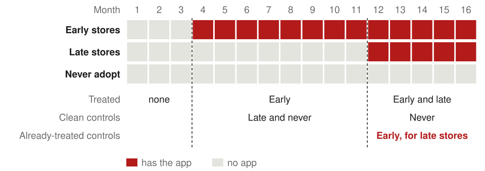
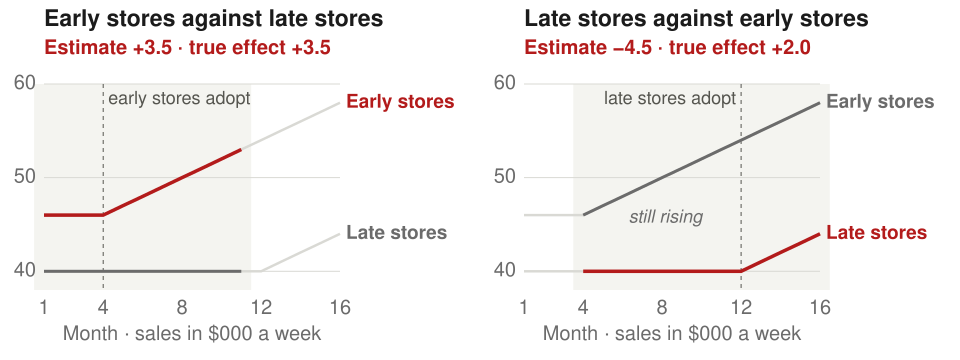

:::: {.content-hidden when-format="revealjs"}

::: {.callout-note appearance="simple"}
[**Open the slides**](09-designs-ii-slides.html)
:::

::: {.callout-important appearance="simple"}
**On Zoom.** This meeting is held on Zoom, at the usual time. Join from the [Zoom page on Canvas](https://canvas.cornell.edu/courses/92942/external_tools/1346), which asks for your NetID.
:::

**What you should be able to do after this meeting.** Draw your project's design as a graph. Name the single assumption carrying the estimate — the one you would have to defend to a sceptic.

## Handouts

[Project description brief](../handouts/project-description.qmd)

## Where to read more

[Remix](https://mixtape.scunning.com/) ch. 8 on panel data and fixed effects, ch. 9 on difference-in-differences, ch. 10 if your rollout is staggered, and ch. 11 on synthetic control. [The Effect](https://theeffectbook.net) ch. 16 to 18 cover fixed effects, event studies and difference-in-differences. [Mostly Harmless](https://www.mostlyharmlesseconometrics.com/) ch. 5.

## Session A · 2:00–3:15

Designs that use change over time, each drawn before it is described. Fixed effects first, opened by women on corporate boards, where the association with firm value changed sign once each firm was compared with itself: what the fixed effects remove, the confounders that change over time and survive them, measurement error that they amplify, and a common shortcut that is not a fixed effect. Then difference-in-differences and event studies as one design built in four steps. Two groups and two periods, opened by John Snow's comparison of two London water companies before and after one of them moved its intake in 1852: cholera deaths fell by 57 per 10,000 residents in the districts it partly supplied, relative to districts it did not reach. A simulated coffee chain that launches a mobile-ordering app shows what each subtraction removes and what parallel trends assumes, and two studies show it failing: trainees whose earnings dipped just before job training, and Philadelphia's beverage tax pushing sales into the stores outside the city. More periods turn the comparison into an event study, whose pre-trend tests can pass when parallel trends fails. Adoption on different dates changes which units serve as controls, and two-way fixed effects can then report the wrong sign. Treatment that comes in doses needs a stronger assumption to compare one dose with another. Then few treated units: standard errors with one treated state, and synthetic control for California's 1988 tobacco program. Last, the finance event study, opened by stock prices on the day of earnings announcements: the market model, abnormal returns, and other news in the window. The session closes with all six designs of meetings 8 and 9 in one table.

## Session B · 3:30–4:30

Every session B opens with a ten-minute team check-in: what you did
since last week, what is stuck, and who is doing what next. Written
down, and handed in with that session's work.

Seven published studies that cover the designs of meetings 8 and 9, each posed as the question and the setting its authors faced: working from home at a Chinese travel agency, family heirs as chief executives, close shareholder votes on governance, calorie labels at Starbucks, bank deregulation and inequality, the cost of terrorism in the Basque Country, and the sudden deaths of company directors. For each, the room proposes a design and names the assumption it needs before the slide shows what the authors did. Then teams are drawn at random to put up their own project's design, draw the graph, state the assumption carrying the estimate, and defend it while the room tries to break it. Every team presents at some point, without notice. The design that survives goes in your identification section, and the attack that landed goes in your limitations paragraph.

Your team's output is submitted before you leave.

## Due

Project description — up to three pages, on Canvas by Friday, October 23

::::

:::: {.content-visible when-format="revealjs"}

## Outline

1. **Fixed effects.** Compare each unit with itself over time, which removes every trait that does not change.
2. **Difference-in-differences and event studies.** Add a comparison group, then follow the effect period by period, across adoption dates and doses.
3. **Few treated units.** With one treated state the usual standard errors are too small, and a weighted mix of other states can serve as its control.
4. **Event studies in finance.** A separate design with the same name, built on share prices around a dated announcement.
5. **Matching a design to a question.** Seven published studies that use the designs of meetings 8 and 9, each posed in the setting its authors faced.

::: {.notes}
One minute. Section 1 compares each unit with itself, the panel tool
every later design uses. Section 2 is one design built in four steps, as
in the practitioner's guide by Baker, Callaway, Cunningham, Goodman-Bacon
and Sant'Anna: two groups and two periods, then many periods as an event
study, then adoption on different dates, then different amounts of
treatment. Section 3 is what to do when only one or a few units are
treated. Section 4 is the finance event study, a different design that
shares the name and that the finance teams will use. The running example
in every animation is a coffee chain that launches a mobile-ordering
app, with weekly sales per store as the outcome.

Where this sits. Meeting 7's bias table had a Solution column that named
the designs: randomize, compare at the cutoff, use an instrument, hold
the confounder fixed. Last week paid off the first three, and each needed
an assignment the researcher can see: a coin, an instrument, a score
with a cutoff. Most projects in this room have a change instead: a
policy, a product launch, a regulation, a merger, an announcement, that
reached some units and not others at a date they can name. Today's
designs use that change. With the same units observed before and after,
anything about a unit that does not change over time can be removed by
comparing the unit with itself. The confounders that survive are the
ones that change over time, and each section adds an assumption about
them.
:::

# 1. Fixed effects

::: {.notes}
Thirty seconds. Comparing each unit with itself. Opened by women on
corporate boards, then the graph, the two-way fixed-effects regression,
and what fixed effects miss.
:::

## Women on boards and firm value {.dense}

- Do boards with more women raise firm value? Norway and others mandate quotas.
- Adams and Ferreira followed 1,939 firms in the Standard & Poor's 1500 index, 1996–2003.
- **Tobin's q** is market value over the book value of assets.
- With industry and size controls, one more woman on a ten-seat board went with 2.2% higher q.
- Within each firm over time, one more woman went with 1.3% lower q.
- Both are significant only at 10%. Firm culture may be a **confounder**, affecting both board makeup and value.

[Adams and Ferreira (2009), *Women in the Boardroom and Their Impact on Governance and Performance*, Journal of Financial Economics 94, 291–309.](https://doi.org/10.1016/j.jfineco.2008.10.007){style="font-size:0.55em; color:#6b6b6b"}

::: {.notes}
Two and a half minutes.

The setting. Governments and investors push for more women on boards,
and Norway's 2003 law required 40%. Earlier cross-sectional studies
found that firms with more diverse boards were worth more. Adams and
Ferreira asked whether women directors change how boards govern, and
whether that raises firm value. Their data: 86,714 directorships in
8,253 firm-years on 1,939 firms in the S&P 500, MidCap and SmallCap
indexes, 1996 to 2003. Women held about 9% of seats; most firms had zero
or one woman on the board.

The two estimates, of the log of Tobin's q on the fraction of women
directors, with board size, independence, firm size, segments and year
dummies. Pooled OLS with industry dummies: +0.221. With firm fixed
effects: −0.135. Adding one woman to a ten-seat board raises the
fraction by 0.1, which gives the 2.2% and −1.3% on the slide (my
arithmetic from the coefficients). For return on assets the same
reversal: +6.19 pooled, −6.17 with firm fixed effects.

Why the sign changes. The authors name the confounder themselves: some
firms may be more progressive than others, with both better governance
and more women on the board. A trait like that does not change much over
eight years, so the firm fixed effect absorbs it, and what is left
compares the same firm in years with more and fewer women.

Two cautions, both on the slide. Both estimates are significant only at
the 10% level, so the honest summary is that the positive association
does not survive the within-firm comparison, not that diversity lowers
value. And the raw comparison goes the other way: firm-years with a
woman on the board have a lower average q, 2.03 against 2.19, because
they are larger firms. The positive pooled number needs the industry and
size controls.

What they found next: the negative average comes from firms with strong
shareholder rights; in firms with many takeover defences, more women
went with higher value, which they read as tougher monitoring helping
where governance was weak. On Norway's quota itself, the evidence is a
dispute (Ahern and Dittmar 2012, QJE, https://doi.org/10.1093/qje/qjr049;
Eckbo, Nygaard and Thorburn 2022, Management Science,
https://doi.org/10.1287/mnsc.2021.4031).
:::

## Fixed effects remove unchanging confounders

- A **unit fixed effect** is a separate intercept for each unit. It absorbs every fixed trait whose effect is also fixed.
- A **period fixed effect** absorbs shocks common to all units in a period.
- **Two-way fixed effects** (TWFE) include both. Units that never switch only help estimate the period effects.

::: {.notes}
Three minutes. Click the button three times.

The coffee chain again, with a different rollout. Each store chooses
when to adopt the app. Larger stores adopt earlier, and larger stores sell
more, so store size confounds any comparison of adopters with
non-adopters. That is the starting graph.

Click once, "Add store fixed effects". A separate intercept for each
store absorbs its size, location and every other trait that does not
change over the panel. Both arrows from store size are crossed. The
regression now compares each store's sales in months with the app to the
same store's sales in months without it. It is the panel version of
Snow's first subtraction, with many periods.

Click again, "Add month fixed effects". A separate intercept for each
month absorbs anything that hit all stores in that month: the season, a
price change, a national campaign. Adoption also rose over time, so
without month effects the common growth in sales would be credited to
the app. This is the second subtraction.

Click again, "What survives". Two kinds of arrow are left. Local demand
that changes within a store over time, such as a new office building
opening nearby, can drive both adoption and sales, and neither set of
fixed effects removes it. The dashed arrow is feedback: last month's
sales influence whether a store adopts this month. The next slides take
each in turn.

The last bullet is the cost. With store fixed effects alone, a store
that had the app all along, or never adopted, has no within-store
variation in the treatment and contributes nothing. With month effects
added, those stores still help estimate the month effects, so they act
as controls. Fixed effects also cannot estimate the effect of anything
that never changes within a unit, such as a manager's gender in a
manager fixed-effects model.

Difference-in-differences with two groups and two periods is the
simplest two-way fixed effects regression; with many units and many
adoption dates, the same regression is what most papers run.
:::

## Two-way fixed effects recover the app's effect

- In this simulation 100 stores choose when to adopt the app. Larger stores adopt earlier and sell more.
- Every store's sales also rise $250 a week each month. The app adds $4,000 a week.
- Across 500 samples **pooled ordinary least squares** (OLS), with no fixed effects, averages $11,300. Store fixed effects give $7,000. TWFE gives $4,000.
- 66 of the 100 stores adopt during the panel. The other 34 only help estimate the month effects.

::: {.notes}
Three minutes. Start on "Only store size confounds". Click "Draw one",
then "Draw 500".

The data-generating process. 100 stores over 24 months. Store size is
fixed, and each store's adoption month falls earlier the larger it is,
with noise. Sales are $40,000 plus $6,000 per standard deviation of size,
plus $250 a week for each month that passes, plus a small shock common to
the month, plus $4,000 with the app, plus store-month noise. The left
panel shows one sample, one row per store, red once the store has the app.

One sample: 64 stores switch during the panel, 17 had the app from month
1 and 19 never adopt. The three estimates are 11.0, 7.1 and 4.4.

Five hundred samples: pooled OLS averages 11.3, because adopters are
larger. Store fixed effects remove size and average 7.0. The remaining 3
is the common trend: sales rise $250 a month for everyone, and the app is
switched on more often in later months, so a store-only model credits
part of the growth to the app (0.25 × 12 = 3.0). Two-way fixed effects
remove both and average 4.0, with an SD of 0.23.

The switchers bullet is the identifying variation. About 66 stores out of
100 change status. Their within-store before-and-after comparisons,
relative to the month effects, are the whole estimate.

The effect here is constant: the same $4,000 in every store and every
month after adoption. Section 2 shows what two-way fixed effects do when
the effect grows over time and stores adopt at different dates.
:::

## Fixed effects miss confounders that change over time

- If local demand jumps $3,000 just before a store adopts, TWFE averages $6,000 against $4,000.
- **Strict exogeneity** assumes treatment in any period is unrelated to shocks in every period.
- **Feedback**, where past outcomes change later treatment, also breaks it.
- [**Solution**: measure the changing confounder, or use treatment timing it cannot influence.]{.solution}

[Imai and Kim (2019), *When Should We Use Unit Fixed Effects Regression Models for Causal Inference with Longitudinal Data?*, American Journal of Political Science 63, 467–490.](https://doi.org/10.1111/ajps.12417){style="font-size:0.55em; color:#6b6b6b"}

::: {.notes}
Two and a half minutes. Switch to "Local demand changes" and click
"Draw 500".

The change to the simulation: two months before a store adopts, local
demand rises by $3,000 a week and stays up. A franchisee who sees more
customers coming in adopts the app. Store and month fixed effects absorb
neither, because the rise happens at a different time in each store. The
means across 500 samples: pooled 13.9, store fixed effects 9.4, two-way
fixed effects 6.0, against a true 4.0. Every estimator carries the demand
shock.

Strict exogeneity, stated precisely: conditional on the unit's fixed
effect, the error in every period is mean-independent of the treatment in
all periods. Imai and Kim spell out what that rules out with a unit fixed
effect: no unobserved confounder that changes over time; past outcomes
do not affect current treatment; past treatment does not affect current
outcomes except through what is modelled. Imai and Kim note
that many researchers miss the second and third.

Feedback is the second. In Adams and Ferreira, boards may add or remove
women after good or bad years; the authors say so and add an instrument
and a lagged-outcome model. In meeting 7's terms it is reverse causality
inside each unit: cities hire police after crime rises, and they do it
city by city, year by year.

The solution has two parts. If the changing confounder can be measured,
control for it, as long as it is not itself caused by the treatment. If
not, the design has to supply timing the confounder cannot drive: a
policy date set elsewhere, a lottery for the order of rollout, a sudden
event. Sections 2 and 4 and several of this afternoon's cases use timing
of that kind.
A check that helps: leads of the treatment, next month's adoption in this
month's regression, should have no effect. Under feedback or anticipation
they often do.
:::

## Fixed effects amplify measurement error

- If 10% of store-months record the app wrongly, TWFE keeps only 45% of its estimate.
- Pooled OLS keeps 80% of its own. Within a store true changes are rare, so errors are a larger share.
- Misreported union status creates false switchers. Within workers, the union wage premium fell by a third to a half.
- [**Solution**: validate the treatment record, and check that each within-unit change is real.]{.solution}

[Freeman (1984), *Longitudinal Analyses of the Effects of Trade Unions*, Journal of Labor Economics 2, 1–26.](https://doi.org/10.1086/298021){style="font-size:0.55em; color:#6b6b6b"}

::: {.notes}
Two minutes. Switch to "Adoption misrecorded" and click "Draw 500".

The change: in 10% of store-months the recorded app status is flipped.
This is misclassification of a binary treatment, unrelated to sales. A
flipped dummy can only err away from its true value, so by meeting 7's
definition the error is non-classical; misclassification of a binary
treatment still biases the slope toward zero. The grey ticks mark each
estimator's mean with the true record. Pooled OLS falls from 11.3 to 9.0,
80% of its value; store fixed effects from 7.0 to 4.1, 59%; two-way fixed
effects from 4.0 to 1.8, 45%.

Read the shares, not the distances. Pooled OLS moves about as far in
dollars, but it was biased by store size to begin with. The point is the
share of the estimate each one keeps. Fixed effects throw away the
variation between stores and keep only the changes within a store. Most
of the true variation in app status is between stores; the recording
errors are spread evenly. So the errors are 36% of the recorded dummy's
variance pooled, 53% within stores and 64% within stores and months, and
attenuation toward zero grows with that share. Like meeting 7's
classical error, it biases the slope toward zero, and fixed effects make
it worse.

Freeman's union example, from the 1983 working paper. Cross-sectional
union wage premiums in four US surveys were 0.14 to 0.28 log points;
comparing the same workers before and after joining or leaving a union
gave 0.09 to 0.19. In the CPS, the National Longitudinal Survey and the
Panel Study of Income Dynamics the premium fell by a third to a half; in
the fourth, a small quality-of-employment survey, it did not. Survey
respondents misreport union status a few
percent of the time, and those misreports become a large share of the
apparent switchers. He attributes 44% to 77% of the gap to
misclassification. Griliches and Hausman (1986, Journal of Econometrics,
https://doi.org/10.1016/0304-4076(86)90058-8) give the general result and
a firm example: the employment–output slope falls from 0.97 pooled to
0.64 within firms and 0.48 in first differences, and recovers to 0.73 in
long differences, where the signal is larger (numbers from the 1984 NBER
draft).

The solution: check the treatment record against a second source, such
as the app vendor's activation dates against the chain's own store list,
and look at the switchers by hand. Long differences, comparing periods
further apart, also raise the signal relative to the noise.
:::

## Demeaning only the outcome biases the estimate {.dense}

- Many finance papers subtract a group's mean from the outcome, then run OLS.
- The treatment is left untransformed, so the estimator is inconsistent.
- Over 60 articles in three top finance journals, 2008–2010, used this or a related shortcut.
- For US listed firms, 1950–2010, the authors regressed leverage on profitability.
- Demeaning only leverage gave +0.051. Firm fixed effects gave −0.028.
- [**Solution**: include the fixed effects, or demean outcome and treatment alike.]{.solution}

[Gormley and Matsa (2014), *Common Errors: How to (and Not to) Control for Unobserved Heterogeneity*, Review of Financial Studies 27, 617–661.](https://doi.org/10.1093/rfs/hht047){style="font-size:0.55em; color:#6b6b6b"}

::: {.notes}
Two minutes. For the finance teams, who will meet this in the papers
they cite.

The shortcut. "Industry-adjusting" subtracts the industry average from
the outcome, such as a firm's return on assets minus its industry's, and
then runs OLS of the adjusted outcome on the treatment. It looks like a
fixed effect. It is not one: the fixed-effects estimator demeans the
outcome and the treatment alike. Leaving the treatment untransformed
leaves the group mean of the treatment in the error, so the estimator is
inconsistent: biased toward zero with one regressor, and of either sign
with several, as in the leverage example, even when plain OLS would have
been consistent. A second shortcut, adding the group mean of the
outcome as a control, is worse: its bias does not have a predictable
sign.

The count. Gormley and Matsa found over 60 articles in the Journal of
Finance, the Journal of Financial Economics and the Review of Financial
Studies from 2008 to 2010 that used one of the two shortcuts.

Their example, Compustat firms from 1950 to 2010, leverage regressed on
firm characteristics with firms as the groups. The coefficient on
profitability is −0.015 in OLS, −0.028 with firm fixed effects, +0.051
when only leverage is demeaned and +0.039 with the group-mean control.
The shortcuts flip the sign. For fixed assets, the shortcuts give
estimates 58% to 73% smaller than fixed effects.

The fix is cheap: put the group indicators in the regression, or demean
both sides. Their four conditions for fixed effects to help are worth
reading out: unobserved group traits exist, they may be correlated with
the treatment, the treatment varies within groups, and it is well
measured.
:::

## Who the fixed-effects estimate is about

- The estimate comes from units whose treatment changed.
- Adams and Ferreira's units added or lost a woman, often one director.
- That says little about a quota that changes many seats at once.
- Report how many units switch and how much treatment varies within them.

::: {.notes}
One and a half minutes.

Imai and Kim show that the unit fixed-effects estimator of a binary
treatment estimates the average effect among units whose treatment
changes over time. Units that are always or never treated contribute
nothing to it.

For Adams and Ferreira, the identifying variation is boards that gained
or lost a woman between 1996 and 2003, typically one director out of
nine or ten. A quota that moves a board from one woman to four is far
outside that range, so the within-firm estimate does not transfer to it
without assumptions the data cannot check. That is why the Norway
studies use the quota itself.

The reporting list: the number of switchers; the share of the
treatment's variance that is within units, after the fixed effects; and
both the pooled and the fixed-effects estimates, so the reader can see
how much the fixed effects moved the result. Gormley and Matsa make the
same request.
:::

# 2. Difference-in-differences and event studies

::: {.notes}
Thirty seconds. Snow first, then the app, then the same design with more
periods, more adoption dates and more than one dose.
:::

## Difference-in-differences in four steps

1. **Two groups and two periods**: the 2×2 comparison.
2. **Many periods**: the event study, one comparison for each period.
3. **Adoption on different dates**: staggered timing, where treated units can end up as controls.
4. **Different amounts of treatment**: continuous doses.

[Baker, Callaway, Cunningham, Goodman-Bacon and Sant'Anna (2026), *Difference-in-Differences Designs: A Practitioner's Guide*, Journal of Economic Literature 64, 498–557.](https://doi.org/10.1257/jel.20251650){style="font-size:0.55em; color:#6b6b6b"}

::: {.notes}
One minute. The order follows the practitioner's guide by Baker,
Callaway, Cunningham, Goodman-Bacon and Sant'Anna, which builds every
design from comparisons of two groups over two periods and then adds
periods, adoption dates and doses. The Mixtape covers the first two in
chapter 9 and staggered timing in chapter 10. Every step keeps the same
idea: the untreated units' change stands in for the treated units'
change without treatment. What changes is which units can play the
untreated role, and in which periods.
:::

## Snow studied cholera and London's water

::: {.columns}
::: {.column width="54%"}
::: {style="font-size:0.74em"}
- Cholera struck London in 1849 and again in 1854. Most doctors blamed foul air.
- John Snow, a London physician, argued that sewage in drinking water spread it.
- In 1849 two companies piped water to south London from the Thames in central London.
- In 1852 the Lambeth company moved its intake upstream, above the sewage. Southwark and Vauxhall did not.
- In many streets both companies' pipes ran side by side, so neighbours drank different water.
:::
:::
::: {.column width="46%"}
{width=100% fig-alt="Snow's 1855 map of south London water supply: blue for the Southwark and Vauxhall company, red for the Lambeth company, purple where the pipes of both are intermingled"}

::: {style="font-size:0.5em; color:#6b6b6b; line-height:1.3"}
On Snow's map blue is Southwark and Vauxhall, red is Lambeth and purple is both.
:::
:::
:::

[Snow (1855), *On the Mode of Communication of Cholera*, 2nd ed., John Churchill, London, pp. 60–90 and Map 2.](https://archive.org/details/b28985266){style="font-size:0.55em; color:#6b6b6b"}

::: {.notes}
Two and a half minutes.

The question Snow wanted answered: is cholera carried by water fouled
with sewage? The medical consensus was the miasma view, that it came
from bad air, so a water company's intake did not matter.

The setting, from his book. In 1849 the Southwark and Vauxhall company
drew water from the Thames at Battersea Fields, and the Lambeth company
opposite Hungerford Market, near today's Charing Cross. Both were in
central London, on the tidal river that received the city's sewage, and
Snow says the two waters were nearly equally impure in 1849. In 1852
Lambeth moved its works upstream to Thames Ditton, above Teddington
Lock, "quite free from the sewage of London" (p. 68). Southwark and
Vauxhall had not finished moving by 1854.

Why the design works. After competition began in the 1830s, both
companies laid pipes down the same streets. Snow (p. 75) says each
company supplied rich and poor, large houses and small, with no
difference in the condition or occupation of their customers, and that
about 300,000 people were divided into two groups "without their
choice". Snow got the address of every cholera death and went from house
to house to find the water company; residents rarely knew, so he used a
salt test, since the two waters differed sharply in salt content.

The map, from the same book, shows the supply areas. Blue is Southwark
and Vauxhall only, red is Lambeth only, purple is where both companies'
pipes were intermingled. The next slide uses the blue and the purple
areas.

The Metropolis Water Act 1852 made it unlawful after 31 August 1855 for
London companies to take Thames water below Teddington Lock (Chelsea had
until 1856). Some textbooks say Lambeth was required by law to move; its
works moved in 1852, three years before that deadline. Whether its
decision predated the Act is not established in the sources checked.
:::

## Cholera deaths before and after Lambeth moved

::: {style="font-size:0.66em"}
| Cholera deaths per 10,000 residents | 1849 | 1854 | Change |
|:-----------------------------------|-----:|-----:|-------:|
| 12 sub-districts supplied only by Southwark and Vauxhall | 134.9 | 146.6 | +11.7 |
| 16 sub-districts supplied by both companies | 130.1 | 84.9 | −45.2 |
| **Difference-in-differences** | | | **−57** |
:::

- The Southwark-only districts show what changed with no new water.
- **Difference-in-differences** (DiD) subtracts that change from the mixed districts' change.
- Lambeth's move cut deaths in the mixed districts by 57 per 10,000 residents.
- With a single earlier year, nobody can check that both groups were on the same path.

[Deaths: Snow (1855), Table XII. Population: Table VIII, 1851 census. Rates as computed in Coleman (2019), *Causality in the Time of Cholera*, SSRN.](https://doi.org/10.2139/ssrn.3262234){style="font-size:0.55em; color:#6b6b6b"}

::: {.notes}
Two and a half minutes.

Read the table as two subtractions. The first column of changes: in the
12 sub-districts that only Southwark and Vauxhall supplied, deaths rose
from 134.9 to 146.6 per 10,000 residents. Nothing about their water
changed, so +11.7 is what the 1854 epidemic did differently from the 1849
one: a different season, a different strain, anything common to south
London. In the 16 sub-districts where both companies laid pipes, deaths
fell from 130.1 to 84.9. Part of that fall would have happened anyway,
and the first row says how much: none of it, the comparison group got
worse. The difference-in-differences is −45.2 − 11.7 = −56.9 per
10,000 from the rounded cells, −57.0 from the unrounded rates.

Two cautions, both for questions. Snow never computed this number. His
Table XII gives counts of deaths by sub-district in 1849 and 1854, and the
rates use the 1851 census populations from his Table VIII. Coleman, and
Huntington-Klein's The Effect (Table 18.1), give exactly these four
numbers, and the causaldata R package carries them. Both editions of the
Mixtape print different Snow tables, with −78 and −97, built from
mismatched denominators or from four Lambeth-only districts that had no
piped water at all in 1849; do not use those.

Second, the treated group is a mix. In the 16 sub-districts about half
or more of the houses took Lambeth water (Coleman's imputation is 58%),
so −57 is the effect of the area's change in supply, diluted toward zero
for a household that actually switched. Snow's own house-level
comparison, his Table IX, is starker: in the first seven weeks of the
1854 epidemic, 315 deaths per 10,000 houses supplied by Southwark and
Vauxhall against 37 per 10,000 Lambeth houses, in the same streets.

The 1849 rates, 134.9 and 130.1, show similar levels, and Snow made the
same point in words. Difference-in-differences needs similar changes,
not similar levels, and one earlier year cannot show them. That is the
fourth bullet, and the next slides return to it.
:::

## Two subtractions remove two kinds of confounder

- In month 7 a coffee chain launches a mobile-ordering app in its larger, busier region.
- Comparing each store with its own past removes every trait of the store that does not change.
- Subtracting the other region's change removes shocks common to all stores, such as the season.
- **Parallel trends** assumes both regions' sales would have changed by the same amount without the app.

::: {.notes}
Three minutes. Click the button three times.

The running example for the rest of the lecture. A coffee chain launches
a mobile-ordering app in month 7, in one region only. The outcome is
weekly sales per store. The region that got the app is the larger,
busier one, so comparing its stores with the others after the launch
mixes the app with the region.

Starting graph: store type (the region, the neighbourhood, the
footfall) drives both which stores got the app and how much they sell.
The month also matters: sales follow the season, and the app arrived in
month 7, so a before-after comparison mixes the app with the season.

Click once, "Compare each store with its own past". The arrows from
store type are crossed. Store type does not change between month 6 and
month 7, so a store's change in sales contains none of it. This is
the Change column of Snow's table: the mixed districts' poverty and
elevation were the same in 1849 and 1854.

Click again, "Subtract the control group's change". The month's arrows
are crossed. The stores without the app went through the same season,
so their change measures the season, and subtracting it leaves the app.
This is Snow's +11.7.

Click again, "Name the assumption". The one arrow that must be missing
runs from a trend that differs by group into sales. If the app region was
on a different path anyway, growing faster, recovering from a bad year,
receiving a new office park, its change would differ from the other
region's for reasons other than the app. Parallel trends says it would
not. It is a statement about the treated region's sales without the app,
which nobody observes, so no statistic can confirm it. The pre-period can
refute it, which is the slide after next.
:::

## Difference-in-differences recovers the app's effect

- The app adds $4,000 a week in each of 40 stores. 40 stores elsewhere never get it.
- App-region stores sell $12,000 more to begin with. All sales rise $3,000 after month 6.
- Regions compared after launch differ by $16,000. The app region's own change is $7,000.
- DiD averages $4,000 across 1,000 samples. Its **standard error** (SE), about $500, matches the **standard deviation** (SD) of the estimates.

::: {.notes}
Three minutes. Start on "Parallel trends". Click "Draw one", then
"Draw 1,000".

The data-generating process. 40 stores in the app region start at a
level drawn around $52,000 a week, 40 elsewhere around $40,000. Every
store follows the same seasonal path, which adds exactly $3,000 from the
first six months to the last six. Store-month noise has an SD of $4,000.
From month 7 the app adds $4,000 a week in every app-region store.

One sample: the red line is the app region, grey the other region, and
the dashed red line is the counterfactual, the app region's pre-launch
level plus the other region's change. The readout gives the two changes,
+6.6 and +2.9 (thousands), and their difference, +3.7, SE 0.5.

A thousand samples: the estimates centre on 3.99 with an SD of 0.50, and
the reported SE averages 0.51. The standard error here comes from each
store's own after-minus-before change, which is the same as clustering
by store. Meeting 7's rule is to cluster at the level of assignment, here
the region, and with one treated region that is the few-treated-units
problem of section 3. Store clustering is right here only because the
simulation has no region-wide shocks.

The two single differences, both on the slide. After the launch, app
stores sell about $16,000 more than the others: $12,000 is the region and
$4,000 the app. The app region's own before-after change is about $7,000:
$3,000 is the season and $4,000 the app. Each single comparison removes one
confounder and keeps the other. The difference of the two removes both,
under parallel trends.

A regression gives the same number: sales on a treated-group dummy, a
post-period dummy and their product, or with store and month fixed
effects in place of the two dummies. The coefficient on the product is
the difference-in-differences.
:::

## Parallel trends is a claim about a counterfactual

- The dashed red line assumes parallel trends. The true **counterfactual**, sales without the app, is never observed.
- If app-region sales already grew $500 a month faster, DiD averages $7,000 against a true $4,000.
- The two groups' **pre-period** paths are the main evidence on the assumption.
- [**Solution**: plot both groups before the change, and choose controls whose earlier paths match.]{.solution}

::: {.notes}
Two and a half minutes. Switch to "Treated stores were already growing
faster" and click "Draw 1,000".

The same stores, the same draws, with one change: sales in the app
region grow by $500 a week each month, app or no app. In the left panel
the red line climbs faster than the grey line before month 7. The
counterfactual dashed line still adds the grey region's change to the red
region's starting level, so it misses the extra growth, and the estimate
absorbs it. Across 1,000 samples: mean 6.99, SD 0.50, against a true 4.

Two points. The standard error is unchanged at 0.5, so the interval is
just as tight around the wrong value. And the failure is the
assumption's, not the estimator's: the same subtraction is right when
the trends are parallel.

What the pre-period buys. Six months before the launch the faster growth
is visible in the left panel. That is the check: draw both groups'
paths before the change. With one pre-period, as Snow had, there is
nothing to plot but two levels. The event study later in this section
turns this plot into a test, and shows that passing the test is weaker
evidence than it looks.

Choosing controls. If one comparison region trends differently, another
may not: other cities, other store formats, other customer segments.
That choice has to be made before seeing the post-period, or it becomes a
specification search.
:::

## Job trainees' earnings fell before they enrolled {.dense}

- In 1976, 3,072 men began a US federal job-training program.
- The controls were men from the Current Population Survey, a national household survey.
- Trainees' earnings fell from $2,970 in 1973 to $1,898 in 1975, in 1967 dollars.
- People enrol after a bad year, the **Ashenfelter dip**. From that year, the usual recovery looks like an effect.

::: {style="font-size:0.58em; width:62%; margin:0 auto"}
| "Before" year | DiD estimate, 1978 earnings |
|:----------------------|--------------------:|
| 1975, the year of the dip | +$785 |
| 1974 | +$8 |
| 1973 | −$473 |
| 1970 | −$1,110 |
:::

- [**Solution**: report several "before" years, and match on recent employment history.]{.solution}

[Ashenfelter and Card (1985), *Using the Longitudinal Structure of Earnings to Estimate the Effect of Training Programs*, Review of Economics and Statistics 67, 648–660, Tables 1–2.](https://doi.org/10.2307/1924810){style="font-size:0.55em; color:#6b6b6b"}

::: {.notes}
Two and a half minutes. Dollars are 1967 dollars. This is not LaLonde's National Supported Work
program from meetings 7 and 8, although the comparison group is again
men from a national survey.

The setting. The Comprehensive Employment and Training Act funded job
training for disadvantaged workers. Ashenfelter and Card took the adult
men who started training in 1976 and a comparison group from the March
1976 Current Population Survey, resampled to match the trainees' ages,
with Social Security earnings for both from 1970 to 1978. The question:
did the training raise earnings?

The dip. Trainees' earnings rose to $2,970 in 1973, then fell to $2,785
in 1974 and $1,898 in 1975, the year before they enrolled. From 1970 to
1975 the comparison group's earnings rose by about $1,700, while the
trainees' fell by about $200. People enter a training program after
losing a job or hours, so their earnings were about to recover with or
without the training. Ashenfelter (1978) first documented the dip, for
the 1964 cohort of an earlier program, and his paper is credited with
bringing difference-in-differences into program evaluation.

The table is the parallel-trends failure in one column. The same data
and the same estimator give +$785 when the "before" year is the dip year,
because the recovery is credited to training, and −$1,110 when it is
1970, because trainees were already falling behind the comparison group
over the early 1970s. Nothing in a single estimate says which base year
is right. The authors concluded that randomized trials were needed.

The experiment that settles it, if asked: Heckman and Smith (1999,
Economic Journal, https://doi.org/10.1111/1468-0297.00451) used the
randomized National Job Training Partnership Act Study. For adult men,
the 18-month before-after estimate was $3,109 against an experimental
$657 (figures from NBER working paper 6983). They found that unemployment, more than low earnings, predicts who
enrolls, so the fix is to compare people with the same recent employment
history: eligible applicants, or matches on labour-force status before
enrollment.

In the course's terms: a consistent estimator, data that violate its
assumption, because selection into treatment depends on a recent
temporary shock to the outcome.
:::

## A tax in one city moved sales across its border {.dense}

- Philadelphia's 2017 tax on sweetened drinks raised their prices 34%.
- City stores' sales of taxed drinks fell 46%. Stores just outside sold more.
- **Spillover** means the treatment changes outcomes in the control group.
- The DiD compares city stores with stores over 6 miles out, where sales did not rise.
- Counting the border gains, purchases fell 22%.
- [**Solution**: choose controls beyond the spillover, and estimate it separately.]{.solution}

[Seiler, Tuchman and Yao (2021), *The Impact of Soda Taxes: Pass-Through, Tax Avoidance, and Nutritional Effects*, Journal of Marketing Research 58, 22–49.](https://doi.org/10.1177/0022243720969401){style="font-size:0.55em; color:#6b6b6b"}

::: {.notes}
Two and a half minutes. Numbers are from the June 2020 working paper,
whose headline figures match the published abstract.

The setting. Philadelphia's City Council passed a 1.5 cents per ounce
tax on sweetened drinks, diet soda included, in June 2016, effective 1
January 2017. On a 2-litre bottle that is $1.01, against an average
pre-tax price of $1.56. The researchers wanted to know how much of the tax reached shelf prices, how
much less was bought, and how much buying moved to untaxed stores.

The data. Weekly store-level scanner data from 2015 to 2018 for 357
stores in Philadelphia and 870 outside it, from 11 chains present on both
sides of the city line.

The results. Pass-through was 97%: prices rose 1.45 cents an ounce, 34%.
Taxed volume in city stores fell 46%. Stores 0–2 miles outside the city
gained 63,650 ounces per store per week, against a loss of about 56,000
per city store. Counting the gains within 6 miles, the net fall was 22%,
and 52% of the city's decline was offset by shoppers driving out.

The design decision. The control group is stores more than 6 miles from
the city limits, "to ensure the control group is not affected by the
treatment through cross-shopping behavior". They check it: stores 6–8
miles out show no increase. Had the 0–2 mile stores been the control, the
estimate would add their rise to the city's fall, roughly doubling it
(my arithmetic, not the authors': about −119,800 against −56,192 ounces
per store per week).

Last week's term for this is interference: one unit's treatment changes
another unit's outcome. In a difference-in-differences it contaminates
the control group, and the usual direction is to exaggerate the effect
when the treatment pushes activity to the controls, as here, or to hide
it when the treatment's benefits spread to them.

A contrast for questions: Roberto et al. (2019, JAMA,
https://doi.org/10.1001/jama.2019.4249) used Baltimore as the control
and a 3-mile Pennsylvania border zone, and found a 24% offset and a 38%
net fall. Seiler et al. reproduce most of the gap by restricting their
data to Roberto's store formats, geography and period (28% net) and to 51
border stores (34%).
:::

## An event study estimates the effect month by month

- App-region stores are compared with the others by month, with store and month fixed effects.
- **Leads** and **lags** mark each month before and after the launch.
- Month −1 is the **reference period**, set to zero. Leads near zero support parallel trends.
- If the effect grows as customers learn the app, the lags climb from $1,000 to $7,000.
- A single DiD coefficient reports their average, $4,000, and hides the path.

::: {.notes}
Three minutes. Start on "Effect constant", click "Draw one", then
switch to "Effect grows" and click "Draw one" and "Draw 1,000".

An event study, in applied economics today, is this regression: unit and
time fixed effects plus an indicator for each period before and after
treatment, the leads and the lags, with one period before treatment left
out as the reference (Miller 2023, Journal of Economic Perspectives,
https://doi.org/10.1257/jep.37.2.203). The lags trace the effect over
time; the leads are a placebo test, because the treatment cannot have an
effect before it happens. Restricting all leads to zero and all lags to
one common value gives back the difference-in-differences regression.

The design: the two-region rollout from the DiD demo, 40 stores in the app
region and 40 elsewhere, observed from six months before the launch to
six months after. The regression has store fixed effects, month fixed
effects and an indicator for each month relative to the launch in the
app region, leaving out month −1. Standard errors are clustered by store,
which, as in the DiD demo, assumes no region-wide shocks.

Effect constant: the leads scatter around zero, the lags around $4,000,
and the joint test that all five leads are zero has p = 0.98. Effect
grows: the effect is $1,000 in the launch month, rising by $1,000 a month
to $7,000. The lags trace it. A single difference-in-differences
coefficient would average the post-launch months and report $4,000 in
both settings, and the manager deciding whether to keep the app for a
year needs the path.

What the plot shows that the table does not. The leads are the pre-trend
check made formal. The lags show whether the effect builds, fades or
appears with a delay. This is the figure referees expect in any panel
design, and the one the solar example in the project description brief
uses.

The leads are a test of a testable implication: if parallel trends hold,
and units do not respond in advance, they should be zero. Anticipation,
units reacting before the treatment because they know it is coming, is a
reason they might not be, and a reason to choose the reference period
before any announcement.
:::

## Choosing a DiD or an event study

::: {style="font-size:0.72em"}
|  | Difference-in-differences | Event study |
|:-------------|:------------------------|:------------------------|
| Reports | One average effect after treatment | One effect for each period, against a reference period |
| Needs | Two periods, or periods pooled before and after | Several periods before and after |
| Shows pre-trends | No | Yes, in the leads |
| Shows whether the effect builds or fades | No | Yes, in the lags |
:::

- With two periods the two are the same comparison.
- With more periods report both: the event study as the figure and the DiD as the summary.

::: {.notes}
One and a half minutes.

They are one design. An event study is a set of differences-in-
differences, each comparing one period with the same reference period.
The DiD averages the periods after treatment against the periods before.
With Snow's two years there is only one comparison, and the two coincide.

When to lead with which. The DiD when there are two periods, or when the
decision needs one number, such as a cost-benefit calculation. The event
study whenever there are several periods, because it shows the pre-trends
in the leads and whether the effect builds, fades or arrives late in the
lags, and referees expect the figure. The practitioner's guide treats
the event study as the multi-period version of the 2×2 and discusses
averaging its estimates into a single summary.

With adoption on different dates the event study lines units up by time
since adoption rather than by calendar month. That is where the next
step goes.
:::

## A pre-trend test can pass when parallel trends fails

- Suppose app-region sales already rose $500 a month faster, app or no app.
- A **pre-trend test** that all leads are zero rejects in only 41% of samples.
- Samples that pass estimate $6,300. Roth shows the same risk in 12 published studies.
- [**Solution**: report how large a violation of parallel trends would overturn the result.]{.solution}

[Roth (2022), *Pretest with Caution*, American Economic Review: Insights 4, 305–322.](https://doi.org/10.1257/aeri.20210236){style="font-size:0.55em; color:#6b6b6b"}

::: {.notes}
Three minutes. Switch to "Treated stores already trending up", click
"Draw one", then "Draw 1,000".

The change: sales in the app region rise by $500 a week each month,
before and after the launch, on top of a constant $4,000 effect. The
first sample passes the pre-trend test (p = 0.44) and estimates $6,000.
Across 1,000 samples, the joint test of the leads rejects at 5% in only
41%. Among the 594 samples that pass, the average post-launch estimate is
$6,300; over all samples it is $6,000; the truth is $4,000. Passing the
test did not protect the estimate, and conditioning on passing made the
bias slightly larger.

Why. Every lead and lag is measured against month −1. A low draw in
month −1 raises the leads and the lags together, so they are positively
correlated. The samples in which the leads happen to
look flat are disproportionately those in which noise pushed the
pre-period up toward zero, and the same noise pushes the post-period up
too.

Roth's evidence. He took the 12 event studies published in the AER and
the two AEJ applied journals from 2014 to 2018 that had replication data
and a usable event-study plot, and imposed linear violations of parallel
trends that the usual pre-test would detect only half the time. Those
violations produced large biases; in the most extreme case, the bias was
larger than the estimated effect and a nominal 95% interval covered the
truth only 24% of the time. Conditioning on passing the pre-test made the
bias larger in most specifications. Only one of the 12 papers reported a
joint test of the leads.

The solution. Rambachan and Roth (2023, Review of Economic Studies,
https://doi.org/10.1093/restud/rdad018) replace "parallel trends holds"
with a bound: each period-to-period change in the post-period violation
is no larger than M̄ times the largest such change in the pre-period.
They report a confidence interval valid under each M̄ and the breakdown
value, the M̄ at which the interval first includes zero. In Benzarti and
Carloni's (2019) data on France's July 2009 cut in the value-added tax on
sit-down restaurants, the 2009 effect on profits survives up to M̄ of
about 2; the average over all four post-years does not survive M̄ = 1. Their HonestDiD package for R and
Stata does this, and Roth's pretrends package computes the power of the
pre-test.
:::

## Staggered adoption changes who serves as control

- In **staggered adoption** units adopt on different dates, here months 4 and 12.
- TWFE compares every pair of groups over every pair of periods.
- After month 12 it uses early stores, which have the app, as controls for late stores.

{.nostretch width=78% fig-alt="A grid of three groups of stores by month 1 to 16. Early stores have the app from month 4, late stores from month 12, and the third group never adopts. Below the grid: in months 1 to 3 no store is treated; in months 4 to 11 early stores are treated and late and never-adopting stores are clean controls; in months 12 to 16 early and late stores are treated, never-adopting stores are the only clean control, and early stores, already treated, serve as controls for late stores."}

::: {.notes}
Two minutes. Read the grid left to right, as time goes by.

Months 1 to 3: no store has the app, and nothing can be compared.

Months 4 to 11: early stores have the app. Late stores and the stores
that never adopt have not, and either group is a clean control for the
early stores: its change is what the early stores' sales would have done
without the app, under parallel trends.

Months 12 to 16: late stores adopt. The stores that never adopt are
still a clean control. But a two-way fixed-effects regression does not
choose its controls. Goodman-Bacon (2021) shows that its estimate is a
weighted average of every comparison of two groups over two periods in
the data, and one of those compares the late stores' change with the
early stores' change over the same months. The early stores already have
the app, so their change includes their own app's effect.

The weights depend on group sizes and on when in the panel each group
adopts: groups treated in the middle of the panel get the most. With
several adoption dates and no never-treated group, every comparison
after the first adoption uses some treated units as controls.

Whether that matters depends on the effect. The next slide shows the
case where it does.
:::

## Already-treated controls can flip the sign

- The app's effect grows by $1,000 a week each month after adoption.
- Early stores against late stores before month 12 is a clean comparison.
- Late stores against early stores subtracts the early stores' growing effect.

{.nostretch width=80% fig-alt="Two panels of weekly sales by month. Left: early stores adopt in month 4 and their sales climb while late stores stay flat; the comparison over months 1 to 11 estimates +3.5 against a true +3.5. Right: late stores adopt in month 12 and are compared with early stores, whose sales are still climbing from their own app; the comparison over months 4 to 16 estimates -4.5 against a true +2.0."}

::: {.notes}
Two and a half minutes. Left panel first, then the right.

The setting: the coffee chain again, now with two groups of stores.
Early stores adopt the app in month 4, late stores in month 12. Without
the app every store's sales would be flat, so parallel trends holds
exactly. The app's effect is zero in the adoption month and grows by
$1,000 a week each month after, as customers learn to use it.

These are the two comparisons from the grid that involve early and late
stores, drawn as sales paths.

Left panel: early stores against late stores, months 1 to 11, while the
late stores have no app. The late stores' change is zero, the early
stores' change is their average effect over months 4 to 11, and the
difference is +3.5, the true effect. This is a clean comparison: the
control group is untreated.

Right panel: late stores against early stores, months 4 to 16. Now the
early stores are the control group, and they already have the app.
Their sales rise from 46 to 58 over the window because their own effect
keeps growing. The subtraction treats that rise as the trend the late
stores would have followed, so it removes 6.5 from the late stores'
change of 2.0: estimate −4.5 against a true +2.0. Papers on staggered
designs call these forbidden comparisons.

Why the growth matters. If the effect were a constant $4,000, the early
stores' sales would jump once in month 4 and stay flat, their change over
the right panel's window would be zero, and the right panel would also
give the right answer. The problem needs effects that change over time,
which is the usual case: customers learn an app, a law's effects build,
a program's graduates accumulate.

The next slide's demo has three groups and shows the weights.
:::

## Growing effects bias staggered TWFE estimates

- Now three groups of 30 stores adopt in months 4, 8 and 12.
- TWFE also uses stores that already have the app as controls, with 60% of its weight.
- If effects grow with time, TWFE averages −$1,100, though no store's true effect is negative.
- [**Solution**: use **Callaway–Sant'Anna**, which compares only with not-yet- or never-treated units.]{.solution}

[Goodman-Bacon (2021), *Difference-in-Differences with Variation in Treatment Timing*, Journal of Econometrics 225, 254–277.](https://doi.org/10.1016/j.jeconom.2021.03.014){style="font-size:0.55em; color:#6b6b6b"}

::: {.notes}
Three and a half minutes. Start on "Effect constant" and "All adopt",
click "Draw 500". Then switch to "Effect grows with time" and click
"Draw 500". Then switch to "Some never adopt" and draw again.

The design: three groups of 30 stores adopt the app in months 4, 8 and
12 of a 16-month panel, and every store eventually adopts.

Effect constant: two-way fixed effects average 4.00 and Callaway–Sant'Anna
3.95, both on target. When the effect is the same everywhere
and always, the regression is fine.

Effect grows: the effect is $1,000 for each month since adoption,
starting at zero in the adoption month. Two-way fixed effects average
−1.10, the wrong sign. The comparison that uses only stores not yet
treated averages 2.79 against its truth of 2.83. That truth averages the
store-months before month 12, because once every store has the app there
is no untreated store left to compare with. Over every treated
store-month the average effect is 4.59, so the two-way estimate has the
wrong sign against either target.

Why, from Goodman-Bacon's decomposition. The two-way estimate is a
weighted average of every two-group, two-period comparison in the data.
Some are clean: early adopters against stores that have not yet adopted.
Others use stores that already have the app as the control group for
later adopters. When the effect grows, the already-treated stores' sales
are rising because of their own app, so the later adopters look worse by
comparison, and those comparisons are negative. Here they get 60% of the
weight: 8 against 4 at −2.5, 12 against 4 at −4.5, 12 against 8 at −2.5.
The weighted sum is exactly −1.10.

With some never-adopters, the weight on bad comparisons falls to 30% and
two-way fixed effects average 1.30 against a truth of 4.59, still badly
off.

The solution, in software: Callaway and Sant'Anna (2021,
https://doi.org/10.1016/j.jeconom.2020.12.001) estimate an effect for each
adoption cohort in each period, using never-treated or not-yet-treated
units as controls, and then average them; R package did, Stata csdid.
Sun and Abraham (2021, https://doi.org/10.1016/j.jeconom.2020.09.006) do
the same for event-study plots, and show that leads of a two-way event
study can show a pre-trend that is only effect heterogeneity. Borusyak,
Jaravel and Spiess (2024) impute each treated unit's untreated outcome;
the stacked design builds a clean comparison for each adoption date. The
Remix chapter 10 works through all of them except the stacked design.
:::

## Staggered designs are common in finance research

- In 2000–2019, 407 of 744 DiD papers in top finance and accounting journals were staggered.
- Baker, Larcker and Wang re-estimated two published results with newer estimators.
- A 2017 study found board reforms in 41 countries raised Tobin's q by 0.11. Newer estimators give an insignificant 0.06.
- [**Solution**: plot adoption dates, decompose the TWFE estimate, and use a staggered-timing estimator.]{.solution}

[Baker, Larcker and Wang (2022), *How Much Should We Trust Staggered Difference-in-Differences Estimates?*, Journal of Financial Economics 144, 370–395.](https://doi.org/10.1016/j.jfineco.2022.01.004){style="font-size:0.55em; color:#6b6b6b"}

::: {.notes}
One and a half minutes. For the finance teams.

The count. Baker, Larcker and Wang read every difference-in-differences
paper published from 2000 to 2019 in the top five finance journals and the
top five accounting journals: 744 papers, of which 407 (55%) used
staggered adoption, 97% of those since 2010. The treatments are typically
state or country laws adopted in different years: takeover laws, board
reforms, banking rules.

The re-examination on the slide. Fauver, Hung, Li and Taboada (2017,
Journal of Financial Economics, https://doi.org/10.1016/j.jfineco.2017.04.010)
studied 41 country-level board reforms, 1990 to 2012, such as
requirements for independent directors or audit committees, and found
that firm value rose: 0.110 in Tobin's q without covariates, significant
at 5%. With the Callaway–Sant'Anna estimator the effect is 0.062 with a
standard error of 0.135. The stacked estimate for the first reform stays
significant, which the re-analysis attributes partly to a pre-trend. The
original authors replied that their conclusions hold with three
never-reforming countries added (SSRN, https://doi.org/10.2139/ssrn.3885472).

The second study they re-examined is one of this afternoon's cases, so it
is not named here.

The solution list is theirs: plot when each unit is treated, run the
Goodman-Bacon decomposition to see where the weight sits, show an event
study without binning the end periods, and report at least one estimator
built for staggered timing.
:::

## Treatment that comes in doses

- In April 1990 the federal minimum wage rose from $3.35 to $3.80 an hour.
- The **dose** was the share of a state's teens paid $3.35–$3.79 in 1989: 0 in Alaska, 54% in West Virginia.
- Teen wages rose more where the dose was larger. Teen employment did not change significantly.
- Comparing doses needs **strong parallel trends**: no state got its dose because of what it would gain.
- [**Solution**: compare each dose with untreated units, and defend strong parallel trends before reading a slope.]{.solution}

[Card (1992), *Using Regional Variation in Wages to Measure the Effects of the Federal Minimum Wage*, Industrial and Labor Relations Review 46, 22–37.](https://doi.org/10.1177/001979399204600103){style="font-size:0.55em; color:#6b6b6b"} · [Callaway, Goodman-Bacon and Sant'Anna (forthcoming), *Difference-in-Differences with a Continuous Treatment*, American Economic Review.](https://doi.org/10.1257/aer.20240137){style="font-size:0.55em; color:#6b6b6b"}

::: {.notes}
Two minutes. The idea only; the estimators are in the paper.

The setting. The federal minimum wage rose from $3.35 to $3.80 on 1
April 1990. Every state was exposed, but by 1989 sixteen states and DC
already had their own minimum above $3.35, and wages differ across
states, so the new minimum bound much harder in some places than in
others. Card measured the bite as the share of teenage workers, ages 16
to 19, earning between $3.35 and $3.79 in 1989: 24% nationally, from 0
in Alaska to 54% in West Virginia. Data: the Current Population Survey's
outgoing rotation groups, April to December of 1989 and 1990, for the 50
states and DC. Numbers from the NBER working paper (w4058).

The results. Regressing the change in the mean log teen wage on the
fraction affected gives 0.15 (standard error 0.03): a state with 10
more points of its teenagers affected saw about 1.5% more wage growth.
The same regression for the teen employment rate gives 0.02 (0.03), and
about zero with controls for the state labour market.

Two questions a dose design can answer. First: what did the dose do to
the units that got it? Compare each dose group's change with the
untreated group's change. That needs only the usual parallel trends, one
for each dose. Second: how does the effect change with the dose, the
slope? Comparing a high-dose state with a low-dose state mixes the
effect of more dose with any difference in how those states respond.
Callaway, Goodman-Bacon and Sant'Anna call that term a version of
selection on gains. Strong parallel trends rules it out: a low-dose
state would have responded to a high dose as the high-dose states did.
Pre-trend tests cannot tell the two assumptions apart. Card's 0.15 is a
slope, so reading it as "more bite, more wage growth" leans on the
stronger assumption.

The regression most papers run puts the dose in a two-way fixed-effects
regression. It averages slopes with weights that do not match the
distribution of doses, and it carries the selection term unless strong
parallel trends holds. In their application, Medicare's 1983 switch to
fixed payments per admission, with each hospital's Medicare share as the
dose, the average effect on capital intensity is clear, while the
average slope is about zero and its sign changes across doses.
:::

## Who the DiD estimate is about

- DiD estimates the **average treatment effect on the treated** (ATT): the effect on treated units in the periods observed.
- Snow's estimate concerns 16 London sub-districts in 1854.
- In an event study each lag is the ATT that many periods after treatment.
- With staggered adoption distant lags come only from the earliest adopters.
- Report the 2×2 means, the pre-period paths, every lead and lag, and the estimator.

[Roth, Sant'Anna, Bilinski and Poe (2023), *What's Trending in Difference-in-Differences?*, Journal of Econometrics 235, 2218–2244.](https://doi.org/10.1016/j.jeconom.2023.03.008){style="font-size:0.55em; color:#6b6b6b"}

::: {.notes}
One and a half minutes.

The parameter. A difference-in-differences compares the treated units
with what they would have done untreated, so it estimates the effect on
the treated, over the periods in the data. Whether the same effect would
hold for the untreated units is a separate claim: they were not treated,
often for a reason. The app region was the busier region; the effect of
an app in a quiet region is not in the data.

Snow's estimate is the effect of the change in supply on 16
sub-districts in the 1854 epidemic. It is internally valid for those
districts and says nothing directly about another city's water.

The event study. Each lag is an effect on the treated at that horizon,
and with staggered adoption the units behind each lag differ: in a panel
that ends in 2020, the effect ten years after adoption comes only from
units that adopted by 2010. A lag that rises may be a growing effect or
a change in which units are averaged. Callaway and Sant'Anna estimate a
separate effect for each adoption group in each period, then average
them by group, by calendar period or by time since adoption.

The reporting list, for the proposal: the 2×2 table of means; a plot of
both groups before and after; every lead and lag with its interval, not
binned at the ends, and the reference period; when each unit is treated
and which units serve as controls; how the standard errors are clustered
and why; and the estimator. Roth and co-authors' review
ends with a practitioner's checklist along these lines, and it is the
best single reading for this section.
:::

# 3. Few treated units

::: {.notes}
Thirty seconds. One or a few treated units: first the standard errors,
then synthetic control for the comparison itself.
:::

## Few treated units break clustered standard errors {.dense}

- **Clustered standard errors** let a state's errors correlate over time. They need many treated states.
- From 1993 Georgia's HOPE scholarship paid tuition. The controls are 41 states without merit aid.
- It raised college enrollment by an estimated 7.8 percentage points.
- Clustered by state, the 95% confidence interval is 5.8 to 9.7.
- The **Conley–Taber** interval, built from the control states' shocks, is −1 to 21.
- In simulations with one treated state, clustered 5% tests rejected a true zero effect 84% of the time.
- [**Solution**: run a **permutation test**, treating each control as if treated, or use Conley–Taber.]{.solution}

[Conley and Taber (2011), *Inference with "Difference in Differences" with a Small Number of Policy Changes*, Review of Economics and Statistics 93, 113–125.](https://doi.org/10.1162/REST_a_00049){style="font-size:0.55em; color:#6b6b6b"}

::: {.notes}
Two minutes. Meeting 7 covered serial correlation and clustering by
state with the Bertrand, Duflo and Mullainathan placebo laws. This slide
adds only what happens when few units are treated.

The setting. Georgia's HOPE scholarship, from 1993, pays full tuition at
in-state public colleges for students with a 3.0 high-school grade point
average. Following Dynarski (2004), the outcome is college enrollment of
18- and 19-year-olds in the October Current Population Survey, 1989 to
2000, with 41 control states, after dropping the other states that
adopted merit aid in those years.

Why clustering fails here. With one treated state, the estimate is
Georgia's change minus the average change elsewhere, and its error is
dominated by Georgia's own state-by-year shocks, which do not shrink as
the sample grows. The clustered standard error estimates that variance
from Georgia's residuals, which the regression forces toward zero. So
the interval of 5.8 to 9.7 points is far too narrow. Conley and Taber use
the 41 control states to learn the distribution of state-level shocks
and build the interval from it: −1 to 21 points, which includes zero.

The simulation numbers, from their Table 3: with 100 states, 10 periods
and a true null, the state-clustered test rejects at a nominal 5% in 84%
of samples with one treated state, 36% with two, 16% with five and 10%
with ten. MacKinnon and Webb (2017, Journal of Applied Econometrics,
https://doi.org/10.1002/jae.2508) find 75% in placebo laws on Current
Population Survey data with one treated state, and that the wild cluster
bootstrap is reliable only with about seven or more treated clusters.

The permutation test is meeting 6's: pretend each control state was
treated, re-estimate, and read the p-value from the treated state's rank.
With 41 controls the smallest p-value is about 1/42. Both this and
Conley–Taber assume the control states' shocks are distributed like
Georgia's; states with small survey samples are noisier (Ferman and Pinto
2019, Review of Economics and Statistics,
https://doi.org/10.1162/rest_a_00759). The Philadelphia tax in section 2
is a one-treated-city design too.
:::

## California's tobacco program had no matching state {.dense}

- In 1988 California voters raised the cigarette tax 25 cents a pack and funded anti-smoking campaigns.
- California's sales began falling in the late 1970s, while other states' still rose.
- **Synthetic control** weights untreated units to track the treated unit's past.
- Synthetic California is 33% Utah, 23% Nevada, 20% Montana, 16% Colorado and 7% Connecticut.
- By 2000 California sold about 26 fewer packs per person than synthetic California.

[Abadie, Diamond and Hainmueller (2010), *Synthetic Control Methods for Comparative Case Studies: Estimating the Effect of California's Tobacco Control Program*, Journal of the American Statistical Association 105, 493–505.](https://doi.org/10.1198/jasa.2009.ap08746){style="font-size:0.55em; color:#6b6b6b"}

::: {.notes}
Two and a half minutes.

The setting. Proposition 99, passed in November 1988 and in force from
January 1989, raised California's cigarette tax by 25 cents a pack,
earmarked the revenue for health and anti-smoking education, funded
anti-smoking media campaigns, and spurred local smoke-free ordinances.
The question: how much did cigarette consumption in California fall
because of the program? The outcome is per-capita cigarette sales in
packs, from state tax revenue, 1970 to 2000.

Why difference-in-differences fails here. California's consumption
peaked and began to fall in the late 1970s while the rest of the country
was still rising; by 1988 the rest of the United States was 27% higher.
The trends were not parallel before the law, so a comparison with the
average state credits California's existing decline to the program.

The design. Synthetic California is a weighted average of the 38 states
that had no large tobacco program or tax rise of their own over 1989 to
2000, with weights that are non-negative and sum to one, chosen to
reproduce California's sales in the 19 years before the law and its
cigarette prices, income, age structure and beer consumption. Five
states get positive weight, Utah 0.334, Nevada 0.234, Montana 0.199,
Colorado 0.164, Connecticut 0.069, and the other 33 get zero. The
pre-period fit is close: mean squared error about 3, in packs squared.

The result: about 26 fewer packs per person by 2000, and almost 20 a
year on average over 1989 to 2000, about 25%. The estimate concerns the
whole program, not the tax alone.

If asked about newer estimators: synthetic difference-in-differences
(Arkhangelsky et al. 2021, AER, https://doi.org/10.1257/aer.20190159) on
the same data gives −15.6 packs averaged over the post-period, against
−19.6 for synthetic control and −27.3 for plain difference-in-differences.
The estimator matters when trends are not parallel.

A question for the room: is Utah, with the largest weight and unusually
low smoking, a sensible stand-in for California? The method chose Utah
because its sales path matched California's. Whether its smoking culture
matters is the open question.
:::

## Synthetic control weights a donor pool

- The chain launches its app in one city. 20 cities without it form the **donor pool**.
- Before launch the **root mean squared prediction error** (RMSPE) is $6,100 for the donor average and $540 for the synthetic control.
- After launch the synthetic control's gap averages $3,900, against a true $4,000.
- A **placebo in space** treats each donor as launched. The launch city ranks 1 of 21 on post/pre RMSPE.

::: {.notes}
Two and a half minutes. Click "Average of the donors", then "Synthetic
control", then "Placebo in space". The demo has no random draws.

The data-generating process. Weekly sales per store, by month, in 21
cities over 36 months, built from three common factors with different loadings in each
city, a shock common to all, and noise. The launch city's loadings lie
inside the donors' range, so a weighted mix can match it. The app adds
$4,000 a week from month 25.

Average of the donors: the launch city sits above it and on a different
path, with a pre-launch RMSPE of 6.1 and a mean gap of 11.1 after the
launch. The donor average
is the plain comparison, and it fails for the reason California's did.

Synthetic control: non-negative weights summing to one, chosen to
minimize the pre-launch gap. Six cities get weight, the largest 0.30.
The pre-launch RMSPE falls to 0.54, and the post-launch gap averages 3.9.

Placebo in space: run the same method on each donor as if it had
launched, and draw each placebo gap in grey. The test statistic is the
ratio of post- to pre-launch RMSPE, so a placebo that fit badly before
the launch does not count as a large effect. The launch city's ratio is
7.3, the donors' run from 0.7 to 2.1, so it ranks first of 21 and the
permutation p-value is 1/21 = 0.048. California ranked first of 39
states, p = 1/39 = 0.026. With 17 units, as in the German reunification
study, the smallest possible p-value is 1/17, above 5%.

What the method needs (Abadie 2021, Journal of Economic Literature,
https://doi.org/10.1257/jel.20191450): one or a few treated aggregate
units, a long pre-period, donors untouched by the intervention, no
anticipation, and a treated unit inside the donors' range. When the
pre-period fit is poor, Abadie advises against the method.
:::

# 4. Event studies in finance

::: {.notes}
Thirty seconds. A different design with the same name as section 2's
event study, the one the finance teams will use. Opened by earnings
announcements.
:::

## Earnings news moved stock prices within a day {.dense}

- Does earnings news change a firm's stock price, and how fast?
- MacKinlay studied 600 announcements by the 30 Dow Jones firms, 1989–1993.
- Earnings beat analysts' forecasts 189 times, missed them 238 times and were close 173 times.
- On the day, returns beyond the market's move were +0.97% for good news and −0.68% for bad.
- Prices move daily for many reasons, so a raw return mixes the news with everything else.
- [**Solution**: subtract the return the market alone would predict.]{.solution}

[MacKinlay (1997), *Event Studies in Economics and Finance*, Journal of Economic Literature 35, 13–39.](https://ideas.repec.org/a/aea/jeclit/v35y1997i1p13-39.html){style="font-size:0.55em; color:#6b6b6b"}

::: {.notes}
Two and a half minutes.

The question. Regulators require firms to publish quarterly earnings so
that investors are informed. Does the news actually move prices, and how
quickly? If markets absorb information fast, the price should jump on the
day of the announcement and then stay put.

The data. The 30 firms of the Dow Jones Industrial Average, quarterly
earnings announcements from the fourth quarter of 1988 to the third of
1993, 20 per firm, 600 in all. Announcement dates from Datastream, actual
earnings from Compustat, and the expected earnings are the mean analyst
forecast from I/B/E/S. Good news: actual earnings more than 2.5% above
the forecast; bad news: more than 2.5% below; otherwise no news.

The results, in daily returns relative to a market model. On day 0, good
news +0.965% (standard error 0.104), bad news −0.679% (0.098), no news
−0.09%. Day +1 adds a little, from announcements made after the close.
After that, the cumulative effect is flat: the price adjusts within a day
or two. Before day 0 there is some drift in the right direction, which
MacKinlay reads as the market learning gradually.

Why "above normal". On any day the market as a whole moves, and a stock
moves with it. A firm that rose 1.5% on its announcement day, on a day the
market rose 1%, has not gained 1.5% from its news. The next slide makes
"normal" precise.

History, for questions. The method's modern form is from Ball and Brown
(1968) and Fama, Fisher, Jensen and Roll (1969, International Economic
Review, https://doi.org/10.2307/2525569), who studied 940 stock splits on
the New York Stock Exchange from 1927 to 1959 with monthly data. Their
famous figure shows abnormal returns rising for 29 months before the
split. That rise is selection, firms split after good runs, not an effect
of the split, and after the split the cumulative abnormal return is flat.
:::

## Abnormal returns isolate the reaction to news

- The **market model** $R_{it} = \alpha_i + \beta_i R_{mt} + \varepsilon_{it}$ links firm $i$'s return on day $t$ to the market's.
- The **abnormal return** is the return minus $\hat\alpha_i + \hat\beta_i R_{mt}$, fit by OLS in an **estimation window**.
- One announcement's **cumulative abnormal return** (CAR) over the **event window** is +2.5%, SE 2.4.
- The true effect is +3.5% over days −1 to +1. Averaged over 100 announcements, the CAR is +3.6%.

::: {.notes}
Three minutes. Start on "Nothing else happened". Click "One
announcement", then "Average of 100".

The setting in the simulation: the coffee chain's stock on the day it
announces the app, and 99 similar announcements by other firms on other
dates. Each firm's daily return is 0.02% plus 1.1 times the market's
return plus noise with an SD of 1.5%. The announcement adds 3.0% on day 0
and a leak adds 0.5% on day −1, so the true CAR over days −1 to +1 is
+3.5%.

Left panel: the estimation window, days −250 to −11, the firm's daily
return against the market's, with the fitted line. That line, alpha-hat
and beta-hat, is the counterfactual: what the stock would have returned
on a given day with no news, given the market. MacKinlay's worked example
uses a 250-day estimation window and a 41-day event window; keeping the
event window out of the estimation window keeps the event from
contaminating the model.

Right panel: the CAR over the event window, days −10 to +10, with a 95%
band, and the true path in solid red. One announcement: +2.5% with a
standard error of 2.4. A single firm's returns are so noisy that one
event says little: across 1,000 simulated single firms only 26% of the
CARs are significant at 5%, although every one has a true 3.5%
effect. That is why published event studies average over many events.
Averaged over 100: +3.6%, SE 0.26.

Why the model choice matters little in daily data: Brown and Warner
(1985, Journal of Financial Economics,
https://doi.org/10.1016/0304-405X(85)90042-X) simulated event studies on
real daily returns and found that a market model, a market-adjusted
return and a plain mean-adjusted return detect a 1% one-day effect in 50
firms about 76% to 80% of the time. Daily expected returns are tiny next
to the news.

Note on clicking: after "One announcement", "Average of 100" gives the
same +3.6%.
:::

## Other news in the window enters the estimate

- The design assumes nothing else moved the stock in the event window.
- If firms also release earnings that day, the average CAR is +5.7%, against a true +3.5%.
- US firms leaving apartheid South Africa had a CAR of −2.4%. Without firms with other news it was −1.0%.
- [**Solution**: keep the window short, search the news, and drop events with other news.]{.solution}

[McWilliams and Siegel (1997), *Event Studies in Management Research*, Academy of Management Journal 40, 626–657.](https://doi.org/10.2307/257056){style="font-size:0.55em; color:#6b6b6b"}

::: {.notes}
Two and a half minutes. Switch to "Earnings released the same day" and
click "Average of 100". Switching resets the demo.

The change: on day 0 each firm also releases earnings news worth about
+2% on average. The market model has no way to tell the two pieces of
news apart, and the CAR attributes both to the announcement: +5.7%,
SE 0.31, against a true +3.5%. The interval is tight and wrong.

The assumption, stated as McWilliams and Siegel list them: markets are
efficient, the event was unanticipated, and there were no confounding
events in the window. The third, in their words, is critical, because
the method attributes the abnormal return to the event by definition.

Their survey. They read all 29 event studies published in the Academy of
Management Journal, the Strategic Management Journal and the Journal of
Management from 1986 to 1995: corporate decisions such as layoffs,
divestment from South Africa, product recalls, CEO turnover. Only 11
reported checking for other news, and 2 of those checked only the days
around the event. Windows of 181 trading days were not unusual.

The replication on the slide. An earlier study found that US firms
announcing withdrawal from apartheid South Africa lost value. McWilliams
and Siegel searched the Wall Street Journal for other news on each firm
in each window, earnings, dividends, litigation, contracts, and dropped
the firms that had any. Over days −5 to +5 the CAR went from −2.43%
(z = −2.68, 39 firms) to −1.03% (insignificant, 19 firms). Over a 41-day
window every firm had other news. A sceptic will note that dropping
firms also cut the sample in half, so "not significant" partly reflects
lost power; the authors say the replication cannot show the effect is
zero.

The solution, from their recommendations: a window of a day or two
unless a longer one is justified, a news search for every firm and date,
and dropping or adjusting the events with other news. Report the firm
names and dates so others can check.
:::

## Two designs are called event studies

::: {style="font-size:0.62em"}
|  | Finance event study | Panel event study |
|:-------------|:------------------------|:------------------------|
| Data | Each firm's daily returns around its event | Treated and untreated units over several periods |
| Counterfactual | The market model, fit before the event | The untreated units' change |
| Assumption | Nothing else moved the stock in the window | Parallel trends; no anticipation |
| Estimates | Abnormal returns by day | The effect in each period since treatment |
:::

- The finance version needs no untreated firms. The market return stands in for calendar time.
- The Effect covers the finance design in ch. 17 and the panel design in ch. 18.

[Miller (2023), *An Introductory Guide to Event Study Models*, Journal of Economic Perspectives 37, 203–230.](https://doi.org/10.1257/jep.37.2.203){style="font-size:0.55em; color:#6b6b6b"}

::: {.notes}
One and a half minutes.

The name causes confusion, so say it once. In finance and accounting, an
event study is the design of the last three slides: one return series per
firm, a model of normal returns as the counterfactual, and abnormal
returns around the date. It needs no untreated firms, because the market
return stands in for everything that happens in calendar time.

In applied economics today, an event study usually means section 2's
panel regression with leads and lags. Miller, at Cornell, wrote the
introductory guide to that version.

Which one fits a project. A dated announcement by a firm with traded
shares: the finance design. A policy or product that reached some units
and not others: the panel design. Teams D, E, F and H will mostly need the
first; most of the others, the second.

Miller also notes that event studies in economics papers took off around
2012, which is why the term now means the panel version to most
economists. Huntington-Klein's chapter 17 covers the finance kind and
chapter 18 the panel kind.
:::

## Who the finance event-study estimate is about

- The estimate is how investors revalued the announcing firms.
- It captures only the news that investors did not already expect.
- Report the estimation and event windows and the news search.

::: {.notes}
One minute.

The abnormal return is the change in investors' valuation of the firm's
future cash flows when the news arrived. It measures only what was news:
if an announcement was expected, it was in the price before the window.
It is a valuation by investors, not a realized change in profits, and it
concerns the firms that made the announcements. Kothari and Warner's
handbook chapter (2007,
https://doi.org/10.1016/B978-0-444-53265-7.50015-9) adds the horizon
warning: short-window tests are reliable, while abnormal returns over a
year or more depend heavily on the model of expected returns.

The reporting list: the estimation window and the event window, the
model of normal returns, the news search and the events it dropped, and
the firm names and dates so others can check.
:::

## What each design assumes

::: {style="font-size:0.5em"}
|  | Design | Variation used | Assumption | Tests that could reject it | The estimate is for |
|:-|:--------|:----------|:--------------|:---------|:--------|
| 1 | Fixed effects | Changes within each unit over time | Strict exogeneity: no confounder that changes over time, no feedback | Leads of the treatment; past outcomes predicting treatment | Units whose treatment changed |
| 2 | Difference-in-differences | The treated units' change against the untreated units' change | Parallel trends; no anticipation; no spillover onto the controls | Pre-period paths; placebo dates and groups | The treated units (ATT) |
| 2 | Event study | The same comparison, period by period | Parallel trends in every period | Leads near zero | The ATT by period since treatment |
| 2 | Staggered adoption | Each adoption group against units not yet or never treated | Parallel trends for every adoption group | Leads by adoption group; the Goodman-Bacon weights | Each adoption group, period by period |
| 2 | Continuous doses | Units with more of the treatment against units with less or none | Parallel trends for each dose; strong parallel trends to compare doses | Pre-period paths by dose | Units at each dose |
| 3 | Synthetic control | One treated unit against a weighted mix of untreated units | The mix that tracked the past would track the future | Pre-period fit; placebo in space | The one treated unit |
| 4 | Finance event study | Returns around a dated announcement | No other news in the window | Pre-event returns; a news search | The announcing firms |
:::

::: {.notes}
Two minutes. A reference slide for the session B cases. Rows are
numbered by section; the four rows of section 2 are its four steps.

Read the Assumption column down. Rows 1 to 3 rest on the same kind of
claim about the units' paths over time: that nothing that changes within
a unit drives both its treatment and its outcome, that the treated and
untreated units would have moved together, that a weighted mix of
untreated units stands in for the treated one. Row 4 rests on nothing
else happening on the day. None can be confirmed by a statistic. The
tests column lists what can refute them: leads that are not flat, a
placebo date or group with an effect, a poor pre-period fit, returns
that move before the news.

The estimate column ties back to the section ends: the units whose
treatment changed, the treated units, each adoption group, one state,
the announcing firms. Each is narrower than "the effect".
:::

## Six designs

::: {style="font-size:0.56em"}
|  | Design | Variation used | Assumption carrying the estimate | The estimate is for |
|:-|:---------|:------------------|:---------------|:-------------|
| 1 | Randomized experiment | A coin | The coin alone decides who is treated | The population randomized |
| 2 | Instrumental variables | The part of treatment an instrument, a variable that shifts it, moves | Exclusion: the instrument reaches the outcome only through the treatment | Compliers, the units the instrument moves into treatment |
| 3 | Regression discontinuity | Units just above and just below a cutoff | Continuity: without treatment, outcomes change smoothly at the cutoff | Units at the cutoff |
| 4 | Difference-in-differences and fixed effects | The treated units' change against the untreated units' change, over two or many periods | Parallel trends | The treated units |
| 5 | Synthetic control | One treated unit against a weighted mix of untreated units | The mix that tracked the past would track the future | The one treated unit |
| 6 | Finance event study | Returns around a dated announcement | No other news in the window | The announcing firms |
:::

- Your proposal names one row and defends its assumption against a sceptic.

::: {.notes}
Two minutes. The slide to keep.

Rows 1 to 3 are last week's: the eBay ad experiment, the draft lottery,
Yelp's half stars. Rows 4 to 6 are today's. Row 4 covers sections 1 to 3,
with a staggered-timing estimator when units adopt on different dates.
Read the assumption column as a ladder of how much the design asks the
reader to believe. The coin is set by the procedure, and meeting 8's
joint balance test checks it. The exclusion restriction, parallel trends
and the synthetic control's stand-in are claims about unobserved
counterfactuals, argued and never confirmed. Continuity and the
no-other-news assumption sit in between: narrow, local, and checkable at
their edges.

Read the last column as the question a decision maker should ask: is
this the population my decision is about? Compliers, units at a cutoff
and the treated units are each a subset, and the proposal has to say
whether that subset is the one that matters.

The bullet is session B. Each team will put its own design up, in this
table's terms, and defend the assumption in its row.
:::

## Designs this course does not cover

::: {style="font-size:0.52em"}
| Design | What it does | Where to read |
|:-------------|:----------------------------------|:-----------|
| Triple differences | Subtracts a second DiD, for a group in the same places that the policy does not target | Remix 10.2 |
| DiD with covariates | Assumes parallel trends only among units with similar covariates, and reweights | Remix 10.3–10.6 |
| Synthetic difference-in-differences | Combines synthetic-control weights with two-way fixed effects | Remix 11.5 |
| Partial identification | Reports the range of effects the data allow under weaker assumptions | The Effect ch. 21 |
| Bunching | Measures the excess number of people at a kink or notch in a tax or price schedule | [Kleven (2016)](https://doi.org/10.1146/annurev-economics-080315-015234) |
| Shift-share instruments | Combines regions' industry shares with national industry shocks | Remix 7.7 |
| Regression kink | Uses a change in the slope of a benefit formula at a threshold | The Effect 20.3.1 |
| Double machine learning, causal forests | Use machine learning for the controls, or for how effects vary | The Effect 22.2.4, 22.3.1 |
| Structural estimation | Fits an economic model and simulates policies never observed | The Effect 22.4 |
| Dynamic panels | Instruments a lagged outcome when it sits alongside fixed effects | Mostly Harmless 5.3 |
:::

::: {.notes}
One minute. Not to be taught, only to be recognized.

Two of these are one step from today. Triple differences is the fix when
parallel trends is doubtful between places but plausible within them:
Gruber (1994) compared the wages of married women of childbearing age
with other workers, in states with and without maternity-benefit
mandates, before and after, and found the cost of the mandate shifted to
wages. Synthetic difference-in-differences is the estimator that gave
−15.6 packs for California.

Partial identification goes beyond meeting 7's Lee bounds, which
bounded an effect when treatment changes who is observed. Two rows
connect to meeting 8. Shift-share instruments are an instrument
built from exposure to national shocks, and the regression kink is a
discontinuity in a slope. Bunching turns last week's density test into
the estimate itself: the number of extra people at a kink in a tax
schedule measures how strongly they respond.

In their usual use, the machine-learning rows assume selection on
observables, meeting 7's control variables. Machine learning picks the controls; it does not
supply the identification.

Chapter numbers are for the online Remix (https://mixtape.scunning.com/)
and the online second edition of The Effect (https://theeffectbook.net).
The 2021 print Mixtape numbers its chapters differently.
:::

# 5. Matching a design to a question

::: {.notes}
Thirty seconds. Seven research questions, each from a published study
and told as the setting its authors faced. For each, the room proposes a
design and names the assumption before the click shows what the authors
did. The cases run down the rows of the six-designs table, across both
design meetings: an experiment, an instrument, a discontinuity, a
difference-in-differences, a staggered rollout, a synthetic control and
a finance event study. Budget about five minutes each.
:::

## Does working from home make staff more productive? {.case}

- In 2010 Ctrip, a Chinese travel agency, considered home working for its Shanghai call center.
- Staff who choose home differ from those who stay, in commutes, children and motivation.
- Ctrip logs every call. 503 of about 1,000 staff in two departments volunteered.
- **Which design could identify the effect, and what would it assume?**

::: {.fragment}
- **What the authors did**: eligible volunteers born on even-numbered days worked from home four days a week for nine months.
- Calls rose 13%, mostly from more minutes per shift. Quits fell from 35% to 17%.

[Bloom, Liang, Roberts and Ying (2015), *Does Working from Home Work? Evidence from a Chinese Experiment*, Quarterly Journal of Economics 130, 165–218.](https://doi.org/10.1093/qje/qju032){style="font-size:0.55em; color:#6b6b6b"}
:::

::: {.notes}
Five minutes. The answer to draw out: a randomized experiment among the
volunteers. Comparing staff who chose home with staff who stayed mixes
home working with whatever made people choose it. The firm controls who
may go home, so it can flip a coin among those willing. The assumption:
the coin alone decided who went home, and the home workers' move did not
change the office workers' outcomes.

The setting. Ctrip, listed on NASDAQ, ran the experiment in the airfare
and hotel booking departments of its Shanghai call center from 6
December 2010, for nine months announced in advance. 503 of 994
employees volunteered, and 249 were eligible: at least six months'
tenure, broadband at home and a room of their own. The chairman drew a
ball from an urn at a public ceremony, and even birthdates went home:
131 treatment, 118 control. The home group worked four shifts at home
and the fifth in the office; the control group worked all five in the
office, with the same schedule, equipment, call queue and pay system.
Balance: 1 of 18 characteristics differed at 5% (having children), and
the joint test gave p = 0.47, meeting 8's balance check.

The results (published version, Table II and pp. 188–192). Log weekly
calls rose 0.12, about 13%: minutes on the phone up 9.2% and calls per
minute up 3.3%. About three quarters of the extra minutes came from
shorter breaks and punctuality, a quarter from fewer sick days. Quality,
measured by sales conversion and recorded-call scores, did not change.
Attrition over the nine months: 17% at home against 35% in the office.

What to press on. The Hawthorne effect: home workers knew they were
watched. The authors answer that the gap widened after the experiment
ended, when the firm had rolled the option out. A demoralized control
group: the controls did no worse than another Ctrip call center or the
eligible non-volunteers. Compliance was 80 to 90%, so the estimate is
intention to treat. Quits differ by arm, so meeting 7's Lee bounds
apply; the upper bound is about 50% above the estimate.

Who the estimate is about: eligible volunteers in a call-center job with
about half of pay tied to performance. After the experiment everyone
could choose again, over half of the experimental employees switched,
and the performance gain rose to about 22 log points, because those who
did badly at home went back to the office. That is selection on gains,
and it is why the volunteers' effect does not transfer to a mandate.

Disclosure: James Liang, a co-author, co-founded Ctrip and was its
chairman during the experiment.
:::

## Does handing a firm to a family heir hurt it? {.case}

- When a Danish firm's chief executive officer (CEO) steps down, the successor may be a relative or an outsider.
- Families may keep the job in the family when they expect the firm to do well.
- Registers link each departing CEO to their children, with each child's sex and birth order.
- **Which design could identify the effect, and what would it assume?**

::: {.fragment}
- **What the authors did**: used a firstborn son as an instrument for a family successor, in 4,692 successions.
- A firstborn son raised family succession from 29% to 39%. A family CEO cut operating return on assets by about 9 points, against 1.4 by OLS.

[Bennedsen, Nielsen, Pérez-González and Wolfenzon (2007), *Inside the Family Firm: The Role of Families in Succession Decisions and Performance*, Quarterly Journal of Economics 122, 647–691.](https://doi.org/10.1162/qjec.122.2.647){style="font-size:0.55em; color:#6b6b6b"}
:::

::: {.notes}
Five minutes. The answer to draw out: an instrument, something that
moves the choice of a family heir and reaches firm performance by no
other route. Comparing firms that chose a relative with firms that chose
an outsider mixes the choice with what the family knew about the firm's
prospects. The authors' instrument is whether the departing CEO's first
child is a son. In these cohorts sons were more likely to take over, and
a child's sex is close to a coin.

The data. 5,334 CEO successions in Danish limited liability firms,
mostly private, 1994 to 2002, from the annual reports every such firm
files, linked to the civil registration system's family trees. A family
succession is one where the departing and incoming CEO are related by
blood or marriage: 1,776, a third of the total, half of them to
children. The instrument sample is the 4,692 successions where the
departing CEO had at least one child. The outcome is the change in
industry-adjusted operating return on assets around the succession.

The results (Tables IV to VI). OLS: family successions are followed by a
fall of 1.4 percentage points, about a fifth of the mean. First stage:
a firstborn son raises the probability of a family succession by 9.6
points, from 29.4% to 39.0%, with an F statistic of 48, strong by meeting
8's rule. IV: −12.6 points without controls and −9.3 with controls,
standard error 4.3, so the interval is wide. The abstract summarizes the
paper's estimates as "at least four percentage points". The IV is larger
than OLS: the authors read it as families keeping the firm in the family
when its prospects look good, which hides part of the cost in OLS.

What to press on: the exclusion restriction. Could a firstborn's sex
affect the firm another way? Son preference could change family size;
the number of children, divorce and the number of spouses do not differ
by the firstborn's sex, and firm size, profitability and age before the
succession are balanced. Over 80% of first births came before 1980,
before parents could learn the sex in advance. Who the estimate is
about: meeting 8's compliers, the families whose choice of a relative
turned on having a son first. The cost is larger in fast-growing
industries and in those with skilled, well-paid workforces.
:::

## Does better governance raise firm value? {.case}

- Shareholders vote on governance proposals, such as removing a **poison pill**, a defence against takeovers.
- Firms where such proposals pass differ from firms where they fail.
- Riskmetrics records 3,984 proposals at large US firms, 1997–2007, with each vote share.
- **Which design could identify the effect, and what would it assume?**

::: {.fragment}
- **What the authors did**: compared vote-day abnormal returns for proposals just above and just below the threshold, usually 50%.
- Passing raised the share price 1.3% that day. Scaled by how often firms adopt passed proposals, adoption is worth about 2.8%.

[Cuñat, Gine and Guadalupe (2012), *The Vote Is Cast: The Effect of Corporate Governance on Shareholder Value*, Journal of Finance 67, 1943–1977.](https://doi.org/10.1111/j.1540-6261.2012.01776.x){style="font-size:0.55em; color:#6b6b6b"}
:::

::: {.notes}
Five minutes. The answer to draw out: a regression discontinuity at the
vote threshold. A proposal that wins 51% and one that wins 49% come from
firms that are alike in everything but the outcome of the vote, so a
jump in the stock price at the threshold measures what the market thinks
passing is worth. The assumption: nothing else changes at the threshold,
and nobody can push a close vote to one side of it.

The data. 3,984 governance proposals classed by Riskmetrics at S&P 1500
and other widely held firms, 1997 to 2007, at 948 firms. The running
variable is the vote share minus the threshold, which is 50% in all but
ten cases. Proposals to remove antitakeover provisions are the largest
group, 1,558; near the threshold, 42% of them asked to declassify the
board, so that all directors stand for election each year, and 25% to
remove a poison pill.

The checks, in meeting 8's terms. The density of vote shares is smooth
at the threshold (McCrary test), so there is no sign of sorting. Returns
before the meeting, Tobin's q, investment, ownership and a governance
index are balanced at the threshold.

The results (Table IV). The abnormal return on the day of the vote, from
a four-factor model, is 1.31 percentage points higher when the proposal
passes, standard error 0.49, and similar using only proposals within 5,
2 or 1 points of the threshold. Over the following week, 2.4%.

The fuzzy part. Most proposals are non-binding: passed proposals are
implemented about 31% of the time and failed ones about 3%. So 1.3% is
an intention-to-treat effect of passing. Scaling by the jump in the
chance of adoption, the authors value adopting one provision at about
2.8% of market value, roughly $600 million for the average firm. That is
meeting 8's instrument logic inside a discontinuity.

Who the estimate is about: firms whose shareholders were split almost
evenly, which may differ from firms where a proposal sails through. The
case also combines two designs: a discontinuity for identification and
section 4's finance event study for the outcome.
:::

## Does posting calories change what customers buy? {.case}

- In 2008 New York City required chains to post calories on menu boards. Starbucks began on 1 April.
- Starbucks shared every transaction at its New York, Boston and Philadelphia stores for 2008–09.
- Boston and Philadelphia had no such law.
- **Which design could identify the effect, and what would it assume?**

::: {.fragment}
- **What the authors did**: compared New York stores with Boston and Philadelphia stores, before and after 1 April 2008.
- Calories per transaction fell 6%, almost all from food. Revenue held, and rose 3.3% near a Dunkin' Donuts, which also posted calories.

[Bollinger, Leslie and Sorensen (2011), *Calorie Posting in Chain Restaurants*, American Economic Journal: Economic Policy 3, 91–128.](https://doi.org/10.1257/pol.3.1.91){style="font-size:0.55em; color:#6b6b6b"}
:::

::: {.notes}
Five minutes. The answer to draw out: difference-in-differences, New
York against the two control cities, with a sharp start date. Store
fixed effects, week fixed effects, weather. The assumption: without the
law, calories per transaction in New York would have moved week by week
like those in Boston and Philadelphia.

The data: over 100 million transactions at all 222 company-owned
Starbucks in New York and 94 in Boston and Philadelphia, 1 January 2008
to 28 February 2009, plus an anonymous loyalty-card panel of 7,520 New
York and 3,772 control-city frequent customers. Before posting, an
average New York transaction carried 247 calories, 143 from drinks and
104 from food.

The results. Calories per transaction fell from 247 to 232, about 6%,
lasting the ten months of data. Food calories fell 14%, drink calories
0.3%. Three quarters of the food effect is fewer food items. The
loyalty-card panel, which compares the same person before and after,
gives 5%, so it is not a change in who walked in. Revenue: no significant
change on average, and +3.3% at the 37 stores within 100 metres of a
Dunkin' Donuts, whose customers also saw calories posted and seem to
have switched their coffee.

What to press on. One treated city: every New York store shares the
same city-level shocks, which is the Conley–Taber problem from section
3; the authors' defence is the sharp date and the event-study plot with
no pre-trend. Other things changed in New York in April 2008: other
chains posted at the same time, and the news covered it, so the estimate
is for the policy episode, not for one menu board. A muffin skipped at
Starbucks may be eaten elsewhere. A falsification-style check: Seattle
posted only drinks, and there drink calories fell and food calories did
not.

The magnitude in their own terms: about 30 calories a day, which by the
medical literature lowers long-run body weight by no more than 1%.
:::

## Did bank deregulation reduce income inequality? {.case}

- Many US states once limited how many branches a bank could open.
- From the 1970s to 1999 every state lifted the limits, each in its own year.
- The Current Population Survey gives each state's income inequality, 1976–2006.
- **Which design could identify the effect, and what would it assume?**

::: {.fragment}
- **What the authors did**: regressed state inequality on the staggered dates with state and year fixed effects. The **Gini coefficient**, from 0 to 1, fell about 2%.
- A 2022 re-analysis used only not-yet-deregulated states as controls and found no effect.

[Beck, Levine and Levkov (2010), *Big Bad Banks? The Winners and Losers from Bank Deregulation in the United States*, Journal of Finance 65, 1637–1667.](https://doi.org/10.1111/j.1540-6261.2010.01589.x){style="font-size:0.55em; color:#6b6b6b"} · [Baker, Larcker and Wang (2022), Journal of Financial Economics 144, 370–395.](https://doi.org/10.1016/j.jfineco.2022.01.004){style="font-size:0.55em; color:#6b6b6b"}
:::

::: {.notes}
Five minutes. Define the Gini coefficient if asked: a measure of income
inequality from 0, everyone equal, to 1, one person has everything. The
mean state Gini here is 0.43.

The answer to draw out: staggered difference-in-differences, states
that deregulated against states that had not yet, with state and year
fixed effects. The assumption: without deregulation, inequality in the
deregulating states would have moved like that in the others. The
attack the room should reach after section 2: every state eventually
deregulates, about a dozen did so before the data start, and no state is
untreated after 1999, so many comparisons use already-deregulated states
as controls.

The original study. In unit-banking states a bank could often operate
only one office. The historical argument for the limits was that big
banks would hurt the poor; the counter-argument was that protected local
banks overcharged them. Beck, Levine and Levkov used the dates on which
states allowed branching through mergers and acquisitions (Jayaratne and
Strahan 1996) and state Gini coefficients from the Current Population
Survey for 48 states and DC, and found that the log
Gini fell by 0.022 (standard error 0.008), about 2%, growing to about 4%
in their event study, with incomes rising below the 40th percentile. They
argued the timing was driven by national technology and state politics
and checked that pre-deregulation inequality did not predict the date.

The re-analysis (Baker, Larcker and Wang, Section 5.1). The two-way
estimate replicates exactly. The Goodman-Bacon decomposition puts 86% of
its weight on comparisons that use earlier-deregulated states as controls
for later ones, averaging −0.027, and 14% on the clean comparisons,
averaging +0.005. With the Callaway–Sant'Anna estimator the effect is
0.001 (standard error 0.007), and with a stacked regression 0.000
(0.005), using only not-yet-treated states as controls. Without the
normalization in the original event-study figure, most post-period
intervals cover zero. Their words: the results raise doubts about
whether banking deregulation impacted income inequality. No published
reply by the original authors was found.

The lesson is for the method, not the authors: in 2010 this was standard
practice, and the newer estimators did not exist.
:::

## What did terrorism cost the Basque Country? {.case}

- ETA, a Basque separatist group, began killing in 1968. Its attacks peaked in 1978–1980.
- The Basque Country fell from third-richest of Spain's 17 regions in the early 1970s to sixth by the late 1990s.
- The other 16 regions have economic data from the 1960s on.
- **Which design could identify the effect, and what would it assume?**

::: {.fragment}
- **What the authors did**: built a synthetic Basque Country from 85% Catalonia and 15% Madrid.
- Basque gross domestic product (GDP) per person ran about 10% below the synthetic region's in the 1980s and 1990s.

[Abadie and Gardeazabal (2003), *The Economic Costs of Conflict: A Case Study of the Basque Country*, American Economic Review 93, 113–132.](https://doi.org/10.1257/000282803321455188){style="font-size:0.55em; color:#6b6b6b"}
:::

::: {.notes}
Five minutes. The answer to draw out: one treated region and 16
possible controls, none of them like it, which is the synthetic-control
setting. The Basque Country was richer, more industrial and more densely
populated than the Spanish average in the 1960s, so the rest of Spain is
a poor comparison, and Spain's late-1970s downturn coincided with the
worst of the violence, so a before-after comparison fails too. The
assumption: without terrorism, Basque income per person would have
followed the weighted combination that matched it in the 1960s.

The paper was the first synthetic control. The weights: Catalonia
0.8508, Madrid 0.1492, matched on income per person, investment,
population density, sectoral shares and schooling in the 1960s. The two
paths move together until 1975; afterwards the Basque Country runs up to
12% below, narrowing to 8–9% in 1995–1997, about 10% over the 1980s and
1990s. Gaps widen after spikes in killings.

The second half of the paper is the meeting's other design. In September
1998 ETA declared a truce, and in November 1999 it ended it. A portfolio
of 14 firms with substantial Basque business, against 59 others, earned a
compounded abnormal return of +10.1% over the 22 trading days when the
truce became credible and −11.2% over the 66 days as it collapsed. So
investors priced the conflict too.

What to press on. There is no sharp date: terrorism grew over a decade.
Catalonia, 85% of the comparison, had its own boost from the 1992
Barcelona Olympics, which a placebo on Catalonia shows. The oil shocks
hit heavy industry, and the Basque Country was Spain's most industrial
region. The good-news stock result disappears under a constant-mean
return model.
:::

## What is an independent director worth? {.case}

- **Independent directors** have no job at the firm. Boards add them after poor results, which confounds comparisons.
- News and filings record 772 deaths of directors of US listed firms, 1994–2007.
- Some died suddenly, of heart attacks, strokes or accidents.
- **Which design could identify the effect, and what would it assume?**

::: {.fragment}
- **What the authors did**: measured abnormal returns over days −1 to +2 around 108 sudden deaths of independent directors.
- Share prices fell 0.85% on average, almost $35 million for the average firm, and more for audit committee members.

[Nguyen and Nielsen (2010), *The Value of Independent Directors: Evidence from Sudden Deaths*, Journal of Financial Economics 98, 550–567.](https://doi.org/10.1016/j.jfineco.2010.07.004){style="font-size:0.55em; color:#6b6b6b"}
:::

::: {.notes}
Five minutes. The answer to draw out: a finance event study around an
event nobody chose the timing of. An independent director's sudden death
removes them from the board on a date unrelated to the firm's prospects,
so the stock's abnormal return measures what investors thought the
director was worth. The assumption: nothing else moved the stock in the
window, and the death was unexpected.

The data. 229 sudden deaths among 772 director deaths found in news
archives and filings; 279 directorships after dropping 17 with earnings,
merger or other news in the window; 108 of them independent directors.
Day −1 is in the window because some deaths follow a hospitalization,
and news lags the death by about 1.7 trading days. The market model is
estimated over days −300 to −46.

The results. The CAR over days −1 to +2 is −0.85% for independent
directors, with an average market value of $4 billion, almost $35
million. Larger falls for audit committee members (−2.0%) and when the
death removed the board's independent majority; smaller for directors
appointed by the current CEO.

What to press on. The main estimate is marginal: 43 of 108 returns are
positive, and the 5% star on a Patell Z of −1.69 implies a one-sided
test (two-sided p about 0.09, my calculation). Days −5 and −4, with no news,
show abnormal returns of the same size. The raw difference between
independent and inside directors' deaths is not significant; it appears
only with controls. A death at 80 surprises less than at 55, which is why
the authors cut by age. This is the McWilliams and Siegel checklist
applied by the authors themselves: short window, news search, events
dropped.
:::

## Which design is open to your project?

- Could you decide at random who gets the treatment?
- Does something unrelated to the outcome push some units into treatment?
- Does a score with a cutoff decide who is treated?
- Did a change reach some units and not others, on a date you can name?
- Did units start on different dates, or is only one unit treated?
- Is your event a dated announcement by a firm whose shares trade?
- If none applies, what do you defend in place of an identifying assumption?

::: {.notes}
One minute. The session B defence starts from these.

The questions run down the six-designs table. The first three are
meeting 8's: an experiment, if the team or a partner can assign the
treatment; an instrument, if something the team can defend as unrelated
to the outcome moves treatment; a discontinuity, if a rule with a cutoff
decides it. The fourth asks whether a difference-in-differences exists
at all: a change, a date, and data on both sides of it for treated and
untreated units, and the team should already have the pre-period plot
or know where the data for it come from. The fifth sends the team to a
staggered-timing estimator or synthetic control. The sixth is the
finance event study. The last is for the descriptive projects: they have
no identifying assumption, and they still need to say what would make
their description wrong, such as the sample, the measure or the period.

Whatever survives the room's attack this afternoon is the design figure
for the identification section of the proposal, and the attack that
landed is its limitations paragraph.
:::

::::
