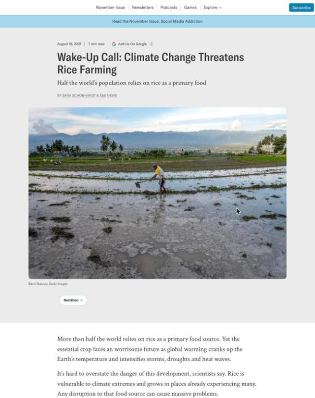
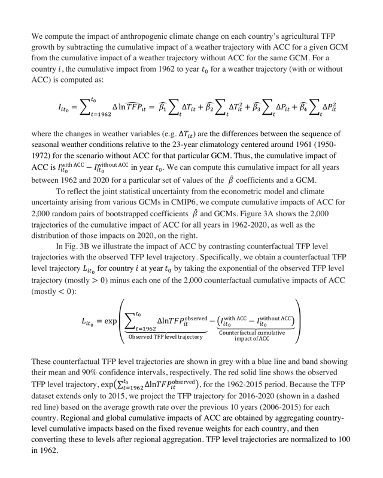
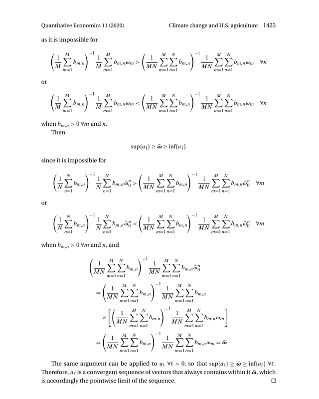
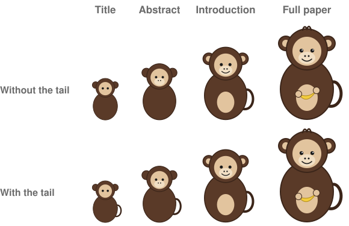
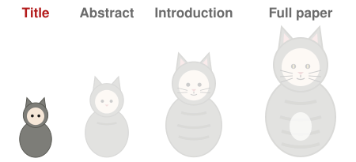
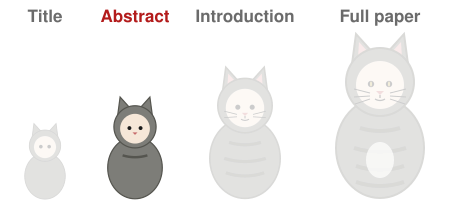
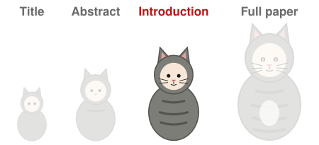
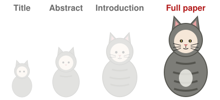
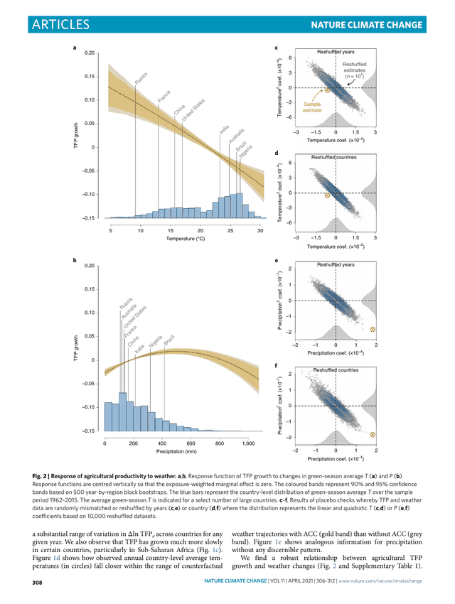
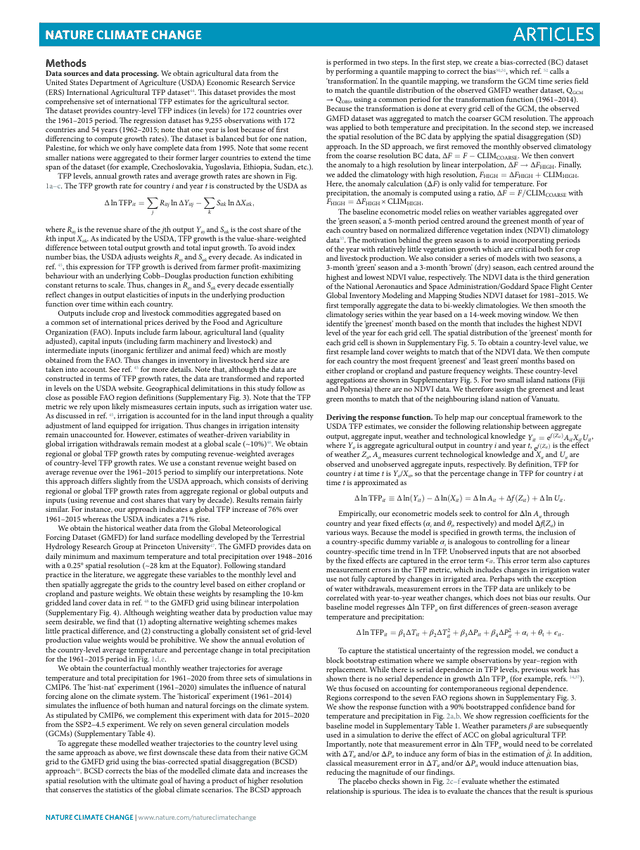

:::: {.content-hidden when-format="revealjs"}

::: {.callout-note appearance="simple"}
[**Open the slides**](10-writing-slides.html)
:::

**What you should be able to do after this meeting.** Write a title, a first page and an outline that each carry your project's message at their reader's level, with one point per paragraph and each doubt answered where it arises.

## Handouts

[Project description brief](../handouts/project-description.qmd) · [Writing guide](../handouts/writing-guide.qmd)

## Where to read more

[Mensh and Kording (2017)](https://doi.org/10.1371/journal.pcbi.1005619) on structuring a paper, and [Przeworski and Salomon](https://law.uga.edu/sites/default/files/OnTheArtOfWritingProposals_SocialScienceResearchCouncilCompetiotions.pdf) on what a proposal's reader looks for. Both are short and free.

## Session A · 2:00–3:15

Writing for the people who actually read. Readers come in three kinds, skimmers, engaged readers and deep readers, in a mix that depends on the setting, and each part of a paper is written for the reader who reaches it: one study is shown at three technical levels and under three titles, and one research team's work framed for two journals. The title, abstract, introduction and full paper then nest like Russian dolls, each carrying the whole message, and a set of dolls shows what happens when the small ones leave out the feature that identifies the paper. The 2021 paper on climate change and farm productivity is quoted version by version. Then the structure readers expect: the order of an empirical paper, a memo and the course's proposal, and the funnel from the literature to the question, drawn. Then one idea per paragraph: topic sentences, and the reverse outline that checks a draft, with a three-minute exercise summarizing a paragraph from a published study of solar farms and home prices. Then keeping the reader on your path: you choose what the reader reads and in what order, readers' minds wander, and a skeptical reader's doubts are answered in the sentence that follows the claim, with on-ramps for readers who drift. Then plain and neutral sentences: hype words, numbers in place of adjectives, six rules for verbs, terms and claims, and when to cite. Last, the mechanics of writing a paper: the sections first, then a detailed outline with one bullet per paragraph, then the prose, shown on the 2021 paper rebuilt as an outline. The writing guide carries the rest.

## Session B · 3:30–4:30

Every session B opens with a ten-minute team check-in: what you did
since last week, what is stuck, and who is doing what next. Written
down, and handed in with that session's work.

The project talks, after the check-in. Every team presents its project description in an order drawn at random: three minutes, timed, then one question from the room. The talks are graded against the project-description brief.

## Due

Project talk — three minutes, in session B

::::

:::: {.content-visible when-format="revealjs"}

## Outline

::: {style="font-size:0.84em"}
1. **Your readers.** Skimmers, engaged readers and deep readers.
2. **Nested versions.** The title, abstract, introduction and full paper, each for its reader.
3. **The structure readers expect.** The standard order of a paper, a memo and a proposal.
4. **One idea per paragraph.** Topic sentences, checked with a reverse outline.
5. **Keeping the reader on your path.** Answering doubts where they arise, and bringing back readers who drift.
6. **Plain and neutral sentences.** Active verbs, numbers in place of adjectives, one term for one thing.
7. **The mechanics of writing a paper.** The sections, then one bullet per paragraph, then the prose.
:::

[Handout: the writing guide, on this meeting's page.]{.src}

::: {.notes}
Two minutes.

You have just written a project description. The next document is the
proposal, and its readers are technically capable but have not lived
inside your project. Today is about those readers, from the title down
to the sentence.

Meeting 5 taught the outline: one topic sentence per paragraph, written
before the prose. It also listed three ways a draft claims more than the
result: past to present, sample to population, association to cause.
Those still hold.

The writing guide on this meeting's page carries what the slides leave
out: the genre schematics, the style rules with more examples, and a
checklist to run before November 11.
:::

# 1. Your readers

::: {.notes}
Thirty seconds. Who reads which part, and at what level of detail.
:::

## Most panelists read only part of a grant application

- The National Institutes of Health (NIH) funds US medical research through review panels.
- About 20 panelists score each application.
- At least three assigned reviewers read it closely.
- The rest most likely skim the abstract, the one-page Specific Aims and the significance section.
- One NIH institute tells applicants to write those parts for a reader of *Scientific American*, a popular science magazine.

[National Institute of Allergy and Infectious Diseases (NIAID), *Know Your Audience*, NIH grant guidance.](https://www.niaid.nih.gov/grants-contracts/know-your-audience){style="font-size:0.55em; color:#6b6b6b"}

::: {.notes}
Two minutes.

NIH is the largest public funder of medical research in the world, and
its review panels are where most US research proposals are judged. The
institute's advice describes the panel as it is: around 20 people score
each application, three of them were assigned to read it, and everyone
else forms a view from the parts they had time for.

The people who vote are mostly not the people who read closely. A
proposal has to work for both. The parts the skimmers read are written
for an intelligent reader outside the field, which is why NIAID names a
popular science magazine as the level.
:::

## One topic written at three levels

::: {.columns}
::: {.column width="32%" .m10-shot}
{fig-alt="A Scientific American article of August 18, 2021, headlined Wake-Up Call: Climate Change Threatens Rice Farming, with a photograph of a flooded rice field."}

For the public: a popular science magazine
:::
::: {.column width="32%" .m10-shot}
{fig-alt="A methods page of the 2021 preprint with two equations for the cumulative impact of climate change on productivity."}

For economists: the methods of the 2021 preprint
:::
::: {.column width="32%" .m10-shot}
{fig-alt="A page of an econometrics paper filled with display equations from a proof."}

For econometricians: a proof in a methods paper
:::
:::

[Schonhardt and E&E News (2021), *Wake-Up Call: Climate Change Threatens Rice Farming*, Scientific American, August 18.](https://www.scientificamerican.com/article/wake-up-call-climate-change-threatens-rice-farming/){style="font-size:0.55em; color:#6b6b6b"}
[Ortiz-Bobea, Ault, Carrillo, Chambers and Lobell (2020), *The Historical Impact of Anthropogenic Climate Change on Global Agricultural Productivity*, arXiv 2007.10415, page 11.](https://arxiv.org/abs/2007.10415){style="font-size:0.55em; color:#6b6b6b"}
[Keane and Neal (2020), *Climate change and U.S. agriculture: Accounting for multidimensional slope heterogeneity in panel data*, Quantitative Economics 11, 1391–1429, page 1423 (CC BY-NC 4.0).](https://doi.org/10.3982/QE1319){style="font-size:0.55em; color:#6b6b6b"}

::: {.notes}
One and a half minutes.

All three are about climate and farming. The magazine story opens on
rice and half the world's diet; further down it cites the 2021 study and
quotes me, with one number and no equation. The preprint's methods page
assumes the reader knows a regression and a counterfactual. Keane and
Neal's appendix proves the properties of a new panel estimator, and it
is written for the few people who will check the proof.

None of these is the right level in general. Each is right for its
reader.
:::

## Readers range from skimmers to deep readers

::: {style="font-size:0.7em"}
| | In research | In an organization |
|:--|:--|:--|
| **Skimmers** read the title and the summary, then stop | Someone searching for papers; a student | The executive who needs the big picture |
| **Engaged readers** read the introduction and the main results | Someone writing a literature review; a researcher deciding whether the paper matters to them | The manager who acts on the recommendation |
| **Deep readers** read the methods and the appendix | A peer who follows the work; a critic; a referee | The analyst who checks the numbers |
:::

- The mix of readers depends on the setting.
- Some details are never read, and they are written for the few who need them.

::: {.notes}
Two minutes.

Every document has all three kinds of reader, in different proportions.
In research, most people who meet a paper see its title in a search or
a reference list. Fewer read the introduction to decide whether it
matters to them. A handful read every line: the referee, a critic, the
researcher who builds on it.

In an organization the summary is for the executive, who needs the big
picture and will not read further. The detail is for the people who
check the work. Some of it is never read, and that is by design: it is
there so the few who need it can find it.
:::

## Each part of a paper has its own reader

- The title reaches skimmers. It has no jargon and no acronyms.
- The abstract reaches skimmers and engaged readers. Each technical term is spelled out.
- The introduction reaches engaged readers. It uses the field's terms and defines each one.
- The methods and appendix reach deep readers. They carry the full technical detail.
- The technical level rises as the reader goes deeper.

::: {.notes}
One and a half minutes.

The common advice to "write for a general audience" is half right. The
title and the abstract are written for the broadest reader. The deeper
sections match the deeper reader, who would be slowed down by
explanations of what they already know.

Two pieces of evidence behind writing the top layers plainly. George
Heilmeier, who ran the Defense Advanced Research Projects Agency (DARPA)
in the 1970s, asked of every proposal: "What are you trying to do?
Articulate your objectives using absolutely no jargon." And in an
economics experiment, Camerer, Loewenstein and Weber (1989,
https://doi.org/10.1086/261651) found that people who know something
overestimate how much others know, which they called the curse of
knowledge. You are the informed party in your own project.
:::

## One paper titled for three audiences

::: {style="font-size:0.64em"}
| Audience | Where it appeared | Title |
|:--|:--|:--|
| The public | Cornell Chronicle, 2021 | "*Climate change has cost 7 years of ag productivity growth*" |
| Scientists in many fields | *Nature Climate Change*, 2021 | "*Anthropogenic climate change has slowed global agricultural productivity growth*" |
| Economists in the field | arXiv working paper, 2020 | "*The Historical Impact of Anthropogenic Climate Change on Global Agricultural Productivity*" |
:::

::: {style="font-size:0.84em"}
- The public title drops the word anthropogenic and states the loss in years of growth.
- The journal title states the finding.
- The working-paper title names the topic for readers who know the field.
:::

[Friedlander (2021), Cornell Chronicle.](https://news.cornell.edu/stories/2021/04/climate-change-has-cost-7-years-ag-productivity-growth){style="font-size:0.55em; color:#6b6b6b"}
[Ortiz-Bobea, Ault, Carrillo, Chambers and Lobell (2021), Nature Climate Change 11, 306–312.](https://doi.org/10.1038/s41558-021-01000-1){style="font-size:0.55em; color:#6b6b6b"}
[Ortiz-Bobea et al. (2020), arXiv 2007.10415.](https://arxiv.org/abs/2007.10415){style="font-size:0.55em; color:#6b6b6b"}

::: {.notes}
Two minutes.

One study, three titles, each written for a different reader. The
university's news office turned "21% since 1961" into years of lost
growth, a unit anyone can picture; the paper's own abstract makes the
same translation. The journal title is for scientists outside economics
and states the result. The working paper went to economists, who read
"historical impact" and know what kind of paper it is.

Your proposal has one title, but the same question applies: who sees it
first, and what do they need from nine words?
:::

## The journal sets the reader and the framing

- Bloom and coauthors ran two randomized experiments at Ctrip, a Chinese travel agency now called Trip.com.

::: {.columns style="font-size:0.72em"}
::: {.column width="50%"}
**For economists**: *Quarterly Journal of Economics*, 2015

- "*Does Working from Home Work? Evidence from a Chinese Experiment*"
- Call-center employees worked from home or in the office.
- The abstract opens on an incentive problem: employees may shirk at home.
- It splits the gain in performance into its sources.
:::
::: {.column width="50%"}
**For scientists in many fields**: *Nature*, 2024

- "*Hybrid working from home improves retention without damaging performance*"
- Employees with university degrees worked a hybrid schedule.
- The abstract opens: "*Working from home has become standard for employees with a university degree.*"
- It ends on a practice firms can adopt.
:::
:::

[Bloom, Liang, Roberts and Ying (2015), *Does Working from Home Work? Evidence from a Chinese Experiment*, Quarterly Journal of Economics 130(1), 165–218.](https://doi.org/10.1093/qje/qju032){style="font-size:0.55em; color:#6b6b6b"}
[Bloom, Han and Liang (2024), *Hybrid working from home improves retention without damaging performance*, Nature 630, 920–925 (CC BY 4.0).](https://doi.org/10.1038/s41586-024-07500-2){style="font-size:0.55em; color:#6b6b6b"}

::: {.notes}
Two and a half minutes.

Same lead author, same firm, two journals. The economics paper is
framed around a question economists care about, incentives: does an
employee out of sight shirk? It decomposes the performance gain into
more minutes worked and more calls per minute. The Nature paper is
framed around a practice that about 100 million employees in Europe and
North America have adopted, and it closes on the sentence a manager
would quote: "These results indicate that a hybrid schedule with two
days a week working from home does not damage performance."

Choose the journal, or the reader, first. The framing of the
contribution follows from it: which question the work answers, and
which literature it speaks to. Your proposal's reader is fixed, so the
framing should be too.
:::

# 2. Nested versions

::: {.notes}
Thirty seconds. Several kinds of reader means several versions of the
same paper, nested one inside the next.
:::

## Internists reported reading only the abstract of most articles

- In 1998, 264 of 399 US internists (doctors of internal medicine) returned a mailed survey on their journal reading.
- They reported reading only the abstract for 63% of the articles they read.
- For those articles, the abstract was the paper.

[Saint, Christakis, Saha, Elmore, Welsh, Baker and Koepsell (2000), *Journal reading habits of internists*, Journal of General Internal Medicine 15(12), 881–884.](https://doi.org/10.1046/j.1525-1497.2000.00202.x){style="font-size:0.55em; color:#6b6b6b"}

::: {.notes}
One minute.

These are practising doctors, who read journals to decide how to treat
patients. For nearly two articles in three, what they took away came
from the abstract alone. Self-reports, and from 1998, but the direction
is not in doubt: most readers of most papers stop early.
:::

## What is each of these?

::: {style="width:44%; margin:0 auto"}

:::

::: {.notes}
Three minutes. The slide opens on the three title dolls. Each click
adds a column: the abstracts, then the introductions, then the full
papers.

Ask what each title doll is before the first click. The cat is a cat
from the title on: the pointed ears survive at every size, and each
larger doll only adds detail. The dog is the same, with its floppy ears.

The third is the one to dwell on. Round ears and a brown body: a bear,
or a monkey? Ask again when the abstracts appear, since the brown doll
still has no tail. The introductions answer it with the tail.

The dolls are Russian nesting dolls, matryoshkas. Each smaller doll is
the paper at a shorter length. A reader who stops at the title should
still name the right animal.
:::

## A title should fit only your paper

::: {.columns}
::: {.column width="52%"}
{fig-alt="Two rows of monkey dolls. In the first, the title and abstract dolls have no tail. In the second, every doll has the tail."}
:::
::: {.column width="48%"}
::: {style="font-size:0.78em"}
- Without the tail, the two small dolls fit a bear as well as a monkey.
- A topic title fits many papers:

::: {.m10-hyp}
Climate change and global agricultural productivity
:::

- The published title fits one: "*Anthropogenic climate change has slowed global agricultural productivity growth*"
- Each version keeps the feature that identifies the paper.
:::
:::
:::

[Doumont (2002), *The three laws of professional communication*, IEEE Transactions on Professional Communication 45(4), 291–296.](https://doi.org/10.1109/TPC.2002.805164){style="font-size:0.55em; color:#6b6b6b"}

::: {.notes}
Two minutes.

The tail is the detail that separates the monkey from a bear. Leave it
out of the title and the abstract and a skimmer leaves with the wrong
animal. In a paper the tail is usually the finding, the setting or the
design: whatever separates your paper from its neighbours.

Jean-luc Doumont, who trains scientists and engineers to communicate,
calls this effective redundancy: each version retells the whole message,
at another level of detail, in other words. Repeat only what the
evidence supports, since repeated statements are rated more true whether
or not they are (Dechêne, Stahl, Hansen and Wänke 2010,
https://doi.org/10.1177/1088868309352251).
:::

## The shortest version reaches the most readers

<svg viewBox="0 0 920 330" width="88%" style="display:block;margin:0 auto" role="img" aria-label="Left, an inverted pyramid of readers: the title band is widest, then the abstract, the introduction and the full paper. Right, bars of length for the 2021 paper: 9 words, 117 words, 362 words, and about 4,200 words before the methods.">
  <g font-size="22" font-weight="600" fill="#6b6b6b" text-anchor="middle" font-family="inherit">
    <text x="240" y="26">Readers</text><text x="700" y="26">Length of the 2021 paper</text>
  </g>
  <g fill="#b31b1b">
    <polygon points="40,44 440,44 410,104 70,104" opacity="1"/>
    <polygon points="70,110 410,110 380,170 100,170" opacity="0.8"/>
    <polygon points="100,176 380,176 350,236 130,236" opacity="0.62"/>
    <polygon points="130,242 350,242 320,302 160,302" opacity="0.46"/>
  </g>
  <g font-size="22" fill="#ffffff" text-anchor="middle" font-weight="600" font-family="inherit">
    <text x="240" y="81">Title</text><text x="240" y="147">Abstract</text>
    <text x="240" y="213">Introduction</text><text x="240" y="279">Full paper</text>
  </g>
  <g fill="#8a8a84">
    <rect x="520" y="60" width="8" height="28"/>
    <rect x="520" y="126" width="40" height="28"/>
    <rect x="520" y="192" width="90" height="28"/>
    <rect x="520" y="258" width="380" height="28"/>
  </g>
  <g font-size="20" fill="#1b1b1b" font-family="inherit">
    <text x="538" y="81">9 words</text><text x="570" y="147">117 words</text>
    <text x="620" y="213">362 words</text>
  </g>
  <text x="532" y="279" font-size="20" fill="#ffffff" font-family="inherit">About 4,200 words, then the methods</text>
</svg>

- Economics journals cap abstracts at 100 words (*American Economic Review*, *Journal of Finance*) or 150 (*Econometrica*).
- The US Government Accountability Office (GAO) publishes each report as Fast Facts, a two-page Highlights and the full report.

[AER submission guidelines;](https://www.aeaweb.org/journals/aer/submissions){style="font-size:0.55em; color:#6b6b6b"} [Journal of Finance submission guidelines;](https://afajof.org/submission-guidelines/){style="font-size:0.55em; color:#6b6b6b"} [Econometrica information for authors;](https://www.econometricsociety.org/publications/econometrica/information-authors){style="font-size:0.55em; color:#6b6b6b"} [GAO, for example GAO-24-107146.](https://www.gao.gov/products/GAO-24-107146){style="font-size:0.55em; color:#6b6b6b"}

::: {.notes}
One and a half minutes.

The pyramid of readers is upside down: many see the title, fewer read
the abstract, fewer the introduction, and a few read the whole paper.
The lengths on the right are the 2021 paper's own; the band widths are
drawn for illustration. The version with the most readers has the
fewest words, and those words carry the message.

Nature Climate Change allowed 150 words for the abstract. Economics
journals allow 100 to 150, so an abstract is about five sentences.
Agencies build the dolls in on purpose: GAO's Fast Facts are for members
of Congress, the full report for analysts. The Canadian Health Services
Research Foundation asked for 1:3:25, one page of main messages, a
three-page summary and at most 25 pages of report.
:::

## The title of the 2021 paper

{.nostretch fig-alt="The cat dolls from title to full paper, with the title doll in focus." width="44%" fig-align="center"}

::: {.m10-quote style="font-size:1.15em"}
"*Anthropogenic climate change has slowed global agricultural productivity growth*"
:::

- Nine words, no acronyms. It states the finding.

[Ortiz-Bobea, Ault, Carrillo, Chambers and Lobell (2021), Nature Climate Change 11, 306–312.](https://doi.org/10.1038/s41558-021-01000-1){style="font-size:0.55em; color:#6b6b6b"}

::: {.notes}
One minute.

The smallest doll. A skimmer who reads only this knows the cause, the
outcome and the direction. The one technical word, anthropogenic, means
caused by people; the public headline dropped it.
:::

## The abstract of the 2021 paper

{.nostretch fig-alt="The cat dolls, with the abstract doll in focus." width="32%" fig-align="center"}

::: {.m10-quote style="font-size:0.66em"}
"*Agricultural research has fostered productivity growth, but the historical influence of anthropogenic climate change (ACC) on that growth has not been quantified. We develop a robust econometric model of weather effects on global agricultural total factor productivity (TFP) and combine this model with counterfactual climate scenarios to evaluate impacts of past climate trends on TFP. Our baseline model indicates that ACC has reduced global agricultural TFP by about 21% since 1961, a slowdown that is equivalent to losing the last 7 years of productivity growth. The effect is substantially more severe (a reduction of ~26–34%) in warmer regions such as Africa and Latin America and the Caribbean. We also find that global agriculture has grown more vulnerable to ongoing climate change.*"
:::

- 117 words in five sentences: the gap, the design, the finding with its size, where it is larger, and what is new.

[Ortiz-Bobea et al. (2021), Nature Climate Change 11, 306–312, abstract.](https://doi.org/10.1038/s41558-021-01000-1){style="font-size:0.55em; color:#6b6b6b"}

::: {.notes}
One and a half minutes.

The abstract is the title with its evidence. Sentence 1 is the funnel in
one sentence. Sentence 2 is the design. Sentence 3 gives the finding
with its size and a unit a skimmer can picture: seven years of growth.
Each acronym is spelled out before it is used.

Total factor productivity (TFP) is output per unit of all inputs
combined: land, labour, capital and materials.
:::

## The introduction of the 2021 paper

{.nostretch fig-alt="The cat dolls, with the introduction doll in focus." width="40%" fig-align="center"}

::: {.m10-quote style="font-size:0.72em"}
1. "*Enhancing agricultural productivity is vital to lifting global living standards and advancing sustainable food production in the face of escalating challenges to agriculture and the environment.*"
2. "*Research to date on the historical impact of ACC focuses overwhelmingly on yields of major cereal crops or on total gross domestic product.*"
3. "*We quantify the impact of ACC on global agricultural productivity since 1961.*"
:::

- The first sentence of each of its three paragraphs, 362 words in all.
- Paragraph 3 opens with the question.

[Ortiz-Bobea et al. (2021), Nature Climate Change 11, 306–312, introduction.](https://doi.org/10.1038/s41558-021-01000-1){style="font-size:0.55em; color:#6b6b6b"}

::: {.notes}
One and a half minutes.

Read only the first sentences and you have the introduction's argument:
why productivity matters, what earlier work measured, and what this
paper does. That is the topic-sentence structure from meeting 5, and it
comes back in part 4 today.
:::

## The full 2021 paper

{.nostretch fig-alt="The cat dolls, with the full paper doll in focus." width="30%" fig-align="center"}

::: {.columns}
::: {.column width="40%" .m10-shot .short}
{fig-alt="Page 308 of the paper, with the figure of the response of productivity growth to temperature and precipitation."}

A results page
:::
::: {.column width="40%" .m10-shot .short}
{fig-alt="The first page of the paper's methods section, in small type in two columns."}

The methods
:::
:::

[Ortiz-Bobea et al. (2021), Nature Climate Change 11, 306–312, page 308 and the methods.](https://doi.org/10.1038/s41558-021-01000-1){style="font-size:0.55em; color:#6b6b6b"}

::: {.notes}
One minute.

The largest doll: about 4,200 words of main text, four figures, then the
methods, the extended data and the supplementary information. Deep
readers live here: the referee, the economist who wants to replicate it,
the critic. The response function, the data sources and the robustness
checks are all here, and almost nobody else reads them.
:::

# 3. The structure readers expect

::: {.notes}
Thirty seconds. Each genre has a standard order. Readers know it and
look for each part where it usually sits.
:::

## Researchers put shuffled paragraphs back in the right section

- Dillon took two articles from a journal in the participants' own field and removed every second paragraph.
- Twelve human factors researchers sorted the rest, shuffled, into introduction, method, results and discussion.
- They put 82.6% in the right section.
- A common error confused the introduction with the discussion.

[Dillon (1991), *Readers' models of text structures: the case of academic articles*, International Journal of Man-Machine Studies 35(6), 913–925.](https://doi.org/10.1016/S0020-7373(05)80168-3){style="font-size:0.55em; color:#6b6b6b"}

::: {.notes}
One minute.

Experienced readers carry the template in their heads. They knew where a
paragraph belonged from its content alone, without headings or
neighbours. A reader who knows where to look skims fast, and a document
that puts things somewhere else costs that reader time. The confusion
between introduction and discussion makes sense: both talk about the
literature and what the result means.
:::

## How an empirical economics paper is organized

::: {style="font-size:0.6em"}
<ol class="m10-steps">
<li class="v"><b>Title</b><span>States the finding</span></li>
<li class="v"><b>Abstract</b><span>The question, the data and design, the finding with its size</span></li>
<li class="v"><b>Introduction</b><span>The funnel to the question, the finding and its size, the closest papers</span></li>
<li><b>Setting and data</b><span>Where and when, and what one row describes</span></li>
<li><b>Empirical strategy</b><span>The design and its <strong>identifying assumption</strong>: what must hold for the estimate to measure the effect</span></li>
<li><b>Results</b><span>Each table introduced by its point</span></li>
<li><b>Threats to validity</b><span>What could break the design, and the checks</span></li>
<li><b>Conclusion</b><span>The message again, shorter</span></li>
</ol>
:::

- The red boxes are the versions most readers stop at.

[Dudenhefer (2014), *A Guide to Writing in Economics*, Duke University.](https://econ.duke.edu/sites/econ.duke.edu/files/file-attachments/Dudenhefer,%20Paul%20-%20Guide%20to%20Writing%20in%20Economics.pdf){style="font-size:0.55em; color:#6b6b6b"}
[Head, *The Introduction Formula*.](https://blogs.ubc.ca/khead/research/research-advice/formula){style="font-size:0.55em; color:#6b6b6b"}

::: {.notes}
One and a half minutes.

The standard order for an applied paper. The first three boxes carry the
whole message; the rest carry the evidence. Head's formula puts the
question by paragraph two or three of the introduction, then the
antecedents, then the contribution.

Cochrane's writing tips drop the funnel and open with the contribution
in the first paragraph. Both put the answer in the introduction, well
before the conclusion.

The writing guide has this schematic and four others: the proposal, the
memo, the executive summary and the research talk.
:::

## How an applied theory paper is organized

::: {.columns}
::: {.column width="44%"}
::: {style="font-size:0.56em"}
<ol class="m10-steps">
<li class="v"><b>Title</b><span>States the finding</span></li>
<li class="v"><b>Abstract</b><span>The question, the model's prediction, the finding</span></li>
<li class="v"><b>Introduction</b><span>The funnel to the question, the finding, the closest papers</span></li>
<li><b>Theoretical framework</b><span>A model that yields the testable prediction</span></li>
<li><b>Empirical framework</b><span>The regression for each part of the prediction</span></li>
<li><b>Data</b><span>And descriptive statistics</span></li>
<li><b>Results</b><span>Each estimate read back through the model</span></li>
<li><b>Conclusion</b><span>The message again, shorter</span></li>
</ol>
:::
:::
::: {.column width="56%"}
::: {style="font-size:0.68em"}
- The model comes before the evidence and says what to estimate.
- Bellemare's rule: the model's prediction maps one to one onto the empirical framework.
- Ortiz-Bobea (2020) studied how climate affects US farmland. The usual estimate regresses farmland prices on climate across counties.
- The model values farmland as farming income plus the option to convert it to other uses.
- It predicts that farmland prices and cash rents give the same climate effect only where conversion is unlikely.
- The empirical sections estimate the effect from prices, then from rents, and compare them.
:::
:::
:::

[Bellemare (2018), *Between the Introduction and the Conclusion: The "Middle Bits" Formula for Applied Papers*, blog post; expanded in *Doing Economics* (MIT Press, 2022).](https://marcfbellemare.com/wordpress/12797){style="font-size:0.55em; color:#6b6b6b"}
[Ortiz-Bobea (2020), *The Role of Nonfarm Influences in Ricardian Estimates of Climate Change Impacts on US Agriculture*, American Journal of Agricultural Economics 102(3), 934–959.](https://doi.org/10.1093/ajae/aaz047){style="font-size:0.55em; color:#6b6b6b"}

::: {.notes}
Two minutes.

Some papers open with a model. The model is short, and its job is to
say which quantities the data must deliver. Bellemare, an agricultural
economist who writes about how applied papers are built, puts the
theoretical framework right after the introduction and asks that its
main prediction map one to one onto the empirical framework. If the
model predicts something the regressions never test, cut it.

My 2020 paper is an example. The Ricardian approach regresses farmland
prices on climate across counties and reads the climate coefficients as
the value of climate to farming. The conceptual framework prices
farmland as the value of farming it plus a premium for converting it to
other uses, such as housing, and lists the predictions that follow.
Estimates from farmland prices and from cash rents should agree where
conversion is unlikely, and diverge where it looms. The price-to-rent
ratio flags the counties where nonfarm influences are large. The
empirical sections test exactly these: estimates from prices, then from
cash rents, then a discussion that reconciles the two.

A second example is Gammans, Mérel and Ortiz-Bobea (2025, American
Journal of Agricultural Economics, https://doi.org/10.1111/ajae.12491),
on planting soybeans right after the winter wheat harvest. Its
conceptual framework splits the effect of climate on crop revenue into
an adaptation term and two yield terms, and each later section
estimates one piece.

Your proposal has a heading for this: the conceptual model. It plays
the same role, at a smaller scale: it says what you will estimate and
why.
:::

## The funnel runs from the literature to your question

```{=html}
<div class="m10-funnel">
  <div class="band b1">Why it matters</div>
  <div class="q"><span>“<i>Enhancing agricultural productivity is vital to lifting global living standards …</i>”</span></div>
  <div class="band b2">What is known</div>
  <div class="q"><span>“<i>… there are signs that it is slowing in certain regions.</i>” “<i>… human activities … have caused global temperatures to rise by more than 1 °C …</i>”</span></div>
  <div class="band b3">What is missing</div>
  <div class="q"><span>“<i>However, the impacts of this ACC on the agricultural sector have not yet been quantified …</i>”</span></div>
  <div class="m10-test"><b>Test</b>: a reader who stops here can already state your question.</div>
  <div class="band b4">The question</div>
  <div class="q"><span>“<i>We quantify the impact of ACC on global agricultural productivity since 1961.</i>”</span></div>
</div>
```

- The first paragraph narrows from the field to what is missing. Paragraph 3 opens with the question.
- In your proposal, the funnel starts at the decision your reader faces.

[Ortiz-Bobea et al. (2021), Nature Climate Change 11, 306–312, introduction, paragraphs 1 and 3.](https://doi.org/10.1038/s41558-021-01000-1){style="font-size:0.55em; color:#6b6b6b"}

::: {.notes}
Two minutes.

The funnel is the opening that moves from the field to your question.
Each band is narrower than the one above it, and the last one is the
question. Here the first paragraph does the first three bands in five
sentences; paragraph 2 says why earlier work on crop yields and GDP does
not answer it; paragraph 3 opens with the question.

The test in the dashed box: a reader who stops after what is missing
should already be able to say your question. Try it on the room before
showing the last band. If they can, the funnel works and the question
lands as confirmation.

A funnel is short. A reader should reach the question within a few
sentences. For your proposal, the top of the funnel is the decision
your reader faces, as meeting 1 said, and a gap in the literature comes
in only where it matters to that decision.
:::

## How a memo is organized

::: {.columns}
::: {.column width="52%"}
::: {style="font-size:0.6em"}
<ol class="m10-steps">
<li class="v"><b>Subject line</b><span>States the bottom line</span></li>
<li class="v"><b>Bottom line</b><span>The conclusion and the decision asked for</span></li>
<li><b>Background</b><span>Only what this reader needs</span></li>
<li><b>Evidence</b><span>Most important first</span></li>
<li><b>Options and risks</b><span></span></li>
<li><b>Next steps</b><span></span></li>
</ol>
:::
:::
::: {.column width="48%"}
::: {style="font-size:0.72em"}
- **Bottom line up front** (BLUF): the first sentence gives the conclusion.
- Suchan and Colucci gave 262 US Navy officers documents in a high-impact style or a bureaucratic style.
- High-impact meant the bottom line first, short paragraphs, headings and plain sentences.
- The high-impact documents took 17–23% less time to read and were understood better.
:::
:::
:::

[Suchan and Colucci (1989), *An analysis of communication efficiency between high-impact and bureaucratic written communication*, Management Communication Quarterly 2(4), 454–484.](https://doi.org/10.1177/0893318989002004002){style="font-size:0.55em; color:#6b6b6b"}
[Purdue OWL, *Parts of a Memo*.](https://owl.purdue.edu/owl/subject_specific_writing/professional_technical_writing/memos/parts_of_a_memo.html){style="font-size:0.55em; color:#6b6b6b"}

::: {.notes}
One and a half minutes.

The memo is the genre most of you will write most often after this
program. Its reader is the executive who skims, and the bottom line goes
first. The study bundles several features into one style, so it shows
that the package works, without saying which part of it does.

The syllabus grades every written piece on one question first: "*Is the
claim in the first sentence?*"
:::

## How a research proposal is organized

::: {.columns}
::: {.column width="55%"}
::: {style="font-size:0.7em"}
- Your proposal is a plan: about five pages that someone could pick up and execute in January.
- The thirteen headings are the course's, from the syllabus.
- Page one answers three questions any funder asks: "*What are we going to learn … that we do not know now? Why is it worth knowing? How will we know that the conclusions are valid?*"
- Przeworski and Salomon wrote these for applicants to fellowships of the Social Science Research Council (SSRC), a US funder of social science.
- Preliminary evidence is optional. Use it only to show that the data exist and can answer the question.
:::
:::
::: {.column width="45%"}
::: {style="font-size:0.58em"}
<ol class="m10-steps">
<li><b>Research problem</b></li>
<li><b>Practical justification</b></li>
<li><b>What is already known</b></li>
<li><b>Conceptual model</b></li>
<li><b>Methodological approach</b></li>
<li><b>Study sample</b></li>
<li><b>Data and access</b></li>
<li><b>Internal validity</b></li>
<li><b>External validity</b></li>
<li><b>Limitations and self-critique</b></li>
<li><b>Work plan</b></li>
<li><b>Research ethics</b></li>
<li><b>References</b></li>
</ol>
:::
:::
:::

[The syllabus, *What you are graded against* and the deliverables table.](../syllabus.qmd#what-you-are-graded-against){style="font-size:0.55em; color:#6b6b6b"}
[Przeworski and Salomon (1988, rev. 1995), *On the Art of Writing Proposals: Some Candid Suggestions for Applicants to Social Science Research Council Competitions*.](https://law.uga.edu/sites/default/files/OnTheArtOfWritingProposals_SocialScienceResearchCouncilCompetiotions.pdf){style="font-size:0.55em; color:#6b6b6b"}

::: {.notes}
Two minutes.

The thirteen headings are the syllabus's, in its order, and they are
what the outline and the proposal are graded against. They are shared
across the AEM 6991 sections. The three questions sit above them, on the
first page.

The three questions come from a different setting. Przeworski and
Salomon wrote them for graduate students and junior scholars applying
for SSRC fellowships to fund dissertation and field research. Funders
in general ask the same things: the National Science Foundation scores
proposals on intellectual merit and broader impacts, which are the
first two questions in other words. We adopt the questions; the
headings are our own.

Your proposal is a plan for work you have not done yet, so it does not
need results. A first look at the data helps only where it shows
feasibility: the data exist, you can get them, and they vary in the way
your design needs.

Each question maps to something you have already done. What we will
learn is your question, from meeting 3. Why it is worth knowing is the
decision it informs (meeting 3) and what is new against your anchor
papers (meeting 5). How we will know the conclusions are valid is your
design and its threats, from meetings 7 to 9.

Today's talks in session B are graded against the project-description
brief, so do not rework your slides at the break.
:::

## Page one of the "Target boycott" proposal

::: {style="font-size:0.8em"}
- In 2023 conservative shoppers boycotted Target over its Pride merchandise. In 2025 shoppers boycotted it after it ended its diversity goals.
:::

::: {.m10-hyp .m10-two style="font-size:0.6em"}
| | |
|:---|:-------|
| What we will learn | How much more store visits fell in counties whose politics matched each boycott |
| Why it is worth knowing | A retailer's marketing team decides where to spend to win shoppers back |
| How we will know | Compare stores in the most and least Republican thirds of counties, week by week, 20 weeks either side of each boycott |
:::

::: {style="font-size:0.8em"}
- This is **difference-in-differences**: the change in one group against the change in another. It assumes both groups would have followed parallel paths without the boycotts.
- The gap should flip sign between 2023 and 2025.
:::

[Written for this slide from the "Target boycott" project description.](../handouts/project-description-example-target.qmd){style="font-size:0.55em; color:#6b6b6b"}

::: {.notes}
Two minutes.

The three answers fit in three lines, and a reviewer who reads only this
page knows what the team will learn, who cares, and why the answer can
be trusted.

Two details from the project description that page one leaves for later.
The comparison is made within groups of counties of similar income, so a
shock to poorer counties does not show up as politics. And every store
was exposed to both boycotts, so the design measures a relative gap
between groups of counties, which is smaller than the boycott's total
effect on Target. The flip in sign is the check: a shock that hits the
same counties both times would push the gap the same way twice.
:::

# 4. One idea per paragraph

::: {.notes}
Thirty seconds. The unit below the section is the paragraph, and each
one carries one point.
:::

## Each paragraph makes one point

- A **topic sentence** states the paragraph's point. The other sentences support it.
- Body paragraphs open with their point. The opening funnel of an introduction ends with it.
- A **reverse outline** checks a draft: write one sentence summing up each paragraph.
- A paragraph that needs two sentences holds two ideas. Split it.
- A summary that matches a later sentence means the point is buried. Move that sentence up.

::: {.notes}
One and a half minutes.

Meeting 5 wrote the outline before the prose: one topic sentence per
paragraph, in order. The reverse outline runs the same tool on a draft.
Read each paragraph and write the one sentence it argues. Then read the
summaries in order. If they make the argument, the draft works. If a
summary is hard to write, the paragraph has no point yet.

A skimmer who reads only first sentences should get the argument, as you
did with the 2021 introduction a few slides back.
:::

## This paragraph states its point first

- Ray and coauthors (2019) estimated how recent climate change has affected the yields of the ten largest crops worldwide. This is their closing paragraph.

::: {.m10-quote style="font-size:0.72em"}
"*[Our findings here illustrate that climate change has potentially already affected global production of the ten largest crops and the production of consumable food calories in specific countries and globally.]{.m10-phrase} The approach used here complements the long-range projections, avoids many of the challenges faced by process-based models, and analyzes a broader set of crops. Although recent climate change has likely reduced overall consumable food calories in these ten crops by ~1% (or ~0.5% across all food calories), there is much variability among crops and regions. These findings can be used to target interventions for adaptation to climate change through better management, crop breeding, and switching crops as climate continues to evolve.*"
:::

[Ray, West, Clark, Gerber, Prishchepov and Chatterjee (2019), *Climate change has likely already affected global food production*, PLOS ONE 14(5), e0217148 (CC BY 4.0).](https://doi.org/10.1371/journal.pone.0217148){style="font-size:0.55em; color:#6b6b6b"}

::: {.notes}
One and a half minutes.

The highlighted sentence is the point. The second sentence says how the
approach differs, the third gives the size, and the fourth says what the
finding is for. A reader who stops after the first sentence has it.

A one-sentence summary: recent climate change has probably already cut
food calories from the ten largest crops by about 1 percent worldwide,
with large differences across crops and regions.
:::

## What is this paragraph's point in one sentence?

- Elmallah and coauthors (2023) compared sale prices of homes near and far from large solar farms in six US states. This is the first paragraph of their introduction.

::: {.m10-quote style="font-size:0.66em"}
"*Large-scale photovoltaic projects (LSPVP), defined here as ground-mounted photovoltaic generation facilities with at least 1 MW of DC generation capacity, are an increasingly prevalent source of renewable energy. LSPVPs accounted for over 60% of all new solar capacity in the United States in 2021, and, as the largest resource by capacity in interconnection queues, are projected to continue growing (Bolinger et al., 2021). However, the local economic impacts of LSPVPs are poorly understood (Mai et al., 2014), despite surveys showing that local public support for large-scale solar is strongly related to perceived economic impacts, including the impact on property values (Carlisle et al., 2014). Concerns surrounding the property value impacts of solar power are reflected in solar industry and environmental advocacy communication that challenge the conception that solar power reduces property values (Center for Energy Education, n.d.; Solar Energy Industries Association, 2019), and in attempts by neighbors of solar plants to claim solar panels as a private nuisance (Westgate, 2017).*"
:::

[Elmallah, Hoen, Fujita, Robson and Brunner (2023), *Shedding light on large-scale solar impacts: An analysis of property values and proximity to photovoltaics across six U.S. states*, Energy Policy 175, 113425 (CC BY 4.0).](https://doi.org/10.1016/j.enpol.2023.113425){style="font-size:0.55em; color:#6b6b6b"}

::: {.notes}
Four minutes, including a three-minute silent write.

Each student writes one sentence that states what this paragraph argues.
Three minutes. Then take two or three from the room before the next
slide.

The paper is the closest published study to the solar project, and the
team cited it in its project description.
:::

## One sentence for that paragraph

- One summary: large solar farms are spreading fast, but their effect on nearby home values, which shapes local support, is poorly understood.
- The point arrives in sentence 3, after *However*.
- This paragraph opens the introduction, so it is a funnel and ends on its point.
- Ray and coauthors' paragraph closes a paper, so it opens on its point.

[Elmallah et al. (2023), Energy Policy 175, 113425, introduction, paragraph 1.](https://doi.org/10.1016/j.enpol.2023.113425){style="font-size:0.55em; color:#6b6b6b"}

::: {.notes}
One minute.

Most summaries from the room will pick up sentence 3. Sentences 1 and 2
set up why solar farms matter, and sentence 4 adds evidence that people
worry about property values. That is the funnel from part 3, in one
paragraph.

When you reverse-outline your proposal, the first paragraph may
summarize to its last sentence. Every other paragraph should summarize
to its first.
:::

## A reverse outline of a whole introduction

```{=html}
<div class="m10-ro">
  <div class="ro-page"></div>
  <div class="ro-side">
    <ol class="ro-outline"></ol>
    <div class="ro-info"></div>
    <div class="ro-legend"></div>
  </div>
</div>
```

[Elmallah, Hoen, Fujita, Robson and Brunner (2023), Energy Policy 175, 113425, section 1 (CC BY 4.0). The roles and summaries are ours.](https://doi.org/10.1016/j.enpol.2023.113425){style="font-size:0.55em; color:#6b6b6b"}

::: {.notes}
Three minutes.

The whole introduction of the paper the room just summarized, as it
appears in the article. First sentences are underlined. Hovering a
sentence shows what it does; hovering a row on the right highlights
that paragraph, scrolls to it, and marks the sentence that carries its
point. Hovering a role in the legend highlights every sentence with
that role.

Walk the five rows. Paragraph 1 is the funnel, so its point comes in
sentence 3. Paragraph 2 states the purpose first, then the questions,
the data and the design. Paragraph 3 opens with a signpost, "several
important contributions", and its own point comes in sentence 2.
Paragraph 4 opens on its point. Paragraph 5 is a roadmap of the
sections, which needs no topic sentence.

Then the last row. The reverse outline shows something a reader of the
introduction never gets: the finding. The abstract says homes within
half a mile sold for about 1.5 percent less; the introduction stops at
the design. Compare the schematic of an empirical paper earlier, where
the introduction gives the finding and its size.
:::

# 5. Keeping the reader on your path

::: {.notes}
Thirty seconds. You choose what the reader reads and in what order. You
cannot choose what they think along the way.
:::

## You choose the reader's path

<svg viewBox="0 0 900 230" width="60%" style="display:block;margin:0 auto 0.3em" role="img" aria-label="A path through a paper, from the title through the introduction, data and results to the conclusion. Three dashed side trails branch off it, each ending in a question mark.">
  <g stroke="#8a8a84" stroke-width="3" stroke-dasharray="7 7" fill="none">
    <path d="M155,128 L120,40"/><path d="M350,137 L390,212"/><path d="M550,137 L515,40"/>
  </g>
  <g fill="#fff" stroke="#8a8a84" stroke-width="3">
    <circle cx="120" cy="40" r="18"/><circle cx="390" cy="205" r="18"/><circle cx="515" cy="40" r="18"/>
  </g>
  <g font-size="24" font-weight="700" fill="#8a8a84" text-anchor="middle" font-family="inherit">
    <text x="120" y="48">?</text><text x="390" y="213">?</text><text x="515" y="48">?</text>
  </g>
  <polyline points="60,150 250,105 450,165 650,110 840,150" fill="none" stroke="#b31b1b" stroke-width="12" stroke-linejoin="round" stroke-linecap="round"/>
  <g fill="#fff" stroke="#7e1313" stroke-width="3">
    <circle cx="60" cy="150" r="9"/><circle cx="250" cy="105" r="9"/><circle cx="450" cy="165" r="9"/><circle cx="650" cy="110" r="9"/><circle cx="840" cy="150" r="9"/>
  </g>
  <g font-size="20" fill="#1b1b1b" text-anchor="middle" font-family="inherit">
    <text x="60" y="185">Title</text><text x="250" y="80">Introduction</text><text x="450" y="200">Data</text><text x="650" y="85">Results</text><text x="840" y="185">Conclusion</text>
  </g>
</svg>

::: {style="font-size:0.9em"}
- You decide what the reader reads and in what order. The reader's thoughts along the way are theirs.
- In laboratory studies, adults read texts and were asked at random moments where their mind was.
- Minds wandered 20 to 30% of the time. More wandering went with lower comprehension.
:::

[D'Mello and Mills (2021), *Mind wandering during reading: An interdisciplinary and integrative review*, Language and Linguistics Compass 15(4), e12412.](https://doi.org/10.1111/lnc3.12412){style="font-size:0.55em; color:#6b6b6b"}
[Bonifacci, Viroli, Vassura, Colombini and Desideri (2023), *The relationship between mind wandering and reading comprehension: A meta-analysis*, Psychonomic Bulletin & Review 30(1), 40–59 (CC BY 4.0).](https://doi.org/10.3758/s13423-022-02141-w){style="font-size:0.55em; color:#6b6b6b"}

::: {.notes}
Two minutes.

Writing is a walk with your reader. You lay the path: what comes first,
what comes next, where it ends. You cannot control where the reader
looks along the way. A reader may wander off on a side trail, wondering
about a criticism, a variation or a limitation, and some never come
back.

The evidence on drifting is strong. D'Mello and Mills review the
laboratory work, where readers are probed at random moments; minds
wandered 20 to 30% of the time. Bonifacci and coauthors pool 25 studies
and find a correlation of about −0.21 between mind wandering and
comprehension. Harder texts draw more of it.

Umberto Eco described reading a story as a walk in the woods: the
reader chooses at each fork, and the text makes some routes more
reasonable than others (Six Walks in the Fictional Woods, 1994).
:::

## Where would a skeptical reader stop following?

::: {.columns}
::: {.column width="56%"}
::: {.m10-hyp style="font-size:0.8em"}
We ask whether a new solar farm lowers the sale prices of [homes within one kilometer]{.m10-phrase}^2^ of it [in upstate New York]{.m10-phrase}^3^. Our sample covers the 431 farms that began operating between 2016 and 2023. [Developers often build on cheap farmland at the edge of a village.]{.m10-phrase}^1^ We compare prices near each farm with prices 2 to 5 kilometers away, before and after it opens.
:::
:::
::: {.column width="44%"}
::: {.m10-bubble .fragment}
**1. A criticism.** Were prices at the village edge already growing more slowly?
:::
::: {.m10-bubble .fragment}
**2. A variation.** Does a farm screened by trees lower prices as much?
:::
::: {.m10-bubble .fragment}
**3. A limitation.** Would this hold outside upstate New York?
:::
:::
:::

[Written for this slide from the solar project description.](../handouts/project-description-example-solar.qmd){style="font-size:0.55em; color:#6b6b6b"}

::: {.notes}
Two and a half minutes. The bubbles appear one at a time.

Before showing them, ask the room where they would stop and wonder.
Then the three: a criticism of the design, a variation the reader wants
to know about, and a limit on where the result applies.

A skeptical reader does not wait for the limitations section. People
resisting a persuasive message mostly argue back in their heads, and in
studies of how people resist persuasion, counterarguing was both the
most common strategy and the one that worked best (Jacks and Cameron
2003, https://doi.org/10.1207/S15324834BASP2502_5). Each bubble is a
counterargument forming. Once it forms, the reader is reading for the
flaw.
:::

## Answer the doubt in the next sentence

- An **off-ramp** is a point where a doubt pulls the reader off your path.

::: {.m10-hyp style="font-size:0.68em"}
We ask whether a new solar farm lowers the sale prices of homes within one kilometer of it in upstate New York. Our sample covers the 431 farms that began operating between 2016 and 2023. Developers often build on cheap farmland at the edge of a village. [Section 4 checks whether prices there were already growing more slowly.]{.m10-added} We compare prices near each farm with prices 2 to 5 kilometers away, before and after it opens.
:::

::: {style="font-size:0.76em"}
- One short sentence is enough. Name the doubt and point to where the paper handles it.
- O'Keefe pooled 107 comparisons of messages that did or did not raise an opposing argument. Raising it and refuting it persuaded slightly more than ignoring it. Raising it without refuting it persuaded less.
- [**Solution**: answer each doubt briefly, right after the claim that raises it, and leave the full check for its own section.]{.solution}
:::

[O'Keefe (1999), *How to handle opposing arguments in persuasive messages: A meta-analytic review of the effects of one-sided and two-sided messages*, Annals of the International Communication Association 22(1), 209–249.](https://doi.org/10.1080/23808985.1999.11678963){style="font-size:0.55em; color:#6b6b6b"}

::: {.notes}
Two minutes.

The green sentence closes the off-ramp that bubble 1 opened. It is
short on purpose. It names the doubt and says where the paper deals with
it, so the reader stays on the path, and it spends no time on how the
check works. The full answer lives in section 4: the event study from
meeting 9, which shows whether near and far prices drifted apart before
each farm opened.

This is how robustness checks usually enter a paper. One sentence where
the doubt arises, "the estimate is similar when we drop farms on former
farmland (appendix table A3)", and the table in the appendix. A long
answer in the middle of the argument is its own off-ramp.

O'Keefe's effects are small, and they hold outside advertising. Raising
an objection and leaving it standing is worse than not raising it. Bubble
2 is answered by saying which farms the design covers; bubble 3 belongs
in the limitations section, stated once.
:::

## On-ramps bring drifting readers back

::: {style="font-size:0.84em"}
- An **on-ramp** is a "you are here" sign: one sentence that tells a reader who drifted where this section fits in the whole argument.
:::

<svg viewBox="0 62 900 150" width="42%" style="display:block;margin:0 auto 0.1em" role="img" aria-label="The path through a paper from the title to the conclusion, with a red pin at the data section labelled you are here.">
  <polyline points="60,150 250,105 450,165 650,110 840,150" fill="none" stroke="#e2b4b4" stroke-width="10" stroke-linejoin="round" stroke-linecap="round"/>
  <g fill="#fff" stroke="#b9a9a9" stroke-width="3">
    <circle cx="60" cy="150" r="8"/><circle cx="250" cy="105" r="8"/><circle cx="650" cy="110" r="8"/><circle cx="840" cy="150" r="8"/>
  </g>
  <circle cx="450" cy="165" r="14" fill="#b31b1b" stroke="#fff" stroke-width="4"/>
  <g font-size="22" fill="#6b6b6b" text-anchor="middle" font-family="inherit">
    <text x="60" y="185">Title</text><text x="250" y="82">Introduction</text><text x="450" y="205">Data</text><text x="650" y="87">Results</text><text x="840" y="185">Conclusion</text>
  </g>
  <text x="474" y="150" font-size="24" font-weight="700" fill="#b31b1b" font-family="inherit">You are here</text>
</svg>

::: {.m10-hyp .m10-two style="font-size:0.54em"}
| | |
|:---|:-------|
| Without an on-ramp | Sale records come from ATTOM through Dewey, Cornell's data platform. We keep arm's-length sales of single-family homes and drop sales below $10,000. Each address is geocoded and matched to the nearest farm. |
| With an on-ramp | [To learn whether a new solar farm lowers the prices of nearby homes, we need the sale prices of homes near and far from each farm, before and after it opens. County averages would mix the two groups, so we need each sale with its address and date.]{.m10-added} We obtain these records from ATTOM through Dewey, Cornell's data platform. |
:::

::: {style="font-size:0.7em"}
- After their minds wandered, readers went back and reread nearly half the time, usually a line or two.
- Talks need on-ramps too, most of all long ones: at each new part, say where it fits.
- [**Solution**: open each section with one sentence that tells the reader how it fits in the overall argument.]{.solution}
:::

[Varao-Sousa, Solman and Kingstone (2017), *Re-reading after mind wandering*, Canadian Journal of Experimental Psychology 71(3), 203–211.](https://doi.org/10.1037/cep0000123){style="font-size:0.55em; color:#6b6b6b"}

::: {.notes}
Two minutes.

The data section is where most readers drift: sources, filters,
merges. The first version is accurate and dry. It says where the data
come from and what the team does to them, and a reader who drifted
during the design section has no way back in.

The green sentences are the on-ramp, a "you are here" sign on the
map of the paper. They remind the reader of the question, say what kind
of data it needs, and justify that choice: individual sales
with addresses and dates, because county averages would mix homes near
and far. Only then comes how the team gets them. A deep reader loses a
few seconds; a reader who drifted rejoins with the argument in hand.

Readers try to rejoin near where they left, so the rejoining point
should be close: the start of each section, the first sentence of each
paragraph. In talks the same tool is spoken. Titsworth and Kiewra (2004,
https://doi.org/10.1016/j.cedpsych.2003.12.001) had college students hear
a lecture in which the speaker named the topic and category of each
point; those students scored 15–45% higher on the tests. How to open a
talk is meeting 12.
:::

## Four ways off the path and their solutions

::: {.m10-recap style="font-size:0.74em"}
| | Off the path | Solution |
|:-|:--------|:--------------------|
| 1 | A criticism of the design | Answer it briefly in the next sentence, and point to the full check |
| 2 | A variation the reader wonders about | Say which cases the design covers |
| 3 | A limitation on where the result applies | State it yourself, once, in the limitations section |
| 4 | A reader who drifted | Open each section with a "you are here" sentence: how it fits in the overall argument |
:::

::: {.notes}
One minute.

Rows 1 to 3 are the bubbles; row 4 is the on-ramp. One study behind row
3: in news stories about cancer research, 601 readers trusted the
scientists more when the story reported limitations, and most when the
scientists stated them themselves (Jensen 2008,
https://doi.org/10.1111/j.1468-2958.2008.00324.x). A limitation stated
once, in its place, costs less than a hedge spread over every sentence.

Spelling errors are an off-ramp of a cruder kind; the writing guide's
checklist covers proofreading.
:::

# 6. Plain and neutral sentences

::: {.notes}
Thirty seconds. Sentences a reader can check: active verbs, numbers in
place of adjectives, and one term for one thing.
:::

## Hype words spread in funded grant abstracts

- A **hype word** is an adjective or adverb that praises the work.

::: {.m10-hyp .m10-two style="font-size:0.58em"}
| | |
|:---|:-------|
| With hype words | We provide [novel]{.m10-phrase} evidence on a [critical]{.m10-phrase} question: the [key]{.m10-phrase} role of solar farms in [dramatically]{.m10-phrase} shaping local home values. |
| With the comparison | We estimate how much a new solar farm changes the sale prices of homes within one kilometer, in New York, where earlier studies have not looked. |
:::

::: {style="font-size:0.74em"}
- Millar, Batalo and Budgell counted hype words in NIH-funded grant abstracts. The share with at least one rose from 72% in 1985 to 97% in 2020.
- Some journals forbid claims to be first. Since 2017 *Nature Human Behaviour* has made authors remove them before acceptance.
- [**Solution**: replace each hype word with the comparison that shows it, and let the gap show that the work is new.]{.solution}
:::

[Millar, Batalo and Budgell (2022), *Trends in the use of promotional language (hype) in abstracts of successful National Institutes of Health grant applications, 1985–2020*, JAMA Network Open 5(8), e2228676.](https://doi.org/10.1001/jamanetworkopen.2022.28676){style="font-size:0.55em; color:#6b6b6b"}
[Nature Human Behaviour (2021), *Not the first, not the best*, editorial, 5, 175.](https://doi.org/10.1038/s41562-021-01068-x){style="font-size:0.55em; color:#6b6b6b"}

::: {.notes}
Two minutes.

The first sentence in the box uses the three most common hype words
Millar and coauthors found, plus an adverb. None of them can be checked.
The second makes the same claim with the comparison: what is measured,
where, and how it differs from earlier work. A reviewer can check every
part of it.

All the hype words they counted were adjectives. When nearly every
funded abstract calls its work novel and critical, the words stop
separating one application from another, and a careful reviewer starts
discounting them.

Some journals go further and remove the claim altogether. Nature Human
Behaviour has required since 2017 that authors drop priority and
novelty claims before acceptance, and since 2019 that they drop
self-praising descriptions of their work; its reasons are that such
claims are hard to verify and distract from the evidence. You do not
need to write "this is the first study to". If the introduction shows
what is known and what is missing, the reader sees that you are
filling the gap.
:::

## Hype words went with higher odds of funding

- Qiu and coauthors studied 11,535 grant applications: 2,439 to NIH from Northwestern faculty (2007–2019) and 9,096 to the Novo Nordisk Foundation, a Danish medical research funder (2015–2022).
- They call them promotional words. Each extra percentage point went with about 1.5 times the odds of funding.
- The data are observational. Work that is new may draw both the words and the funding.
- A reviewer cannot check novel without a comparison.
- [**Solution**: say once what is new, compared with the closest published study.]{.solution}

[Qiu, Peng, Fosse, Woodruff and Uzzi (2024), *Use of promotional language in grant applications and grant success*, JAMA Network Open 7(12), e2448696.](https://doi.org/10.1001/jamanetworkopen.2024.48696){style="font-size:0.55em; color:#6b6b6b"}

::: {.notes}
One and a half minutes.

This is the evidence on the other side, and you should know it. The
typical application used about 1% promotional words, so one extra
percentage point roughly doubles the share. The authors cannot tell
whether the words persuade or whether newer work is described with more
of them.

The fix keeps what the words were trying to do. Say once what is new,
and show it with the comparison: the closest study, and what yours adds.
Novelty is meeting 3's test, and the closest study is meeting 5's anchor
paper.
:::

## Give the number in place of the adjective

::: {.m10-two style="font-size:0.78em"}
| | |
|:---|:-------|
| Invented for this slide | Target's sales collapsed dramatically after the boycott. |
| The "Target boycott" project description, verbatim | "*comparable store sales fell 4.3 percent in the second quarter of 2023*" |
:::

- The first sentence is made up to show the problem. The second is how the project description reports the figure, taken from Target's earnings release.

- **Comparable store sales** are in-store sales at stores open at least 13 months, against the same quarter a year earlier.
- The number, its unit, the comparison and the period let the reader judge the size.

[Target Corporation (2023), second-quarter earnings release, Form 8-K, Exhibit 99, August 16.](https://www.sec.gov/Archives/edgar/data/27419/000002741923000032/a2023q2ex-99.htm){style="font-size:0.55em; color:#6b6b6b"}
["Target boycott" project description.](../handouts/project-description-example-target.qmd){style="font-size:0.55em; color:#6b6b6b"}

::: {.notes}
One and a half minutes.

"Collapsed dramatically" asks the reader to trust the writer's sense of
scale. The second line lets the reader judge: 4.3 percent, against the
same quarter a year earlier, in stores that were open both years. It also
avoids a claim the first line makes without evidence, that the boycott
caused the fall. Target said in 2023 that it could not separate the
reaction from other causes.

Meeting 5 said numbers come from your table, and meeting 6 separated
percent from percentage points. Both apply here.
:::

## Three rules for verbs

- Every sentence below is invented to show the rule. None corrects a published sentence.

::: {.m10-rules style="font-size:0.58em"}
| | Rule | Before (invented) | After (invented) |
|:-|:------|:------|:------|
| 1 | **Active voice**: the subject does the action, with we for the team | Sale records were obtained from ATTOM through Dewey, Cornell's data platform. | We obtained sale records from ATTOM through Dewey, Cornell's data platform. |
| 2 | **Present tense** for what a paper or table shows, past for what happened in its sample, future for your plans | Gaur and Lang (2023) found that solar farms lower home values. | Gaur and Lang (2023) find that homes in Massachusetts and Rhode Island within 0.6 miles of a solar farm lost 1.5 to 3.6 percent of their value. |
| 3 | **Verbs** in place of nominalizations, nouns made from verbs | We conduct an analysis of sale prices. | We analyze sale prices. |
:::

[The numbers in row 2 are Gaur and Lang's finding. Gaur and Lang (2023), *House of the rising sun: The effect of utility-scale solar arrays on housing prices*, Energy Economics 122, 106699.](https://doi.org/10.1016/j.eneco.2023.106699){style="font-size:0.55em; color:#6b6b6b"}

::: {.notes}
One and a half minutes.

The passive hides who did it. In a proposal the actor is the team, and
"we" is standard in economics.

The tense rule follows economics usage. A paper and a table show
something now, so they take the present. What happened in a sample
happened then, so it takes the past. Meeting 5 listed past to present as
one way a draft claims more than the result. The "before" sentence does
exactly that: it states a finding about homes in two states as a fact
about solar farms everywhere. The present tense goes on the paper's
verb, never on the finding about its sample.

Nominalizations turn the action into a noun and add a weak verb to carry
it.
:::

## Three rules for terms and claims

- Every sentence below is invented to show the rule. None corrects a published sentence.

::: {.m10-rules style="font-size:0.54em"}
| | Rule | Before (invented) | After (invented) |
|:-|:------|:------|:------|
| 1 | **One term** for one thing | Solar farm, array, facility and project in one paragraph read as four things. | Solar farm, every time. |
| 2 | **Name the study** and its setting | The literature finds that solar farms lower home values. | Elmallah et al. (2023) find that, across more than 1,500 solar projects in six states, homes within half a mile sold for about 1.5 percent less than homes two to four miles away. |
| 3 | **Hedge once**, on the interpretation, where the doubt lies | Visits may have fallen somewhat more in Republican counties, which possibly suggests the boycott may have mattered. | Visits fell 2.1 percent more in the most Republican third of counties. The gap may reflect the boycott, or a local shock in the same weeks. |
:::

[The numbers in row 2 are Elmallah et al.'s finding; the 2.1 percent in row 3 is made up. McCloskey (1985), *Economical Writing*, Economic Inquiry 23(2), 187–222, rule 19.](https://doi.org/10.1111/j.1465-7295.1985.tb01761.x){style="font-size:0.55em; color:#6b6b6b"}
[Elmallah, Hoen, Fujita, Robson and Brunner (2023), *Shedding light on large-scale solar impacts*, Energy Policy 175, 113425.](https://doi.org/10.1016/j.enpol.2023.113425){style="font-size:0.55em; color:#6b6b6b"}

::: {.notes}
One and a half minutes.

A reader who meets a new word assumes a new thing. In economics prose,
synonyms for variety cost the reader the most. McCloskey, an economist
writing a style guide for economists, makes it rule 19.

"The literature" hides how many studies, where and how large. Name the
study, its setting and its number, and the reader can judge how far it
carries to your setting.

The hedge goes on the interpretation, once. The data statement stays
plain: the team measured the gap, and the doubt is about what caused it.
:::

## Cite what a reader could dispute

- Cite any claim a reader could dispute. Mark a hypothesis or an opinion as yours, and point your own results to a table.

::: {.m10-rules style="font-size:0.56em"}
| | Sentence (invented) | What it is | What it needs |
|:-|:--------------------|:--------|:----------|
| 1 | Target's comparable store sales fell 4.3 percent in the second quarter of 2023 (Target 2023). | A number someone could check | The source |
| 2 | Homes within half a mile of a solar farm sold for about 1.5 percent less than homes two to four miles away (Elmallah et al. 2023). | Another study's finding | The study |
| 3 | Solar panels turn sunlight into electricity. | Common knowledge | Nothing |
| 4 | We expect larger effects where farms replace open fields, since neighbors lose a view. | Our hypothesis | "We expect", and the evidence behind it if any |
| 5 | Visits fell 2.1 percent more in the most Republican third of counties (table 2). | Our own result | The table or figure |
:::

[The numbers in rows 1 and 2 are from the cited sources; the 2.1 percent in row 5 is made up. Target Corporation (2023), second-quarter earnings release.](https://www.sec.gov/Archives/edgar/data/27419/000002741923000032/a2023q2ex-99.htm){style="font-size:0.55em; color:#6b6b6b"}
[Elmallah et al. (2023), Energy Policy 175, 113425.](https://doi.org/10.1016/j.enpol.2023.113425){style="font-size:0.55em; color:#6b6b6b"}

::: {.notes}
Two minutes.

The test for a citation is whether a reasonable reader could ask "says
who?". A number, a finding from another study, a method you take from
someone else: each needs its source, at the sentence where it appears.
Common knowledge does not: nobody needs a reference for what solar
panels do.

Your own claims come in two kinds, and the reader must be able to tell
them apart. A hypothesis or an opinion is marked as yours, "we expect",
"we argue", so it is not read as an established finding; if it rests on
evidence, cite that evidence. Your own results point to the table or
figure that shows them.

The common failure runs both ways. A disputable claim with no source
reads as the writer's guess. A guess written in the voice of a finding,
with no "we expect", reads as a fact the writer has not earned.
:::

# 7. The mechanics of writing a paper

::: {.notes}
Thirty seconds. Sections 3 to 6 described a finished text. This section
is the order of work that produces one.
:::

## A paper is written in three passes

::: {style="font-size:0.7em"}
<ol class="m10-steps">
<li><b>Sections</b><span>The headings the document needs, in order</span></li>
<li><b>Outline</b><span>Under each heading, one bullet per paragraph: its topic sentence, and the tables, figures and sources it will cite</span></li>
<li><b>Prose</b><span>Each bullet becomes a paragraph</span></li>
</ol>
:::

- Plan code the same way, from the big picture down to small steps.
- Every paragraph of the draft has its bullet in the outline.
- Your proposal outline, due November 11, is pass 2.

[Meeting 5: "Plan first and work in small steps" and "You write the outline".]{.src}

::: {.notes}
Two minutes.

Pass 1 is short. For the proposal the headings are given: the course's
headings from section 3. For a paper, the schematic of an empirical
paper is the default.

Pass 2 does most of the thinking. Each bullet is one paragraph, and it
holds the topic sentence written out in full, plus the evidence the
paragraph will point to: the citation, the number, the table or figure.
The outline is exhaustive. If a paragraph will exist, it has a bullet;
if you cannot write the bullet, the paragraph has no point yet.

This is how meeting 5 asked you to plan code: decide the structure
first, then fill in small pieces you can check one at a time.

Pass 3 is the writing, and it comes last. The proposal outline due on
November 11 is exactly pass 2, which is why it is graded on its own.
:::

## The 2021 paper rebuilt as an outline

```{=html}
<div class="m10-ol">
  <div class="ro-page"></div>
  <div class="ro-side">
    <div class="ol-label">Outline written for this slide</div>
    <ol class="ro-outline"></ol>
    <div class="ro-info"></div>
  </div>
</div>
```

[Ortiz-Bobea, Ault, Carrillo, Chambers and Lobell (2020), arXiv:2007.10415, main text of the version first submitted.](https://arxiv.org/abs/2007.10415){style="font-size:0.55em; color:#6b6b6b"}
[Published in *Nature Climate Change* 11, 306–312 (2021).](https://doi.org/10.1038/s41558-021-01000-1){style="font-size:0.55em; color:#6b6b6b"}

::: {.notes}
Three minutes.

The left panel is the main text of the 2021 paper as first submitted,
numbered by paragraph. The right panel is an outline that could have
produced it: seven sections, then one bullet per paragraph with its
topic sentence, its evidence and its length. Hovering a bullet scrolls
to the paragraph and marks the sentence that carries its point.
Scrolling the paper marks the bullet.

Nature Climate Change prints no section headings in the main text. The
sections were still there in the outline, and a reader can recover them.

Walk four bullets. Paragraph 1 is the funnel, so its point comes last,
as in the solar paper. Paragraph 4 sets up the production function before
its point. Paragraph 8 opens with a question and answers it in sentence
4. Paragraph 16 carries three points, what the counterfactual removes,
measurement error and the conclusion; an outline would give it three
bullets. The other twelve open on their point.

Every figure in the paper appears in the outline before any prose.

The published version updated some numbers in revision (seven years of
growth in place of nine). The structure did not change.
:::

## The outline sets the length

- Plan about 150 words for each paragraph.
- The number of bullets then gives the length of the draft.

::: {style="font-size:0.62em"}
| Section of the 2021 paper | Paragraphs | At 150 words each | Words written |
|:--------------------------|-----:|-----:|-----:|
| Introduction | 3 | 450 | 357 |
| Framework and model | 2 | 300 | 322 |
| Data | 1 | 150 | 113 |
| How TFP responds to weather | 3 | 450 | 448 |
| Impact of climate change since 1961 | 3 | 450 | 315 |
| Checks | 3 | 450 | 437 |
| Caveats and conclusion | 1 | 150 | 272 |
| **Total** | **16** | **2,400** | **2,264** |
:::

[Main text of arXiv:2007.10415, equations excluded.](https://arxiv.org/abs/2007.10415){style="font-size:0.55em; color:#6b6b6b"}

::: {.notes}
One minute.

The rule of thumb is about 150 words a paragraph. Sixteen bullets
predicted 2,400 words; the paper came in at 2,264, about 140 a
paragraph.

So count the bullets before you write. If the count times 150 runs past
the page limit, cut bullets, which means cutting points, before writing
any prose. Trimming words from finished paragraphs costs far more time
and saves far less space.
:::

## Write each paragraph from its bullet

::: {.columns}
::: {.column width="40%"}
::: {style="font-size:0.72em"}
1. Open with the bullet's point, in the first sentence.
2. Answer each doubt in the sentence that follows it.
3. Open each section with a "you are here" sentence.
4. Use precise terms and numbers throughout.
:::
:::
::: {.column width="60%"}
::: {.m10-bulletpara style="font-size:0.56em"}
[Bullet 9, written for this slide]{.lbl}

::: {.m10-plan}
Weather has no detectable lasting effect on TFP growth. Evidence: lags up to 10 years (Tab. S2).
:::

[Paragraph 9 as submitted]{.lbl}

::: {.m10-quote}
"*[We find no evidence that weather has a persistent effect on TFP growth.]{.k1} Our baseline specification only considers contemporaneous weather effects. [But a weather shock could conceivably affect TFP growth in future years, for example if growth is faster following a year with bad weather.]{.k2} This would result in cumulative weather events affecting TFP growth. [By introducing lags for weather in prior years, we cannot reject the hypothesis that the cumulative effect of changes in weather conditions up to 10 years in the past have no effect on TFP growth (Tab. S2).]{.k3} But rejecting this hypothesis may be challenging with aggregate data.*"
:::

[The point]{.k1} · [the doubt a reader would raise]{.k2} · [the answer, with its table]{.k3}
:::
:::
:::

[Ortiz-Bobea et al. (2020), arXiv:2007.10415, paragraph 9 of the main text.](https://arxiv.org/abs/2007.10415){style="font-size:0.55em; color:#6b6b6b"}

::: {.notes}
Two minutes.

Pass 3. The bullet already holds the point and the evidence, so the
paragraph opens on the point: sections 4 to 6 apply sentence by
sentence.

In paragraph 9 the first sentence is the bullet's point. Sentence 3
raises the doubt a careful reader would have, that a bad year could be
made up the next. Sentence 5 answers it with the test and points to the
table. The last sentence says what the test cannot rule out.

Do not bury the point at the end of the paragraph. A reader who stops
after the first sentence of each paragraph should still have the
argument.
:::

## Seven steps for the proposal

::: {style="font-size:0.84em"}
1. Name your readers, from the skimmer to the deep reader.
2. Make the title, the first page and the full proposal each carry the message, at their reader's level.
3. Follow the required headings, and open with a funnel to your question.
4. Give each paragraph one point, stated in its first sentence.
5. Answer each doubt where it arises, and open each section with a sentence on where it fits.
6. Write active sentences with numbers, one term for one thing, and a source for any claim a reader could dispute.
7. Write in three passes: the sections, one bullet per paragraph, then the prose.
:::

[Handout: the writing guide, on this meeting's page.]{.src}

[Mensh and Kording (2017), *Ten simple rules for structuring papers*.](https://doi.org/10.1371/journal.pcbi.1005619){style="font-size:0.55em; color:#6b6b6b"}
[Przeworski and Salomon (1988, rev. 1995), *On the Art of Writing Proposals*.](https://law.uga.edu/sites/default/files/OnTheArtOfWritingProposals_SocialScienceResearchCouncilCompetiotions.pdf){style="font-size:0.55em; color:#6b6b6b"}

::: {.notes}
Two minutes.

One step per section. The writing guide turns these into a checklist to
run before you submit the outline on November 11. The two readings are
short and free: Mensh and Kording on structure, and Przeworski and
Salomon on what a proposal's reader looks for.

Run the reverse outline on your outline before you submit it: one
sentence per paragraph, read in order.
:::

# Project talks

::: {.notes}
Session B. The team check-in, then the nine project talks in a random
order: three minutes each, then one question from the room.
:::

::::
