:::: {.content-hidden when-format="revealjs"}

::: {.callout-note appearance="simple"}
[**Open the slides**](11-figures-slides.html)
:::

**What you should be able to do after this meeting.** Tell a figure made to explore data from a figure made for a reader. Build a figure for a reader in four steps: choose the comparison, encode it so the eye reads it precisely, keep it faithful to the numbers, and finish it so it stands alone. Name what is wrong with a published figure, at which step, and sketch the fix.

## Handouts

[Figure guide](../handouts/figure-guide.qmd) · [Figure critique cards](../handouts/figure-tricks.qmd)

## Where to read more

[Schwabish (2014)](https://doi.org/10.1257/jep.28.1.209), "An Economist's Guide to Visualizing Data", is short, free and written for economists. Wilke's [*Fundamentals of Data Visualization*](https://clauswilke.com/dataviz/) and Healy's [*Data Visualization*](https://socviz.co) are free online. Zelazny, *Say It With Charts*, for choosing a chart from its message.

## Session A · 2:00–3:15

Figures have two jobs. Exploratory figures are for the author: many, quick and rough, made to understand the data and catch errors (meeting 5). Explanatory figures are for a reader: few and finished, each making one point. This meeting is about the second kind, built in four steps. First, choose the comparison: the message in one sentence, the benchmark it needs, the quantity (nominal or real, levels or an index, counts or a rate) and the form. Second, encode it for the eye: readers judge positions on a common scale more accurately than lengths, angles, areas or colors, so ordered values need an ordered color scale, many series read best as small multiples, and thousands of points need a binned scatter. Third, keep it faithful: bars start at zero, two periods belong on one scale, estimates carry their intervals, and a causal title needs a causal design. Fourth, finish it for the reader: the title states the finding, every mark carries information, the caption lets the figure stand alone, and a slide gets its own version. Each step is shown with a figure drawn badly and redrawn, many of them published, and with the experiments that measured how readers read them.

## Session B · 3:30–4:30

Every session B opens with a ten-minute team check-in: what you did
since last week, what is stuck, and who is doing what next. Written
down, and handed in with that session's work.

Each team gets one published or constructed figure with something wrong in it. Using the figure guide, the team says what the figure claims, what is wrong and at which step, what the figure is entitled to claim, and sketches the redraw. Teams then present in an order drawn at random, and the room adds what they missed.

::::

:::: {.content-visible when-format="revealjs"}

## Figures have two jobs

- An **exploratory figure** is made by the author, for the author.
- Exploratory figures are many, quick and rough. They find patterns and errors.
- An **explanatory figure** is made for a reader.
- Explanatory figures are few and finished. Each makes one point.
- Meeting 5 covered exploring a new file. Today is about explaining.

[Gelman and Unwin (2013), "Infovis and statistical graphics: different goals, different looks", *Journal of Computational and Graphical Statistics* 22(1).](https://doi.org/10.1080/10618600.2012.761137){style="font-size:0.55em; color:#6b6b6b"}

::: {.notes}
Two minutes.

Meeting 5's slide "Explore the data before you analyze it" covered the
first job: what one row is, the units, how a missing value is written,
and plotting the file before any model. Those figures are for you. You
make dozens, you never polish them, and most are thrown away.

Gelman and Unwin argue the two jobs differ in their goals and should
differ in their look. A figure made to discover something shows
everything at once. A figure made to tell someone something shows one
comparison and drops the rest. Knaflic's *Storytelling with Data* draws
the same line for business readers.

Everything after the outline is about the second kind.
:::

## Four datasets with the same statistics

::: {style="font-size:0.66em"}
- Anscombe built four datasets of eleven points each, in 1973.
- All four have mean x = 9, mean y = 7.5 and correlation 0.82.
- All four have the same fitted line, y = 3 + 0.5x.
- Only the plots show that the four datasets differ.
:::

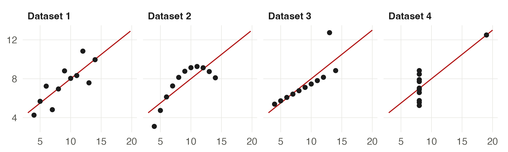{.fragment width=100% fig-alt="Four scatter plots with the same red fitted line: a noisy linear cloud, a smooth curve, a straight line with one outlier above it, and a vertical stack of points with one point far to the right."}

[Anscombe (1973), "Graphs in statistical analysis", *The American Statistician* 27(1).](https://doi.org/10.1080/00031305.1973.10478966){style="font-size:0.55em; color:#6b6b6b"}

::: {.notes}
Two minutes. Show the statistics first, ask what the four datasets look
like, then reveal the plots.

Dataset 1 is a noisy linear relationship. Dataset 2 is a smooth curve, so
the line is the wrong model. Dataset 3 is a perfect line with one
outlier pulling the fit. Dataset 4 has no relationship at all except one
point far to the right, which sets the whole slope.

The regression output is the same for all four: same means, same
variances (11 for x, about 4.1 for y), same correlation of 0.82, same
fitted line. Only the plot tells them apart. That is what exploring is
for.

The Datasaurus Dozen (Matejka and Fitzmaurice 2017,
https://doi.org/10.1145/3025453.3025912) is the modern version: twelve
datasets with the same means, standard deviations and correlation to two
decimals, one of them shaped like a dinosaur.
:::

## Outline

::: {style="font-size:0.84em"}
A figure for a reader is a comparison. It is built in four steps.

1. **Choose the comparison.** The message, the benchmark, the quantity and the form.
2. **Encode it for the eye.** Put the comparison where the eye reads it precisely.
3. **Keep it faithful.** The scale, the window, the uncertainty and the title match the numbers.
4. **Finish it for the reader.** The title, the marks, the caption and the medium.
:::

[Handout: the figure guide, on this meeting's page.]{.src}

::: {.notes}
Two minutes.

The four steps are also the order you work in. Each section opens with
its four questions and closes with a table of problems and solutions.
The figure guide on this meeting's page has the same questions on one
page. Session B uses it to critique figures, and your proposal figures
should pass it.
:::

## A grocery chain in today's examples

- The chain is invented, and its data are simulated.
- It runs 300 stores in 20 regions.
- It sells groceries in neighborhood stores and superstores.
- In January 2024 it launched a loyalty program in 8 of its regions.
- Examples from the chain are marked as invented. The rest use public data.

::: {.notes}
One minute.

One invented company carries the made-up examples, so its setting is
told once. Everything else is real: FRED (Federal Reserve Economic Data)
series, Robert Shiller's stock index, county unemployment rates, Texas
home sales, diamond prices, and published charts redrawn from their
numbers.
:::

# 1. Choose the comparison

::: {.notes}
Sixteen minutes for the section.
:::

## Four questions about the comparison

1. What is the message, in one sentence?
2. Compared with what?
3. Which quantity shows it?
4. Which form shows it?

[Zelazny (2001), *Say It With Charts*, 4th ed., McGraw-Hill: decide the message, find the comparison, then choose the chart.](https://www.oreilly.com/library/view/say-it-with/9780071369978/){style="font-size:0.55em; color:#6b6b6b"}

::: {.notes}
One minute.

Zelazny was McKinsey's director of visual communications, and his rule
is the order of these four questions: the message decides the
comparison, and the comparison decides the chart. A chart chosen first
leaves the reader to find the message.
:::

## One figure shows one comparison

::: {.m11-under}
- The analyst's message is that sales in the West pulled away after 2023.
:::

::: {.m11-pair}
::: {.before}
[As drawn]{.m11-tag}
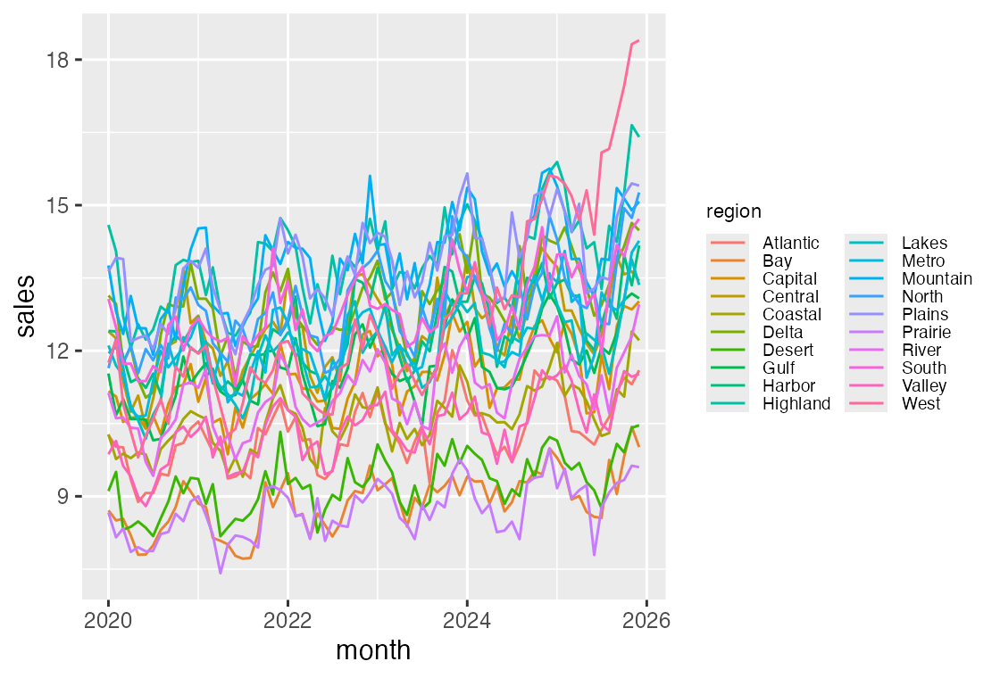{fig-alt="Twenty tangled colored lines of monthly sales from 2020 to 2025, with a twenty-entry legend."}
:::
::: {.after .fragment}
[Redrawn]{.m11-tag}
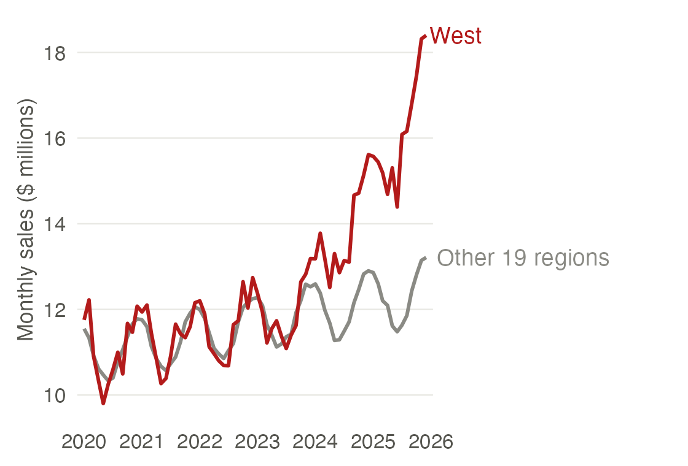{fig-alt="Two lines: the West in red rising steeply after 2023, and the average of the other 19 regions in grey, flatter."}
:::
:::

::: {.m11-under}
- **No message.** Twenty lines show everything and compare nothing.
- [**Solution**: write the message first, then draw only its comparison.]{.solution}
:::

::: {.notes}
Two minutes.

Ask the room what the first figure says. Most will say "sales go up and
down". The analyst's message was that the West pulled away from the
other regions after 2023, and that is invisible in the first figure.

The redraw compares two things, the West and the average of the rest.
Writing the message down first is what tells you which two lines to
keep. If the message were "every region follows the same seasonal
pattern", the right figure would be different again.
:::

## A change needs a comparison group

::: {.m11-under}
- The chain reports sales in its loyalty-program regions after the launch.
:::

::: {.m11-pair}
::: {.before}
[As drawn]{.m11-tag}
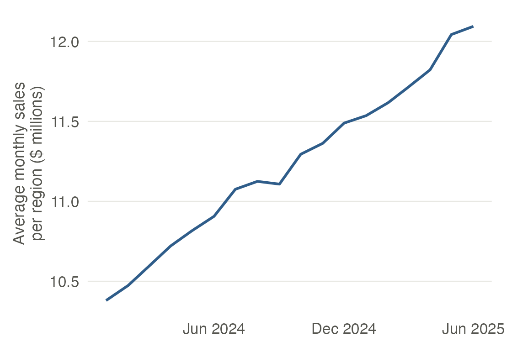{fig-alt="One blue line of average monthly sales in the launch regions, rising steadily from January 2024."}
:::
::: {.after .fragment}
[Redrawn]{.m11-tag}
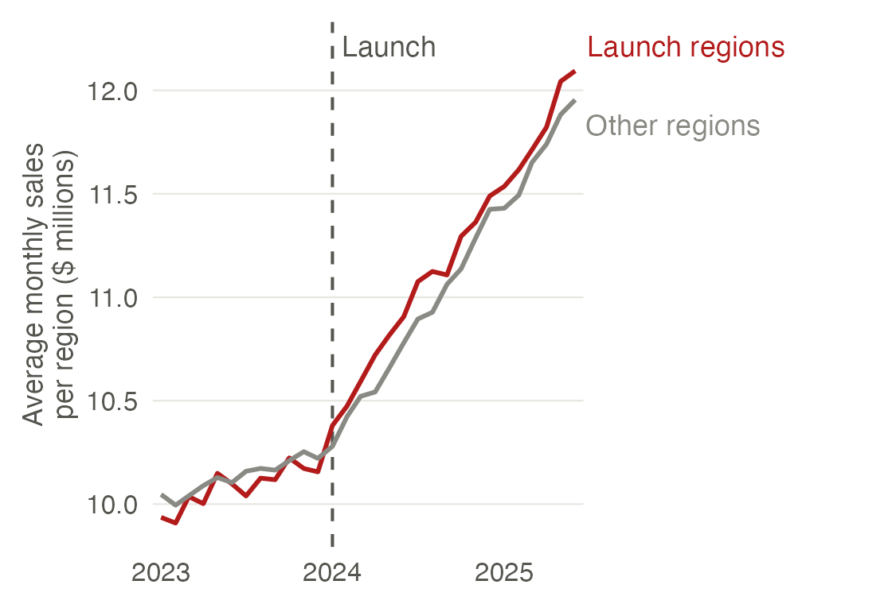{fig-alt="Launch regions in red and other regions in grey from 2023, with the launch in January 2024 marked; both rise after 2024 and the red line ends slightly higher."}
:::
:::

::: {.m11-under}
- **No benchmark.** The other regions' sales rose too.
- [**Solution**: add a comparison group and the period before the change.]{.solution}
:::

::: {.notes}
Two minutes.

The first figure is the one a marketing team sends up the chain: sales
in the launch regions went up after the launch. It has no benchmark, so
the reader cannot tell the program from everything else that happened
in 2024.

The redraw adds the regions without the program and the twelve months
before. The other regions rose almost as fast. The program's effect is
the small gap that opens after the launch, about 1.5 percent in this
simulation, not the whole rise.

This is the difference-in-differences comparison from meeting 9, drawn.
Tufte's question for any quantitative display is "compared to what?"
:::

## Money over time needs constant dollars

::: {.m11-under}
- The federal minimum wage rose from $0.75 an hour in 1950 to $7.25 in 2009.
:::

::: {.m11-pair}
::: {.before}
[As drawn]{.m11-tag}
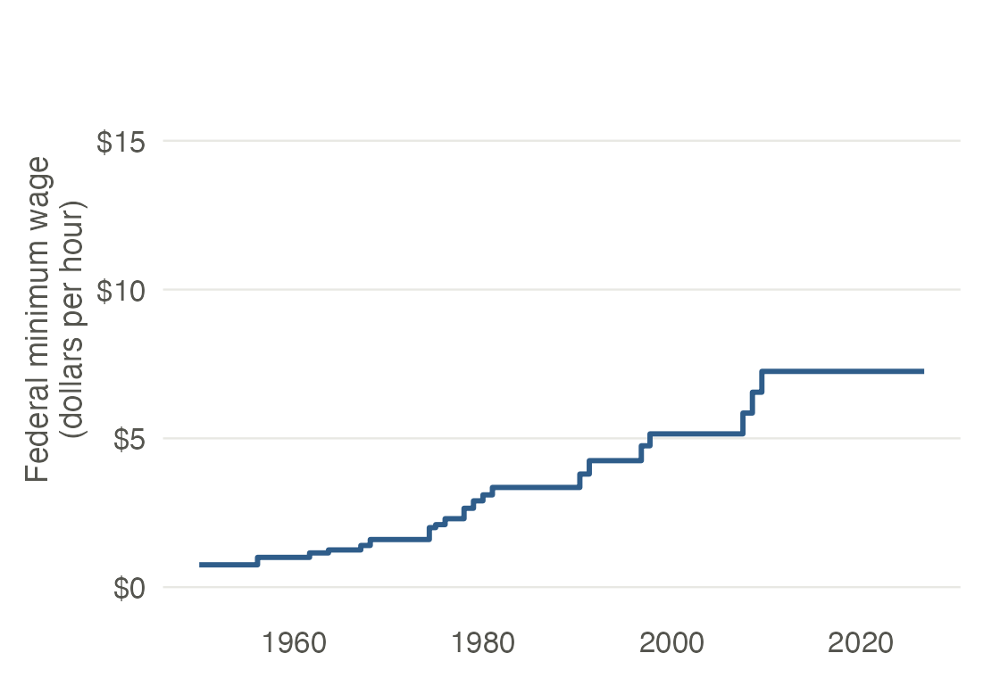{fig-alt="A blue staircase rising from 75 cents in 1950 to 7.25 dollars after 2009."}
:::
::: {.after .fragment}
[Redrawn]{.m11-tag}
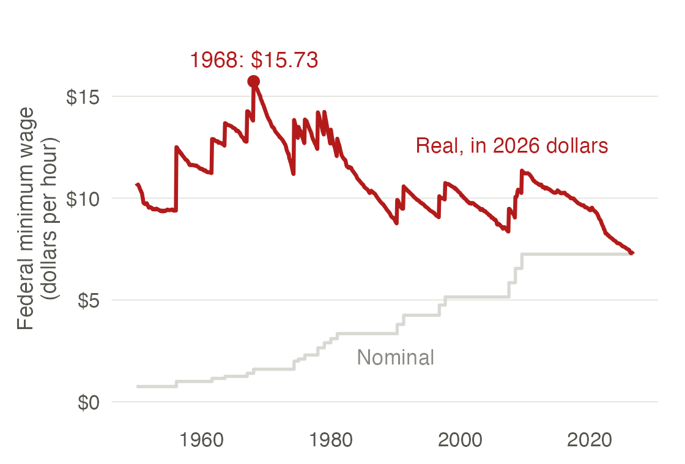{fig-alt="The same wage in 2026 dollars in red, peaking at 15.73 dollars in 1968 and falling to 7.25; the nominal staircase in light grey below."}
:::
:::

::: {.m11-under}
- **Nominal dollars** are dollars of each year. **Real dollars** are dollars of one base year.
- The redraw deflates by the consumer price index (CPI) to 2026 dollars.
- [**Solution**: deflate money by a price index and name the base year.]{.solution}
:::

[Federal Reserve Economic Data (FRED), series FEDMINNFRWG and CPIAUCSL.](https://fred.stlouisfed.org/series/FEDMINNFRWG){style="font-size:0.55em; color:#6b6b6b"}

::: {.notes}
Two minutes.

The nominal series only ever rises, so the first figure says the
minimum wage has never been higher. In dollars of 2026, deflated with
the consumer price index for all urban consumers, it peaked in February
1968 at $15.73 and has lost more than half its value since. Same data,
opposite message.

The choice of quantity is a choice of comparison. Nominal dollars
compare the number printed on the paycheck. Real dollars compare what it
buys.
:::

## Four choices of quantity

1. Nominal dollars or real dollars.
2. Levels or an index to a base year.
3. Two series or the gap between them.
4. Counts or a rate per person.

::: {.notes}
One and a half minutes.

Each pair answers a different question. Levels compare sizes; an index
set to 100 in a base year compares growth. Two series show each one; the
gap shows their difference, which is often the message (exports and
imports against the trade balance). Counts compare totals; a rate per
person compares risk or intensity, and a map of counts is usually a map
of population.

No figures here on purpose: session B has cases of each.
:::

## An average needs the data behind it

::: {.m11-under}
- The chain compares the average basket in its two store formats.
:::

::: {.m11-pair}
::: {.before}
[As drawn]{.m11-tag}
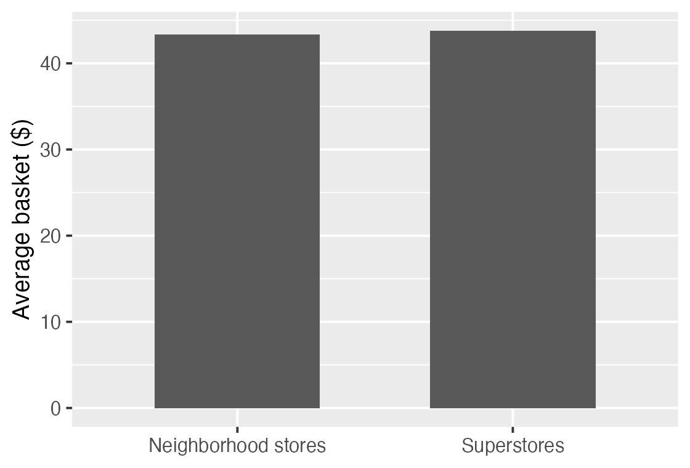{fig-alt="Two grey bars of almost equal height, about 43 dollars each, for neighborhood stores and superstores."}
:::
::: {.after .fragment}
[Redrawn]{.m11-tag}
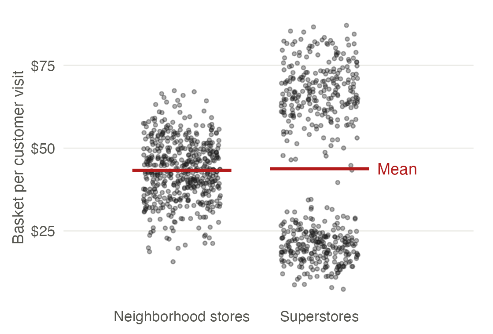{fig-alt="Every customer visit as a dot. Neighborhood stores form one cloud around 43 dollars. Superstores form two clouds, near 20 and near 67 dollars, with the mean between them where few customers are."}
:::
:::

::: {.m11-under}
- **A bar of means hides the distribution.** Superstore customers come in two groups.
- [**Solution**: show the data points, or the distribution, with the mean marked.]{.solution}
:::

::: {.notes}
Two minutes.

The bars say the two formats are the same. The dots say superstores
serve two kinds of visit: quick trips around $20 and weekly shops around
$67. Almost no superstore customer spends the average. A pricing or
staffing decision built on the mean would fit nobody.

With a few hundred points, show them all. With thousands, show a
histogram or a density per group.
:::

## Few physiology papers showed the data points

- Weissgerber and coauthors read 703 papers in top physiology journals from early 2014.
- 85.6% used bar graphs. 13.4% showed the individual data points.
- Half the papers had a group of four observations or fewer.
- Newman and Scholl showed viewers a bar for a mean.
- Viewers judged values inside the bar likelier to be in the data.

[Weissgerber et al. (2015), "Beyond bar and line graphs", *PLOS Biology* 13(4).](https://doi.org/10.1371/journal.pbio.1002128){style="font-size:0.55em; color:#6b6b6b"}
[Newman and Scholl (2012), "Bar graphs depicting averages are perceptually misinterpreted", *Psychonomic Bulletin & Review* 19(4).](https://doi.org/10.3758/s13423-012-0247-5){style="font-size:0.55em; color:#6b6b6b"}

::: {.notes}
One and a half minutes.

Weissgerber and coauthors reviewed every research article in the top
quarter of physiology journals from January to March 2014. Most showed
continuous data as bar graphs of means. With four observations in a
group, the reader could have seen every point, and many different
datasets produce the same bar.

Newman and Scholl showed viewers a bar for a mean and asked how likely a
test value was to be in the data. Values inside the bar were rated more
likely than values the same distance above the mean, as if the bar held
the data. The effect held with error bars and from memory.
:::

## Chart families follow the comparison

::: {style="font-size:0.66em"}
- The Financial Times groups chart types by the comparison they show.
- Find your comparison in a column heading, then choose a chart from that column.
:::

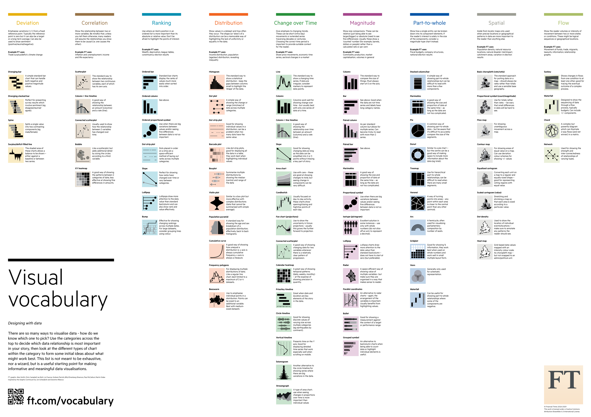{width=78% fig-align="center" fig-alt="The Financial Times Visual Vocabulary poster: nine columns of chart types grouped by deviation, correlation, ranking, distribution, change over time, magnitude, part-to-whole, spatial and flow."}

[Financial Times, *Visual Vocabulary*, MIT License.](https://github.com/Financial-Times/chart-doctor/tree/main/visual-vocabulary){style="font-size:0.55em; color:#6b6b6b"}

::: {.notes}
One and a half minutes. Easiest slide to drop in this section.

The Financial Times graphics desk built this poster as a shared
vocabulary. It groups chart types by the relationship they show:
deviation, correlation, ranking, distribution, change over time,
magnitude, part-to-whole, spatial and flow. Find your comparison in the
column headers, then pick a chart from that column. The figure guide
links it.
:::

## Solutions for the comparison

::: {.m11-recap style="font-size:0.74em"}
| | Question | Problem | Solution |
|:-|:--------|:--------|:--------------------|
| 1 | What is the message? | Everything shown, nothing compared | Write the message first, then draw only its comparison |
| 2 | Compared with what? | No benchmark | Add a comparison group and the period before |
| 3 | Which quantity? | Nominal, levels, two series or counts | Choose real dollars, an index, the gap or a rate when the message needs it |
| 4 | Which form? | A bar of means | Show the data points or the distribution |
:::

::: {.notes}
One minute.
:::

# 2. Encode it for the eye

::: {.notes}
Fifteen minutes for the section.
:::

## Two kinds of reading error

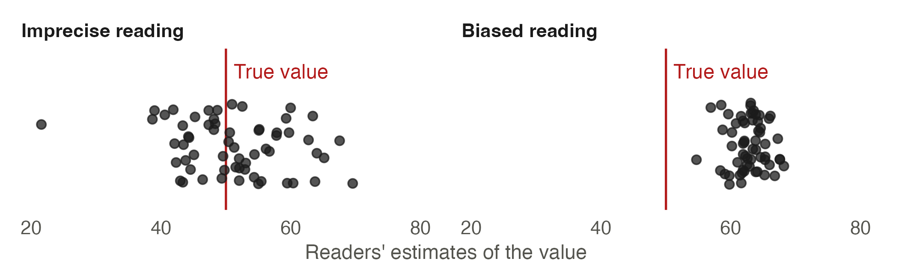{width=100% fig-alt="Two strips of reader estimates of a value of 50. On the left the estimates scatter widely around 50. On the right they cluster tightly around 63, away from the true value."}

- **Encoding** turns numbers into positions, lengths, angles, areas or colors.
- An **imprecise** reading scatters around the true value. Step 2 fixes it.
- A **biased** reading moves away from it in one direction. Step 3 fixes it.

::: {.notes}
One and a half minutes.

These are the same two words as for estimators in meetings 6 and 7. An
imprecise reading is noisy: readers' estimates of a value scatter
around the truth, so small differences get lost. A biased reading is
systematic: readers' estimates move away from the truth in the same
direction, so the figure tells them something false.

This is the rule that separates the next two sections. Choosing a pie
over dots makes readings imprecise. Cutting a bar axis makes them
biased.
:::

## Four questions about encoding

- A **channel** is the visual property that carries a number.

1. Is the key comparison on a common scale?
2. Does the channel match the data?
3. Are the compared items next to each other?
4. Do the points hide each other?

::: {.notes}
Half a minute. A channel is the visual property that carries the
number: position, length, angle, area, color.
:::

## Readers judge position most accurately

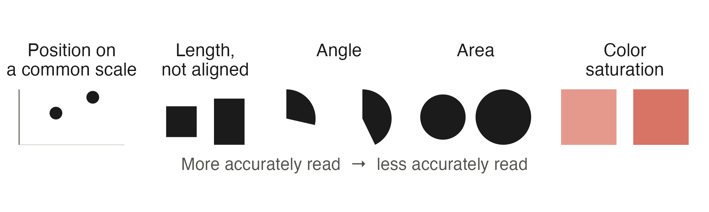{width=100% fig-alt="The values 40 and 60 drawn five ways: as two dots on a common scale, two bars not aligned, two pie wedges, two circles and two shades of red. An arrow runs from more accurately read to less accurately read."}

::: {style="font-size:0.66em"}
- Cleveland and McGill asked people what percent one marked value was of another.
- Position on a common scale beat length, and length beat angle.
- Heer and Bostock replicated it with 50 online workers per chart in 2010.
- Circle and rectangle areas were read less accurately than angles.
:::

[Cleveland and McGill (1984), "Graphical perception", *Journal of the American Statistical Association* 79.](https://doi.org/10.1080/01621459.1984.10478080){style="font-size:0.55em; color:#6b6b6b"}
[Heer and Bostock (2010), "Crowdsourcing graphical perception", Proceedings of the ACM Conference on Human Factors in Computing Systems (CHI).](https://doi.org/10.1145/1753326.1753357){style="font-size:0.55em; color:#6b6b6b"}

::: {.notes}
Two minutes.

The figure draws the same two numbers, 40 and 60, five ways. Ask which
one makes 60 easiest to read as one and a half times 40.

Cleveland and McGill ran two experiments at Bell Labs: one on bar and
divided-bar charts, one on pie charts against bar charts. Subjects said
which marked value was smaller and what percent it was of the larger.
They tested position, length and angle. The rest of their ranking, from
area down to color saturation, they drew from earlier perception
research.

Heer and Bostock repeated the experiments on Amazon's Mechanical Turk
with 50 workers per chart, and added circles and rectangles. The ranking
held, and both kinds of area were read least accurately.

Color is still the right channel for a map, where position is taken by
geography. The next slides apply the ranking.
:::

## Values compare best along one axis

::: {.m11-under}
- Seven invented grocery chains split one region's sales.
:::

::: {.m11-pair}
::: {.before}
[As drawn]{.m11-tag}
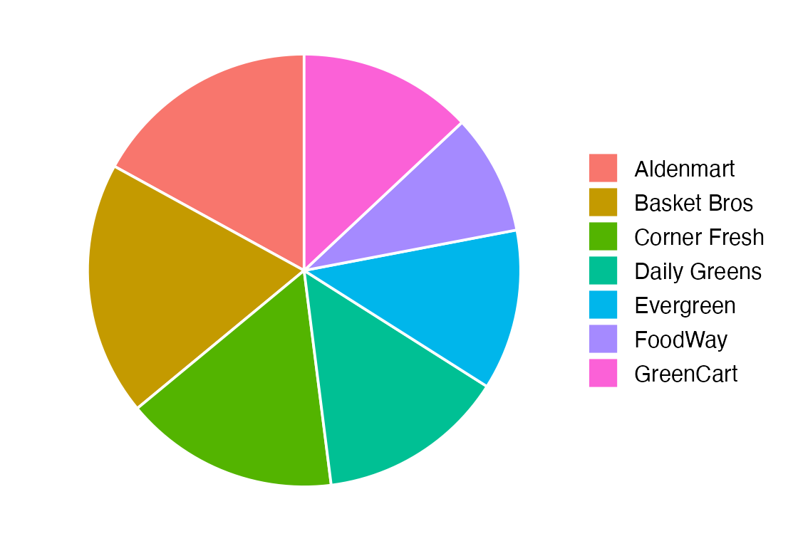{fig-alt="A pie chart of seven similar slices in seven colors with a legend."}
:::
::: {.after .fragment}
[Redrawn]{.m11-tag}
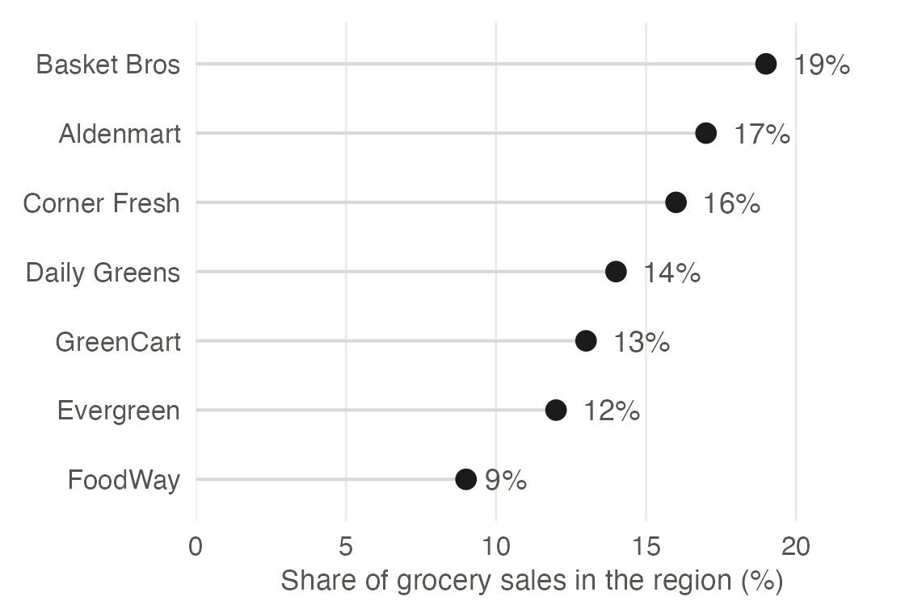{fig-alt="A sorted dot plot of the seven chains' shares, from Basket Bros at 19 percent to FoodWay at 9 percent."}
:::
:::

::: {.m11-under}
- **Angle and area** make close shares hard to rank.
- [**Solution**: put the values on one common axis, sorted.]{.solution}
:::

::: {.notes}
One and a half minutes.

Ask the room which chain is second largest in the pie. Aldenmart (17%)
and Corner Fresh (16%) are hard to separate by angle, and the legend
sends the eye back and forth. The dot plot answers it at a glance, and
it is sorted so the ranking is the order on the page.

A pie can work for two or three parts of a whole with very different
sizes. With seven similar shares it hides the comparison.
:::

## Ordered values need an ordered color scale

::: {.m11-under}
- A map shows [unemployment rates](https://cran.r-project.org/package=maps) for every county in the lower 48 states.
:::

::: {.m11-pair}
::: {.before}
[As drawn]{.m11-tag}
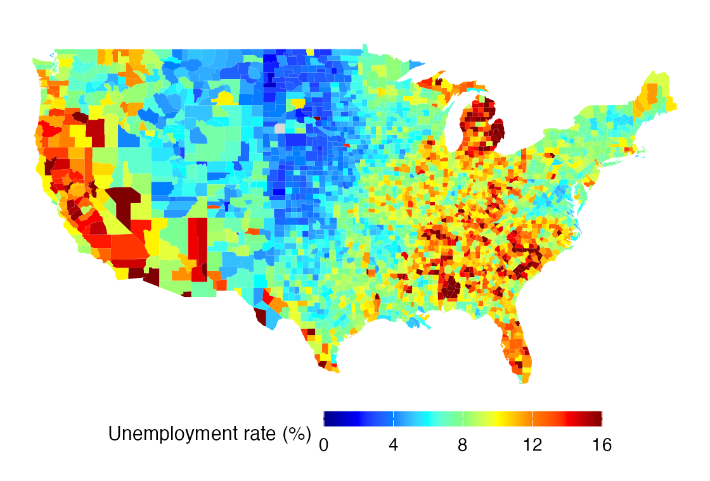{fig-alt="A county map of the United States colored with a rainbow scale from dark blue through cyan, green and yellow to dark red, with sharp color bands."}
:::
::: {.after .fragment}
[Redrawn]{.m11-tag}
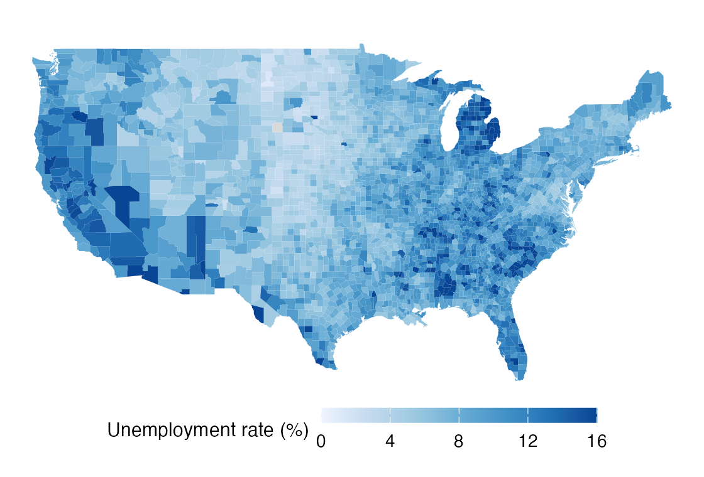{fig-alt="The same map in shades of one blue, light for low unemployment and dark for high."}
:::
:::

::: {.m11-under}
- **A rainbow scale** has no order, and its hue changes draw false borders.
- Borkin and coauthors tested artery images used to diagnose heart disease.
- Viewers found 39% of problem areas in rainbow images and 91% in two-color ones.
- [**Solution**: use a scale that runs light to dark for ordered values.]{.solution}
:::

[Borkin et al. (2011), *IEEE Transactions on Visualization and Computer Graphics* 17(12).](https://doi.org/10.1109/TVCG.2011.192){style="font-size:0.55em; color:#6b6b6b"}

::: {.notes}
Two minutes.

In the rainbow map the eye sees bands where the hue changes from green
to yellow or yellow to orange, though the rates change smoothly there.
Nobody knows whether green is more than cyan. In the one-hue map, darker
means higher, and the reader needs no legend to rank two counties.

Borkin and coauthors tested artery images used to diagnose heart
disease. Participants looking for regions of low shear stress found 39%
of them in 3D images with a rainbow scale and 91% in 2D images with a
two-color diverging scale. Within 3D images the color scale alone made a
large difference.

About 8% of men of European ancestry cannot tell red from green, which
rules out the red and green ends of a rainbow too (Birch 2012,
https://doi.org/10.1364/JOSAA.29.000313).
:::

## Many series read best as small multiples

::: {.m11-under}
- The chart shows [median home prices](https://ggplot2.tidyverse.org/reference/txhousing.html) in ten Texas cities from 2000 to 2014.
:::

::: {.m11-pair}
::: {.before}
[As drawn]{.m11-tag}
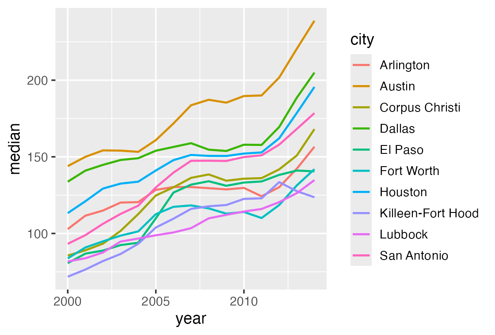{fig-alt="Six colored lines of median sale prices in one panel, with a legend."}
:::
::: {.after .fragment}
[Redrawn]{.m11-tag}
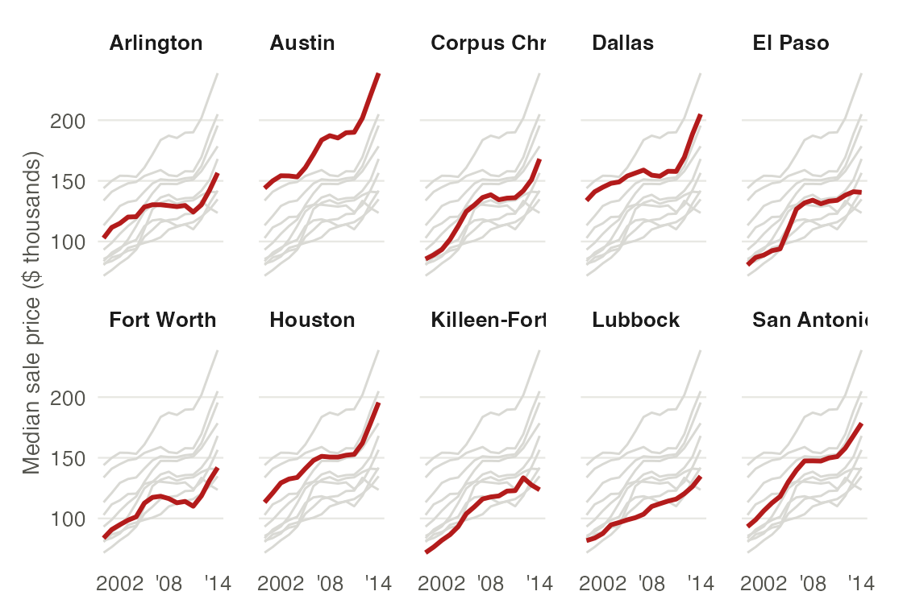{fig-alt="Six small panels, one per city, each showing that city's prices in red with the other five cities in light grey behind."}
:::
:::

::: {.m11-under}
- **Many series in one panel** make each line hard to follow.
- **Small multiples** give each series its own small panel on shared axes.
- Javed and coauthors found them faster for comparisons across a long period.
- [**Solution**: draw small multiples when each series has its own story.]{.solution}
:::

[Javed, McDonnel and Elmqvist (2010), *IEEE Transactions on Visualization and Computer Graphics* 16(6).](https://doi.org/10.1109/TVCG.2010.162){style="font-size:0.55em; color:#6b6b6b"}

::: {.notes}
Two minutes.

Each small panel shows one city in red against the others in grey, on
the same axes, so the reader sees each city's path and where it sits
among the rest. Austin stays the most expensive; El Paso flattens after
2007.

Javed and coauthors had 16 students compare 2, 4 or 8 series drawn in
one panel, as small multiples, and two other ways. Small multiples were
faster when the comparison spanned much of the time axis. One shared
panel was better for comparing values at a single date.

Schwabish (2014) makes the same redraw for a published chart of
disability awards by cause, 1975 to 2010.
:::

## Thousands of points need a binned scatter

::: {.m11-under}
- The chart plots price against weight for 53,940 diamonds.
:::

::: {.m11-pair}
::: {.before}
[As drawn]{.m11-tag}
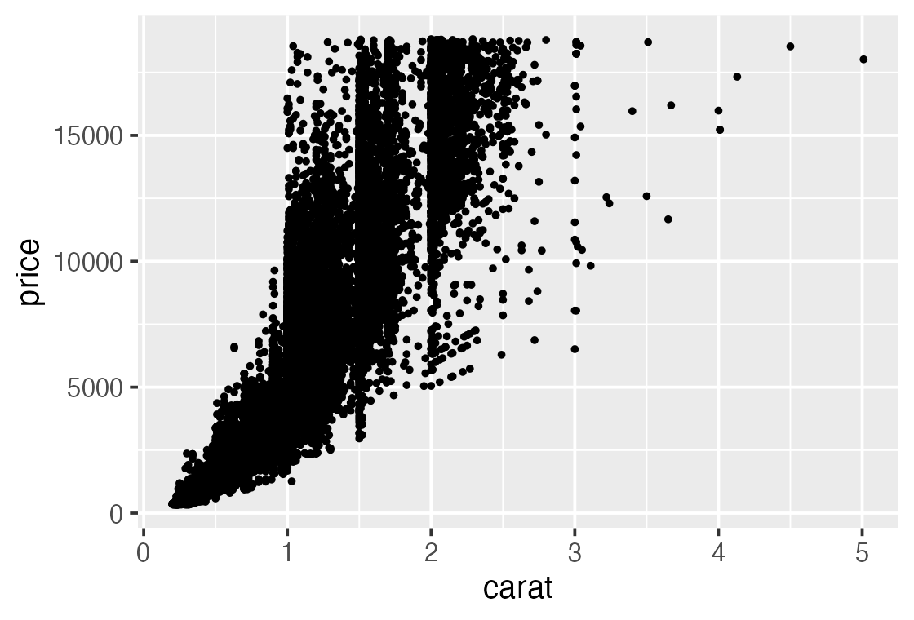{fig-alt="A solid black mass of overlapping points rising from left to right."}
:::
::: {.after .fragment}
[Redrawn]{.m11-tag}
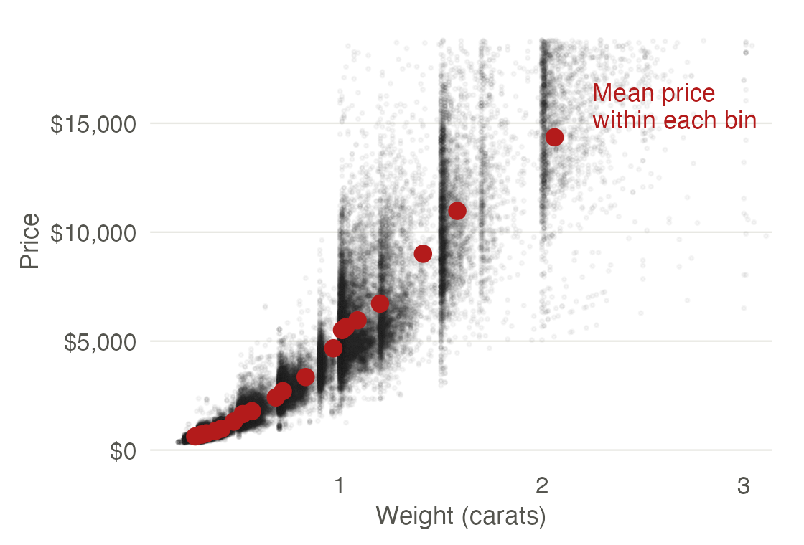{fig-alt="The same diamonds as faint transparent points, dense at small weights, with twenty red dots for the mean price in each of twenty equal-sized bins of weight, curving upward."}
:::
:::

::: {.m11-under}
- **Overplotting** hides how many points lie where.
- A **binned scatter** plots the mean price within equal-count bins of weight.
- [**Solution**: make the points transparent and add the bin means.]{.solution}
:::

[Diamond prices in R's ggplot2 package.](https://ggplot2.tidyverse.org/reference/diamonds.html){style="font-size:0.55em; color:#6b6b6b"}
[Cattaneo, Crump, Farrell and Feng (2024), "On binscatter", *American Economic Review* 114(5).](https://doi.org/10.1257/aer.20221576){style="font-size:0.55em; color:#6b6b6b"}

::: {.notes}
One and a half minutes. Easiest slide to drop in this section.

The blot shows the range and nothing else. The binned scatter splits
the diamonds into twenty groups of equal size by weight and plots each
group's mean weight and mean price. The curve is now visible: price
rises faster than weight.

Binned scatter plots are common in applied economics. Cattaneo and
coauthors show one trap: residualizing y and x on controls before
binning can draw the wrong curve. Bin first, with the controls handled
as they show.
:::

## Solutions for encoding

::: {.m11-recap style="font-size:0.74em"}
| | Question | Problem | Solution |
|:-|:--------|:--------|:--------------------|
| 1 | Common scale? | Angle and area | Put the values on one axis, sorted |
| 2 | Channel matches the data? | A rainbow scale for ordered values | Use one hue, light to dark |
| 3 | Compared items together? | Many series in one panel | Draw small multiples on shared axes |
| 4 | Points hide each other? | Overplotting | Make points transparent and add bin means |
:::

::: {.notes}
One minute.
:::

# 3. Keep it faithful

::: {.notes}
Twenty minutes for the section.
:::

## Four questions about faithfulness

1. Does the scale match the quantity?
2. Do the window and the sample favor the message?
3. Is the uncertainty shown?
4. Does the title claim only what the figure shows?

::: {.notes}
Half a minute. A faithfulness problem biases the reading: readers come
away believing something the numbers do not say.
:::

## Truncated axes make a change look more serious

- Correll, Bertini and Franconeri ran three online experiments.
- Readers rated how serious a change looked, on a scale from 1 to 5.
- Starting the axis at 25% in place of zero raised the rating by 0.36 points.
- An axis break did not remove the effect.
- The effect stayed when readers read the values correctly.
- Pandey and coauthors found the same for truncated bar charts.

[Correll, Bertini and Franconeri (2020), "Truncating the y-axis: threat or menace?", Proceedings of CHI.](https://doi.org/10.1145/3313831.3376222){style="font-size:0.55em; color:#6b6b6b"}
[Pandey et al. (2015), "How deceptive are deceptive visualizations?", Proceedings of CHI.](https://doi.org/10.1145/2702123.2702608){style="font-size:0.55em; color:#6b6b6b"}

::: {.notes}
One and a half minutes.

Participants were recruited online and saw many bar and line charts of
the same change, with the y-axis starting at zero, at 25% or at 50%. Starting at 25% raised the rated severity by 0.36 points on
the five-point scale, for bars and lines alike. Broken-axis symbols and
gradient bars did not remove it. People who could read the exact values
off the axis still judged the change larger.

Pandey and coauthors found the same with truncated bar charts in a
separate experiment with crowd workers.
:::

## Bars start at zero

::: {.m11-under}
- In July 2012 Fox Business showed the top income tax rate if the 2001 tax cuts expired.
:::

::: {.m11-pair}
::: {.before}
[As drawn: axis from 34%]{.m11-tag}
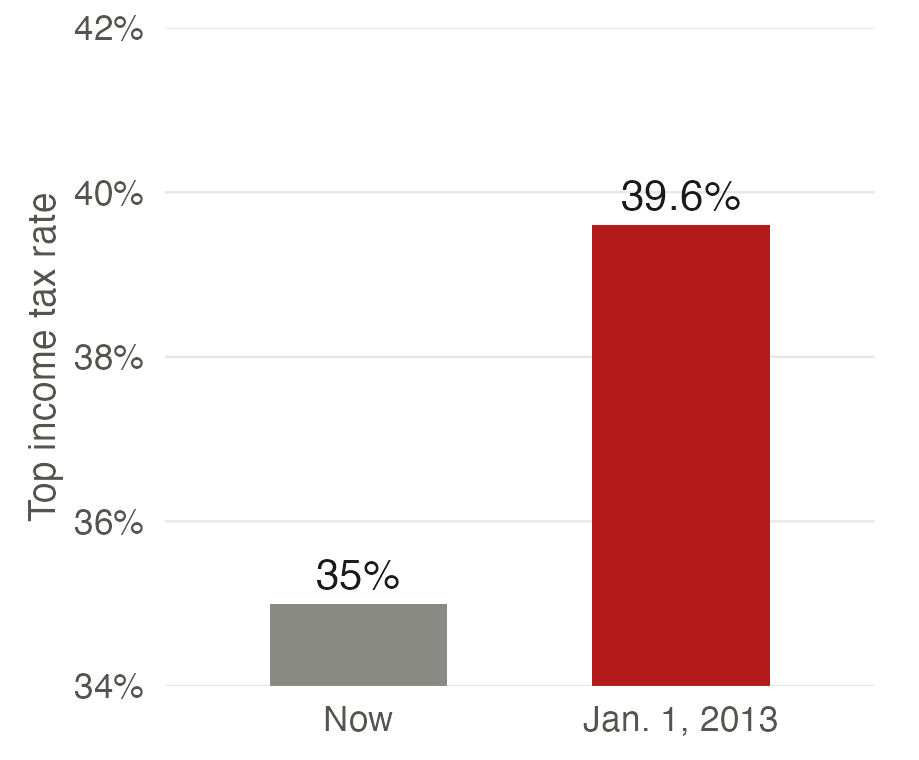{fig-alt="Two bars on an axis starting at 34 percent: 35 percent now, short and grey, and 39.6 percent on January 1, 2013, red and more than five times taller."}
:::
::: {.after .fragment}
[Redrawn from zero]{.m11-tag}
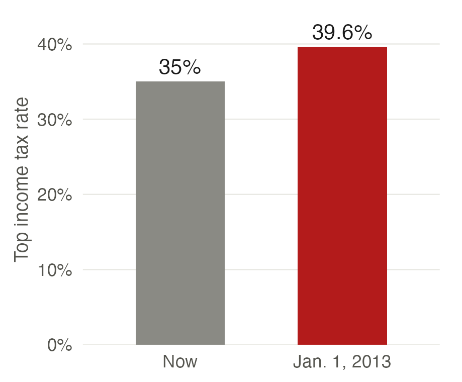{fig-alt="The same two bars on an axis from zero: 35 and 39.6 percent, similar heights."}
:::
:::

::: {.m11-under}
- **A truncated bar** drew a 4.6-point rise as a bar 5.6 times taller.
- In 2015 the Obama White House drew graduation rates as books with no axis.
- [**Solution**: start bars at zero, or show the values as dots.]{.solution}
:::

[Redrawn from the published numbers. Media Matters, "Dishonest Fox chart", 2012.](https://www.mediamatters.org/fox-business/dishonest-fox-chart-bush-tax-cut-edition){style="font-size:0.55em; color:#6b6b6b"}
[Quartz, "The most misleading charts of 2015, fixed".](https://qz.com/580859/the-most-misleading-charts-of-2015-fixed){style="font-size:0.55em; color:#6b6b6b"}

::: {.notes}
Two and a half minutes.

The Fox Business chart aired on *Cavuto* on July 31, 2012. It showed the
top income tax rate at 35% "now" and 39.6% on January 1, 2013, if the
2001 tax cuts expired, on an axis starting at 34%. The second bar's
visible part is 5.6 / 1 = 5.6 times the first.

The Obama White House tweeted a chart on December 16, 2015, showing the
high-school graduation rate at an all-time high, drawn as columns of
stacked books with no visible y-axis. Quartz redrew it from zero and the
rise looked much smaller. The fault belongs to no party.

Bars need zero because readers compare their lengths. A line or a dot
plot can start elsewhere, because readers compare positions. The test
is whether the axis matches the quantity: an index, a temperature or a
growth rate has no natural zero to show.
:::

## Readers misread COVID-19 deaths on a log scale

- In April 2020, 2,074 Americans saw a chart of cumulative US COVID-19 deaths.
- Half saw it on a linear scale, half on a log scale, at random.
- The log group read the trend less accurately and forecast worse.
- The log group also wanted businesses reopened sooner.
- [**Solution**: use a linear scale for a general reader.]{.solution}

[Romano, Sotis, Dominioni and Guidi (2020), "The scale of COVID-19 graphs affects understanding, attitudes, and policy preferences", *Health Economics* 29(11).](https://doi.org/10.1002/hec.4143){style="font-size:0.55em; color:#6b6b6b"}

::: {.notes}
Two minutes.

A log scale shows equal percentage changes as equal distances, so it is
the right scale for growth rates. Most readers do not know that. In this
experiment, published in an economics journal, the participants were
recruited online and shown the worldometers chart of US deaths. Those
who saw the log version judged which week rose more less accurately,
made higher forecasts that were further from the truth, were less
worried, and favored reopening businesses sooner.

The scale changed policy preferences. If your reader is not a
specialist, use a linear scale, or say on the figure that each gridline
is ten times the last.
:::

## Two periods belong on one scale

::: {.m11-under}
- A chart shared in February 2014 overlaid the 1929 Dow on 2012–14 to warn of a crash.
:::

::: {.m11-pair}
::: {.before}
[The overlay's method]{.m11-tag}
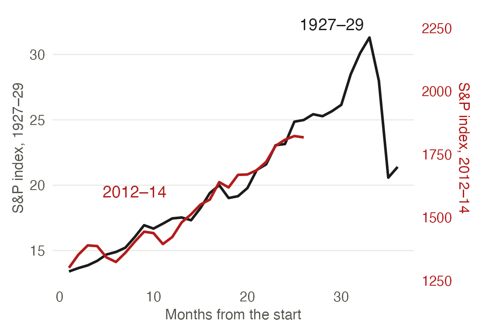{fig-alt="Two lines on two y-axes: the S&P index in 1927 to 1929 in black, peaking and crashing, and 2012 to 2014 in red on its own right-hand axis, tracking the black line closely until month 26."}
:::
::: {.after .fragment}
[One scale, the full period]{.m11-tag}
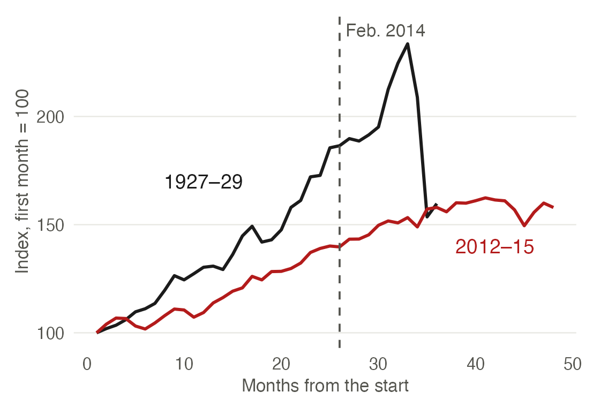{fig-alt="Both periods indexed to 100 in their first month on one axis. The 1927 to 1929 line rises to 234 before crashing; the 2012 to 2015 line rises to about 160 and does not crash."}
:::
:::

::: {.m11-under}
- Both panels redraw it with the S&P composite stock index from 1927 and from 2012.
- **Two y-axes** let the author set where the lines meet. **A chosen window** lines them up.
- [**Solution**: put compared periods on one scale, over the full period.]{.solution}
:::

[Redrawn with Shiller's monthly S&P composite. Quartz (2014), on the original Dow chart.](https://qz.com/153040/an-incredibly-misleading-chart-is-warning-of-a-1929-style-market-crash){style="font-size:0.55em; color:#6b6b6b"}
[Shiller, *Irrational Exuberance* data.](http://www.econ.yale.edu/~shiller/data.htm){style="font-size:0.55em; color:#6b6b6b"}

::: {.notes}
Two and a half minutes.

The original chart circulated in February 2014 among market analysts
(Tom McClellan, Tom DeMark) and ran on MarketWatch on February 11. It
drew the Dow in 1928–29 on one axis and the Dow in 2012–14 on another,
with the start dates and both axis ranges chosen so the two lines
matched. The 1929 crash then sat just ahead of the 2014 line.

Our redraw uses Robert Shiller's monthly S&P composite, not the daily
Dow, with the same method: the two axes are fitted so the 26 shared
months line up. On one scale, indexed to 100 in each first month, the
1927–29 market rose 134% before the crash; 2012–14 rose 40%. No crash
followed in 2014 or 2015.

Two y-axes are not always wrong, but whoever chooses both ranges
chooses where the lines cross. No experiment we found measures this;
the mechanism is enough.
:::

## Estimates need their intervals

::: {.m11-under}
- The chain estimates the loyalty program's effect in each of its 8 launch regions.
:::

::: {.m11-pair}
::: {.before}
[As drawn]{.m11-tag}
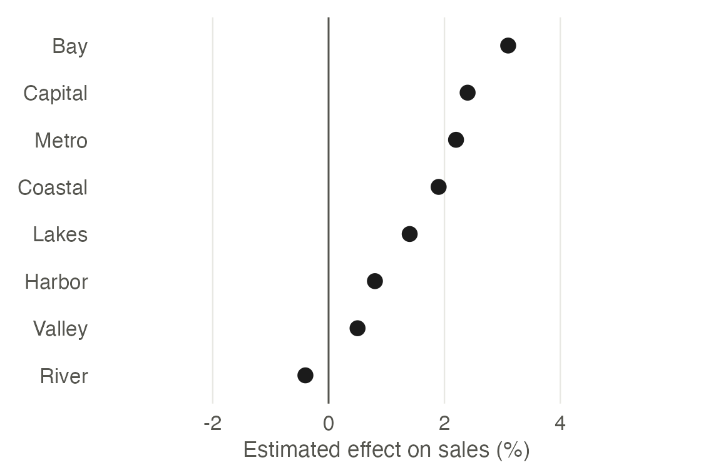{fig-alt="Eight dots, one per region, all but one to the right of zero, sorted from Bay at 3.1 percent to River at minus 0.4 percent."}
:::
::: {.after .fragment}
[Redrawn]{.m11-tag}
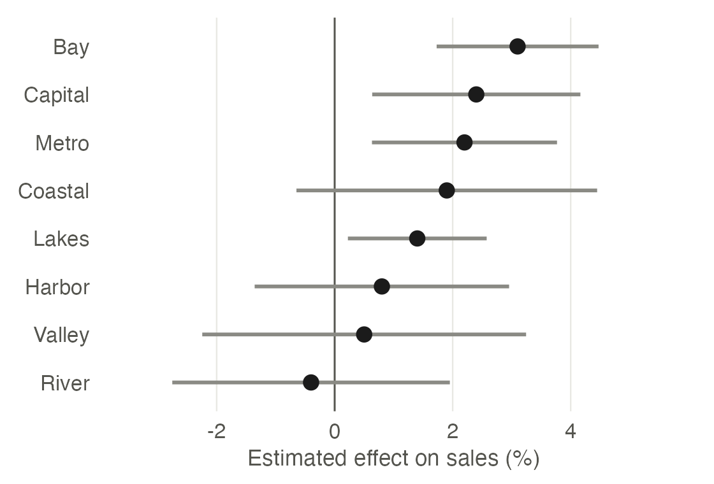{fig-alt="The same eight dots with grey horizontal bars for 95 percent confidence intervals; four of the eight cross zero."}
:::
:::

::: {.m11-under}
- A **95% confidence interval** (CI) covers the true effect in 95% of samples.
- An **error bar** shows a standard error or a confidence interval.
- **Uncertainty left out**: four of the eight intervals include zero.
- [**Solution**: draw each interval, and say in the caption which interval it is.]{.solution}
:::

::: {.notes}
Two minutes.

Without intervals, the first figure says the program raised sales in
seven of eight regions. With 95% confidence intervals, only four
regions' effects are distinguishable from zero. Meeting 6 defined the
confidence interval and the standard error.

Say which interval you drew. A standard-error bar is about half the
length of a 95% interval, and readers confuse the two (next slide).
:::

## Authors leave uncertainty out and readers misread it

- Hullman surveyed 90 authors of data visualizations.
- 62% of those who omit uncertainty said they feared confusing readers.
- Only 3% of 449 news charts used to draw inferences showed uncertainty.
- Belia and coauthors asked 473 published researchers to read error bars.
- Many confused confidence intervals with standard-error bars.

[Hullman (2020), "Why authors don't visualize uncertainty", *IEEE Transactions on Visualization and Computer Graphics* 26(1).](https://doi.org/10.1109/TVCG.2019.2934287){style="font-size:0.55em; color:#6b6b6b"}
[Belia, Fidler, Williams and Cumming (2005), "Researchers misunderstand confidence intervals and standard error bars", *Psychological Methods* 10(4).](https://doi.org/10.1037/1082-989X.10.4.389){style="font-size:0.55em; color:#6b6b6b"}

::: {.notes}
Two minutes.

Hullman surveyed 90 visualization authors and interviewed 13. The
reasons given for leaving uncertainty out: not wanting to confuse or
overwhelm viewers (62%), having no uncertainty information (47%), not
knowing how to compute it (26%), and not wanting the data to look
questionable (17%).

Belia and coauthors asked 473 authors of articles in psychology,
behavioral neuroscience and medicine to drag two means until the
difference looked just significant at p < .05, once with 95% confidence
intervals and once with standard-error bars. Many confused the two:
they placed confidence intervals too far apart and standard-error bars
too close together.

A rule of thumb for two independent groups: 95% intervals that overlap
by about half of one arm still differ at p of about .05 (Cumming and
Finch 2005, https://doi.org/10.1037/0003-066X.60.2.170). Overlap alone
does not mean no difference.
:::

## A causal title needs a causal design

- In 2012 a cardiologist plotted chocolate eaten per person against Nobel laureates per 10 million people.
- Across about two dozen countries the correlation was 0.79.
- The piece's title paired chocolate with cognitive function.
- Several news outlets reported the correlation as cause and effect.
- **A causal title on a correlation** claims more than the figure shows.
- [**Solution**: title the association, and leave causal claims to a design.]{.solution}

[Messerli (2012), "Chocolate consumption, cognitive function, and Nobel laureates", *New England Journal of Medicine* 367(16).](https://doi.org/10.1056/NEJMon1211064){style="font-size:0.55em; color:#6b6b6b"}

::: {.notes}
Two minutes.

Franz Messerli published this as an "Occasional Notes" piece, not a
peer-reviewed study. Chocolate consumption came from industry data and
the laureate counts from a per-capita ranking. The figure plots one dot
per country; Switzerland and Sweden sit at the top. The correlation was
0.791 (0.862 without Sweden). The methods mention 22 countries with
chocolate data; news reports said 23. He told Reuters the idea was
absurd but the data legitimate, and outlets still reported it straight.

Richer countries eat more chocolate and fund more research. A title
such as "Countries that eat more chocolate have more Nobel laureates"
states what the figure shows. A title such as "Chocolate makes
countries smarter" needs a design from meetings 8 and 9.
:::

## Solutions for faithfulness

::: {.m11-recap style="font-size:0.74em"}
| | Question | Problem | Solution |
|:-|:--------|:--------|:--------------------|
| 1 | Scale matches the quantity? | A truncated bar or a log scale | Start bars at zero; use a linear scale for a general reader |
| 2 | Window and sample favor the message? | Two y-axes and a chosen window | One scale over the full period |
| 3 | Uncertainty shown? | Estimates without intervals | Draw the interval and name it |
| 4 | Title supported? | A causal title on a correlation | Title the association |
:::

::: {.notes}
One minute.

Two cases from the critique cards also belong here: a total that rises
while every region falls (meeting 2's Berkeley admissions case is the
same reversal), and a sample that loses its failures over time, such as
fund returns averaged over surviving funds only.
:::

# 4. Finish it for the reader

::: {.notes}
Thirteen minutes for the section.
:::

## Four questions about finishing

1. Does the title state the finding?
2. Does every mark carry information?
3. Does the caption let the figure stand alone?
4. Does it fit the page or the slide?

[Schwabish (2014), "An economist's guide to visualizing data", *Journal of Economic Perspectives* 28(1): show the data, reduce the clutter, integrate the text and the graph.](https://doi.org/10.1257/jep.28.1.209){style="font-size:0.55em; color:#6b6b6b"}

::: {.notes}
Half a minute.

Schwabish, an economist at the Urban Institute, wrote this guide for the
*Journal of Economic Perspectives* and redrew eight published economics
figures in it. It is free and short, and it is the reading for today.
:::

## Readers remember the message in the title

- Kong, Liu and Karahalios showed 104 Americans charts on refugees and the defense budget.
- Each chart's two series supported opposite sides. The title took one side.
- 77 of the 101 messages people recalled matched the title.
- About 80% rated the chart neutral, whatever its title said.
- Borkin and coauthors tracked viewers' eyes on 393 published charts.
- Viewers restated the title in 46% of their descriptions.

[Kong, Liu and Karahalios (2018), "Frames and slants in titles of visualizations on controversial topics", Proceedings of the ACM Conference on Human Factors in Computing Systems (CHI).](https://doi.org/10.1145/3173574.3174012){style="font-size:0.55em; color:#6b6b6b"}
[Borkin et al. (2016), "Beyond memorability", *IEEE Transactions on Visualization and Computer Graphics* 22(1).](https://doi.org/10.1109/TVCG.2015.2467732){style="font-size:0.55em; color:#6b6b6b"}

::: {.notes}
Two minutes.

Each participant saw two charts, one on Syrian refugee admissions and
one on the US defense budget. Each chart had two series that supported
opposite policy positions, and a title slanted toward one. Asked later
what the chart said, most repeated the title's side. Most also judged
the chart neutral, and their own attitudes did not change. A follow-up
(2019) found the same when the title contradicted the chart.

Borkin and coauthors tracked the eyes of 33 people looking at 393
published visualizations for ten seconds each. Titles drew 59% of
fixations and were restated in 46% of the descriptions people wrote
afterwards.

The title is what most readers keep. That cuts both ways: it carries
your finding, and it can carry a claim the data do not support (the
chocolate slide).
:::

## The title states the finding

::: {.m11-pair}
::: {.before}
[Label title]{.m11-tag}
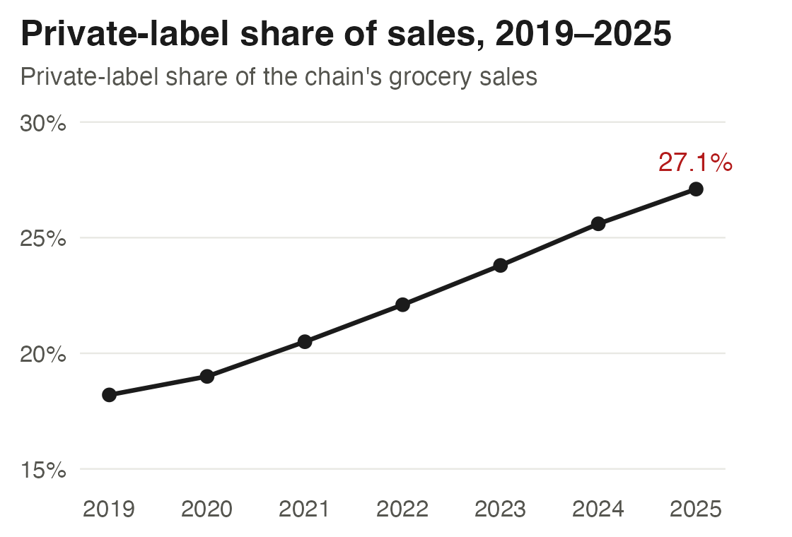{fig-alt="A line rising from 18 to 27 percent between 2019 and 2025, titled Private-label share of sales, 2019 to 2025."}
:::
::: {.after .fragment}
[Finding title]{.m11-tag}
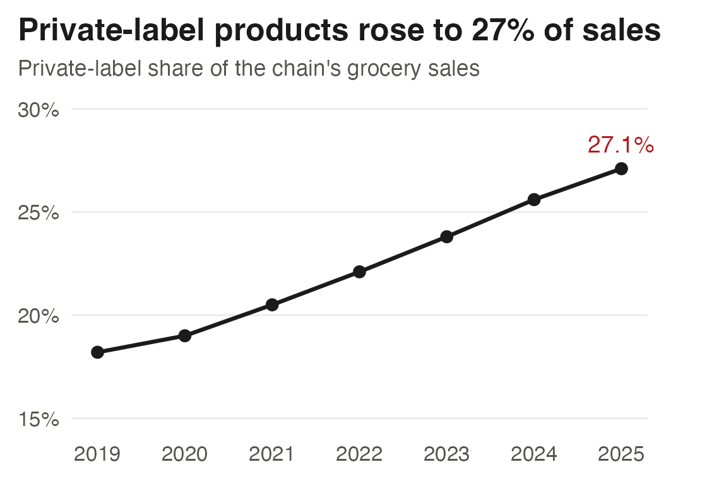{fig-alt="The same line, titled Private-label products rose to 27 percent of sales."}
:::
:::

::: {.m11-under}
- **A label title** names the variables and leaves the finding to the reader.
- [**Solution**: write the finding as the title, and put the variables in the subtitle.]{.solution}
:::

::: {.notes}
One and a half minutes.

Meeting 10 made the same point for papers: a title that states the
result reaches the readers who read nothing else. In a talk, meeting 12
asks for the same of slide titles.

In a journal the figure title is often replaced by a caption, and the
caption's first sentence does this job.
:::

## Every mark should carry information

::: {.m11-under}
- The message is that Austin's home sales recovered fastest after 2011.
:::

::: {.m11-pair}
::: {.before}
[As drawn]{.m11-tag}
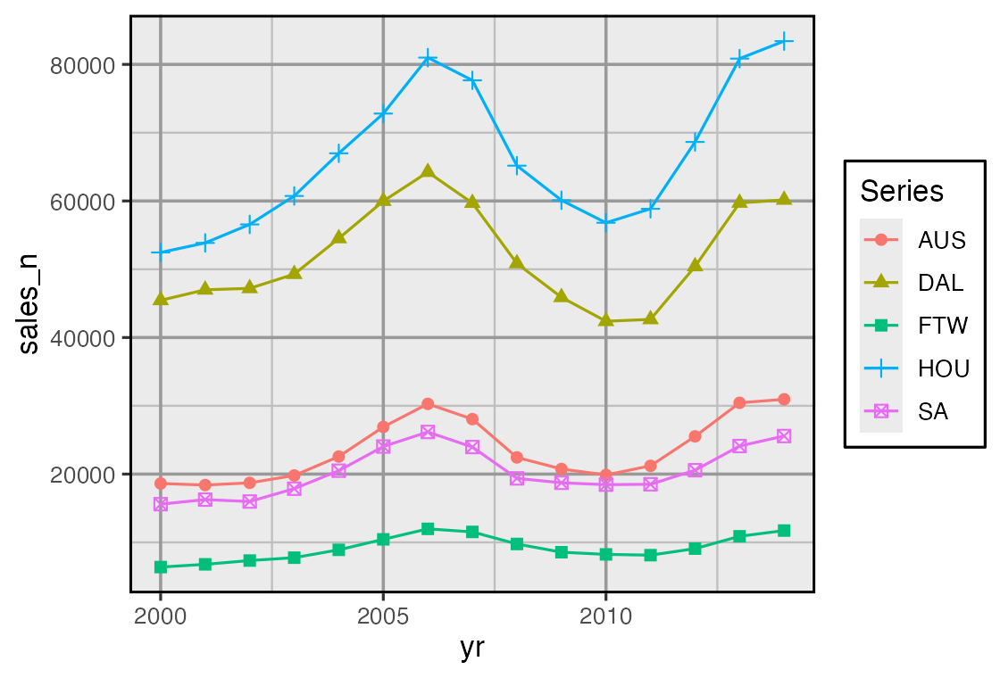{fig-alt="Five colored lines with point markers on a grey panel with heavy gridlines and a black border. The legend lists codes AUS, DAL, FTW, HOU and SA. The axes are labelled yr and sales_n."}
:::
::: {.after .fragment}
[Redrawn]{.m11-tag}
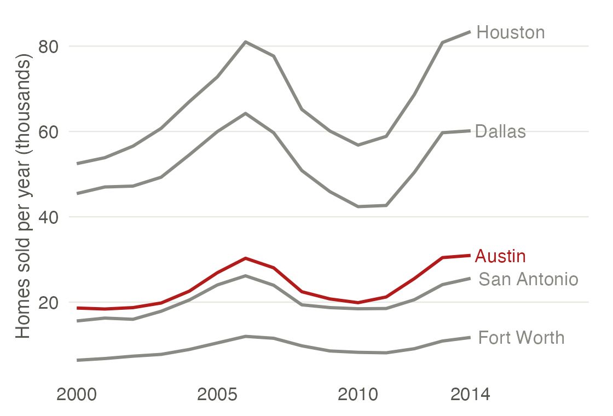{fig-alt="The same five lines in grey with the city names at their ends, Austin in red, light gridlines, and the axis labelled homes sold per year in thousands."}
:::
:::

::: {.m11-under}
- **Clutter** is every mark that carries no data: heavy gridlines, a border, markers and codes.
- [**Solution**: delete what carries no data, label lines directly, and highlight one.]{.solution}
:::

[Texas A&M Real Estate Center data, in R's ggplot2 package.](https://ggplot2.tidyverse.org/reference/txhousing.html){style="font-size:0.55em; color:#6b6b6b"}

::: {.notes}
Two minutes.

Go through the first figure piece by piece and ask what each piece
tells the reader. The grey panel and the black border tell nothing. The
minor gridlines tell nothing. The markers repeat the line. The legend's
codes send the eye back and forth, and "sales_n" and "yr" are variable
names from the dataset.

The redraw keeps the lines, labels them where they end, puts the units
in the axis title, and uses color for one city only. Schwabish's guide
does this to a published chart of food-stamp caseloads, with
abbreviations defined fifteen pages before the figure.
:::

## The caption lets the figure stand alone

::: {.columns}
::: {.column width="55%"}
{width=100% fig-alt="The eight regional effect estimates with their 95 percent confidence intervals."}
:::
::: {.column width="45%"}
::: {.m11-caption}
Figure 3: Effects.
:::

::: {.m11-caption .fragment}
Figure 3: The loyalty program's estimated effect on monthly sales, in percent, in each of the 8 regions that launched it in January 2024. Each dot compares the change in that region's sales with the change in the 12 regions that did not launch, from 2023 to January 2024–June 2025. Bars are 95% confidence intervals. Source: the chain's store sales.
:::
:::
:::

::: {.m11-under}
- [**Solution**: give the source, the unit, the sample, the comparison and the interval.]{.solution}
:::

::: {.notes}
Two minutes.

Many readers look at the figures before the text, so the figure and its
caption are a small nested version of the paper, as in meeting 10. A
reader who sees only this figure should know what was compared, in what
unit, over which period, with which estimator, and what the bars are.

The first caption is what most drafts have.
:::

## A slide needs its own version of the figure

::: {.m11-pair}
::: {.before}
[The paper's figure]{.m11-tag}
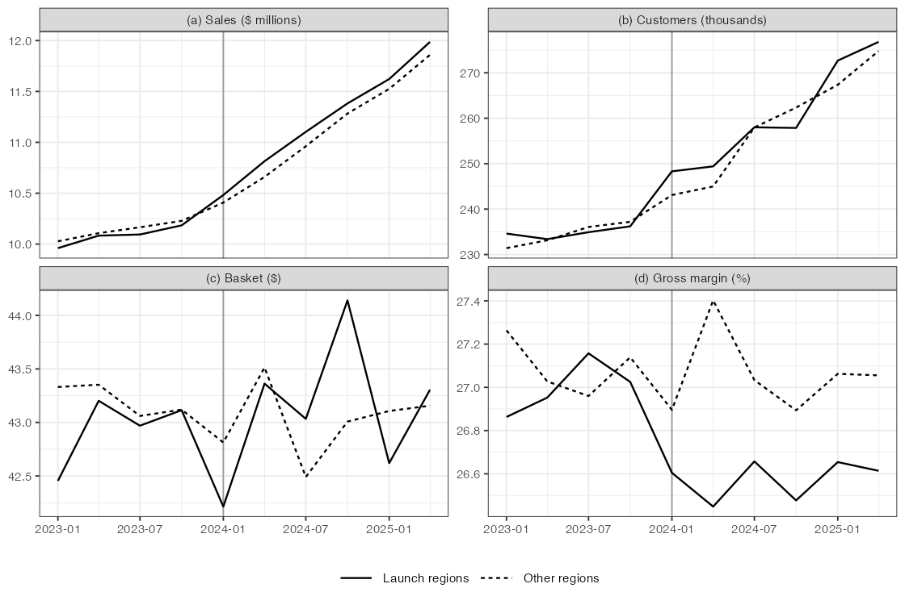{fig-alt="A four-panel figure in very small type: sales, customers, basket and gross margin by quarter for launch and other regions, with a legend at the bottom."}
:::
::: {.after .fragment}
[The slide's figure]{.m11-tag}
{fig-alt="One panel, sales per region by quarter, in large type, with launch regions in red and other regions in grey labelled at their ends and the launch marked."}
:::
:::

::: {.m11-under}
- **A paper's figure on a slide** has type too small and panels too many for the room.
- [**Solution**: redraw for the slide with one panel, large type and direct labels.]{.solution}
:::

::: {.notes}
One and a half minutes. Easiest slide to drop in this section.

A reader of a paper can study four panels at their own pace. A room
sees a slide for a minute, from ten meters away. Keep the one panel the
slide's claim needs, double the type, label the lines directly, and
mark the event. The other panels go to a backup slide. Meeting 12 takes
this further.
:::

## Solutions for finishing

::: {.m11-recap style="font-size:0.74em"}
| | Question | Problem | Solution |
|:-|:--------|:--------|:--------------------|
| 1 | Title states the finding? | A label title | Write the finding as the title |
| 2 | Every mark informative? | Clutter and a coded legend | Delete what carries no data; label lines directly |
| 3 | Caption stands alone? | "Figure 3: Effects" | Give source, unit, sample, comparison and interval |
| 4 | Fits the medium? | A paper's figure on a slide | Redraw it for the slide |
:::

::: {.notes}
One minute.

One more check across figures: the same group keeps the same color in
every figure of a document. If the launch regions are red in figure 2,
they are red in figure 5.
:::

## Four steps for every figure

::: {.m11-steps}
::: {.m11-step}
**1. Choose the comparison**

1. What is the message?
2. Compared with what?
3. Which quantity?
4. Which form?
:::
::: {.m11-step}
**2. Encode it for the eye**

1. Is the comparison on a common scale?
2. Does the channel match the data?
3. Are compared items together?
4. Do the points hide each other?
:::
::: {.m11-step}
**3. Keep it faithful**

1. Does the scale match the quantity?
2. Do the window and sample favor the message?
3. Is the uncertainty shown?
4. Is the title supported?
:::
::: {.m11-step}
**4. Finish it for the reader**

1. Does the title state the finding?
2. Does every mark carry information?
3. Does the caption stand alone?
4. Does it fit the page or slide?
:::
:::

[Handout: the figure guide, on this meeting's page.]{.src}

::: {.notes}
Four minutes.

This is the figure guide on one slide. Run it on every figure in the
proposal before December 11, and on every slide figure before meeting 14.
Session B runs it on figures that fail it.
:::

# Critiquing figures

::: {.notes}
Session B. Check-in first (ten minutes). Then one figure per team from
the critique cards, fifteen minutes to fill the sheet, then teams
present in a random order: about two minutes each, then a minute for
the room to add what the team missed. Points for a fault the room names
that the team did not. Close with which steps the room caught most and
least.
:::

## Four questions for each figure

1. What does the figure claim?
2. What is wrong, and at which step?
3. What is the figure entitled to claim?
4. How would you redraw it?

[Handouts: the critique cards and the figure guide, on this meeting's page.]{.src}

::: {.notes}
Leave this slide up while teams work.
:::

::::
