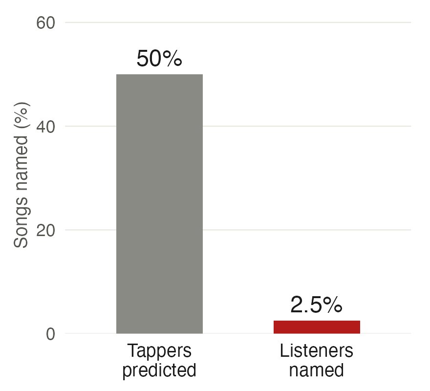
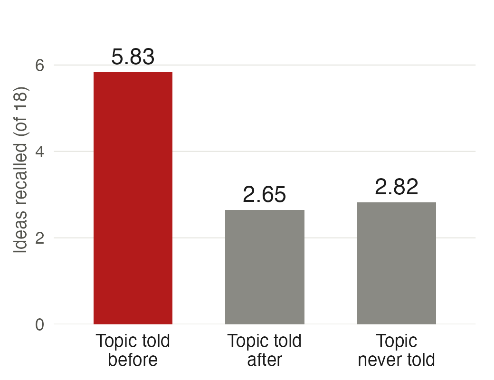
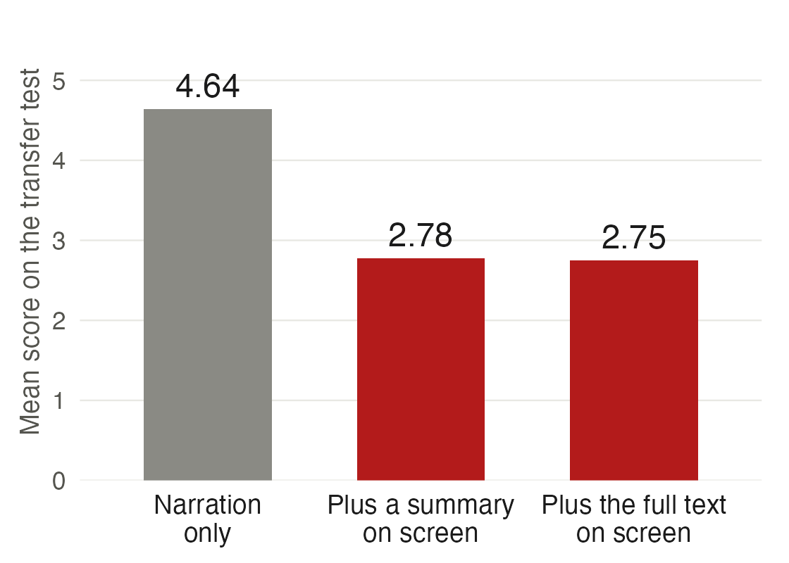
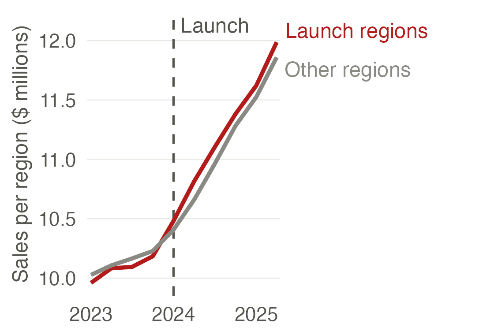
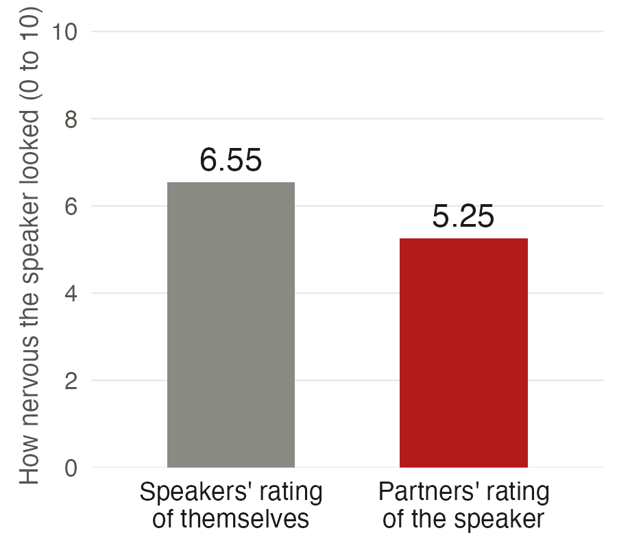

:::: {.content-hidden when-format="revealjs"}

::: {.callout-note appearance="simple"}
[**Open the slides**](12-speaking-slides.html)
:::

**What you should be able to do after this meeting.** Describe who will listen to a talk and what they will judge. State the talk's message in one sentence and place it in the first minute. Organize ten minutes for a research proposal, with spoken signposts and a planned close. Build slides with one point each. Plan your delivery and your rehearsal. Answer a question with a structure, including one you cannot answer.

## Handouts

[Talk scoring sheet](../handouts/talk-scoring-sheet.qmd)

## Where to read more

[Shapiro](https://shapiro.scholars.harvard.edu/notes-and-lectures), "How to give an applied micro talk", is a short set of notes written for economists. Winston's lecture [*How to Speak*](https://www.youtube.com/watch?v=Unzc731iCUY) (MIT OpenCourseWare) is an hour long, and its first ten minutes cover how to open a talk. [Adams](https://doi.org/10.4135/9788132108498) ch. 16 on presenting.

## Session A · 2:00–3:15

Speaking to a room, after writing for readers (meeting 10) and drawing for them (meeting 11). A reader can skim, re-read and stop. A listener hears the talk once, in the speaker's order and at the speaker's pace. The meeting has six parts. The audience: who is listening, what they already know and what they will decide, with an experiment on how badly speakers predict what listeners follow. The message: one sentence a listener could repeat the next day, stated first, with its reasons under it. The structure: the first minute, a ten-minute budget for a research proposal, spoken signposts, the last minute and the handoffs in a team talk. The slides: one point per slide, and an experiment in which printing the narration on screen lowered what students learned. The delivery: pace and pause, where to look and stand, what nerves do and how to rehearse. The questions: three kinds of question, a structure for an answer, and what to say when you do not know. The running example is your own talk on December 2: ten minutes to an expert who is hearing your proposal for the first time and judging its importance, its soundness and its feasibility.

## Session B · 3:30–4:30

Every session B opens with a ten-minute team check-in: what you did
since last week, what is stuck, and who is doing what next. Written
down, and handed in with that session's work.

Everyone watches the same four recorded talks, and each student scores them on their own sheet: who the talk is for, its message and when it arrives, how it is organized, what the slides add, two delivery choices, and one thing the team should use on December 2. Teams then compare answers. The sheet is for your own use and is not collected. Nobody rehearses their own presentation today.

## Due

Proposal outline · Rate your teammates

::::

:::: {.content-visible when-format="revealjs"}

## Speaking differs from writing

- Meetings 10 and 11 prepared a document for a reader.
- A reader can skim, read a step again and stop.
- A listener hears the talk once, in the speaker's order and at the speaker's pace.
- A listener who misses a step has lost it.
- Today is about preparing a talk for a listener.

::: {.notes}
Two minutes.

This slide says why speaking gets its own meeting. The last two
meetings assumed a reader. A reader of your proposal can skim the first
page, jump to the design, go back to a definition and stop when they
have enough. A listener can do none of that. Everyone in the room gets
the same order and the same speed, and a step they miss is gone.

Everything today follows from that difference. You decide the order for
them, you say where you are, you repeat what matters, and you put less
on the screen than on the page.

On December 2 each team has ten minutes. Today is about that talk, and
about every talk after it.
:::

## Outline

::: {style="font-size:0.84em"}
1. **The audience.** Who is listening and what they already know.
2. **The message.** One sentence, stated first.
3. **The structure.** The first minute, ten minutes for a proposal, signposts and the last minute.
4. **The slides.** One point per slide, with the words you will not say.
5. **The delivery.** Voice, eyes, stance and rehearsal.
6. **The questions.** Three kinds of question and a structure for an answer.
:::

::: {.notes}
One minute.

Six parts, in the order you would prepare a talk. The first three decide
what you say. The next two decide how the room receives it. The last is
the four minutes after your talk, which is graded too.

Each part has one framework with a name and a source, and one thing to
do before December 2. Session B applies the six parts to four recorded
talks.
:::

# 1. The audience

::: {.notes}
Twelve minutes for the section.
:::

## Four questions about the audience

::: {.m12-wide style="font-size:0.8em"}
| The question | [Your presentation on December 2]{.fragment fragment-index=1} |
|:--|:--|
| 1. Who is in the room? | [An expert in a seminar room, hearing your proposal for the first time]{.fragment fragment-index=1} |
| 2. What do they already know? | [Research designs and their assumptions. Your setting and your data are new to them]{.fragment fragment-index=1} |
| 3. What will they decide? | [Whether the proposal is important, sound and feasible]{.fragment fragment-index=1} |
| 4. What should they remember tomorrow? | [Your message, in one sentence]{.fragment fragment-index=1} |
:::

::: {.m12-under .fragment fragment-index=1}
- Each team has 10 minutes to present and 4 minutes for questions.
- The presentation is graded against [the rubric in the syllabus](../syllabus.qmd#what-you-are-graded-against).

::: {.m12-next}
- **Next**: speakers get question 2 wrong, as an experiment shows.
:::
:::

::: {.notes}
Three minutes. The four questions first, for any talk. Then click for
the answers on December 2.

Meeting 10 started with the reader, and a talk starts in the same place.
The answers set the vocabulary, the amount of background, and what the
talk has to deliver. The same project gives a different talk to a
manager, to a seminar and to a general audience.

After the click: picture one person, an economist who knows
difference-in-differences and regression discontinuity better than you
do, and who has never heard of your firm, your policy or your dataset.
That tells you where the minutes go. The expert does not need the
design explained from the beginning. The expert needs your setting,
your data and the reason your design fits them.

Nine teams present across the whole meeting, 2:00 to 4:30. The slot is
15 minutes: 10 to present, 4 for questions, 1 to change over. Every
member is encouraged to speak. The syllabus rubric applies, plus fitting the time and answering questions.
A rubric written for the presentation will replace this link.

The second question is the one speakers get wrong, and the next three
slides are about why.
:::

## How often can a listener name a tapped song?

::: {.m12-q}
Question 2: What do they already know?
:::

- Elizabeth Newton ran this experiment for her 1990 doctoral dissertation in psychology at Stanford.
- A **tapper** picks a well-known song, such as "Happy Birthday", and taps its rhythm on a table.
- A **listener** hears only the taps and tries to name the song.
- Before the listener answers, the tapper predicts the chance that the listener names it.

::: {.m12-next}
- **Next**: what Newton found.
:::

[Newton (1990), *The rocky road from actions to intentions*, PhD dissertation, Stanford University.](https://gwern.net/doc/psychology/cognitive-bias/illusion-of-depth/1990-newton.pdf){style="font-size:0.55em; color:#6b6b6b"}

::: {.notes}
Four minutes, with three for the room to try it in pairs. There is no
sound on this slide: the room makes it.

Explain the two roles, then have each pair run the experiment. The
tapper picks a song everyone knows, such as "Happy Birthday" or "Jingle
Bells", and taps it once with a finger. No humming. The tapper writes
down a percentage before the listener answers. Then they swap.

Ask how many listeners named the song, and what chance the tappers had
written down. Then ask the room to guess the result of the real
experiment before the next slide.
:::

## Listeners named 3 of 120 songs

::: {.m12-q}
Question 2: What do they already know?
:::

::: {.m12-side}
::: {.m12-under}
- 80 Stanford undergraduates worked in 40 pairs, and each tapper tapped three well-known songs.
- Tappers predicted that listeners would name 50% of the songs.
- Listeners named 3 of the 120 songs, which is 2.5%.
- The tapper hears the tune in their head. The listener hears only knocks on a table.
:::
::: {}
{fig-alt="Two bars. Tappers predicted that 50% of songs would be named. Listeners named 2.5%."}
:::
:::

::: {.m12-under .fragment}
- [**Key lesson**: a speaker who knows the material overestimates how much the audience follows.]{.solution}

::: {.m12-next}
- **Next**: the name for this error.
:::
:::

[Newton (1990), *The rocky road from actions to intentions*, PhD dissertation, Stanford University.](https://gwern.net/doc/psychology/cognitive-bias/illusion-of-depth/1990-newton.pdf){style="font-size:0.55em; color:#6b6b6b"}
[Heath and Heath (2006), "The Curse of Knowledge", *Harvard Business Review*.](https://hbr.org/2006/12/the-curse-of-knowledge){style="font-size:0.55em; color:#6b6b6b"}

::: {.notes}
Two minutes. Ask the room why the tappers were so far off before you
click for the lesson.

The tapper hears the tune in their head while they tap. The listener
hears knocking on a table. The tapper cannot switch the tune off, so
the taps sound obviously like the song, and the tapper predicts that
half of the listeners will get it. One in forty did.

Compare with the count from the room. The lesson for a talk: you are
the tapper. You know your project, so your explanation sounds complete
to you. The next slide gives this its name.

The dissertation was never published as a paper. It became known
through Chip and Dan Heath's article and their book *Made to Stick*.
The dissertation's abstract gives a different count from its own
results table; 3 of 120 is the table's figure.
:::

## The curse of knowledge

::: {.m12-q}
Question 2: What do they already know?
:::

::: {style="font-size:0.82em"}
- The **curse of knowledge**: once you know something, it is hard to imagine not knowing it.
- Camerer, Loewenstein and Weber named it in 1989 after an experiment with business students at Wharton.
- A first group forecast companies' earnings before the earnings were known.
- A second group was told the actual earnings, then had to guess the first group's forecasts.
- The second group's guesses were pulled toward the earnings it knew.
- **A speaker is a tapper.** After months on a project, every step sounds obvious.
:::

::: {.fragment style="font-size:0.82em"}
- [**Solution**: say each step aloud, and define each term when it first appears.]{.solution}

::: {.m12-next}
- **Next**: one proposal opened for listeners who know different things.
:::
:::

[Camerer, Loewenstein and Weber (1989), "The Curse of Knowledge in Economic Settings: An Experimental Analysis", *Journal of Political Economy* 97(5).](https://doi.org/10.1086/261651){style="font-size:0.55em; color:#6b6b6b"}

::: {.notes}
Two minutes. Ask the room what the tapper could do differently before
you click.

The term comes from economics. Camerer and coauthors had 51 Wharton
students forecast the 1980 earnings of eight real companies from
reports that ended in 1979. A second group of Wharton students was told
the actual 1980 earnings. Their task was to estimate the first group's
average forecast, and they were paid by how close they came. To do well
they had to ignore what they knew, and they could not: their estimates
of the forecast sat too close to the actual earnings. Paying them for
accuracy did not remove the bias.

The second group is in the tapper's position. It knows the answer and
has to predict the mind of someone who does not.

You are the tapper. You have worked on your project since September.
Your team's abbreviations, your data source and the reason for your
design all sound obvious to you, and the room has heard none of it.
The remedy is mechanical: say the step you were going to skip, and
define each term the first time you use it.
:::

## One proposal opened for two audiences

::: {.m12-q}
Question 2: What do they already know?
:::

::: {.m12-pair}
::: {.before}
[For a general audience]{.m12-tag}

::: {.m12-say}
"*Every grocery chain now has a loyalty program. Shoppers get discounts, and the chain learns what they buy. One chain launched a program in 2024, and nobody has checked whether it changed what people spend.*"
:::
:::
::: {.after}
[For an expert]{.m12-tag}

::: {.m12-say}
"*We ask whether a grocery chain's loyalty program raised spending per customer. The chain launched it in 8 of its 20 regions in January 2024. We compare launch regions with the others before and after, and the estimate rests on parallel trends.*"
:::
:::
:::

::: {.m12-under}
- Both openings belong to the same proposal, for the hypothetical chain of meeting 11.
- The expert's opening names the design and its assumption in the first half minute.
:::

::: {.m12-next}
- **Next**: what the expert will decide.
:::

::: {.notes}
Two minutes. Easiest slide to drop in this section.

Read both aloud. Ask which words in the second opening a general
audience would not follow: "per customer", "launch regions", "parallel
trends". For the expert those words save two minutes of explanation.

Neither is the better opening. The first is right for a town hall and
wrong for December 2. Session B looks at an economist who gave the
first kind of talk, on randomized experiments, to a general audience.
:::

## What the expert is judging

::: {.m12-q}
Question 3: What will they decide?
:::

::: {.m12-wide style="font-size:0.74em"}
| The expert asks | Where your project description answered it |
|:--|:--|
| **Importance.** Is the question worth answering? | 1. Research question. 2. Why it matters and who acts on the answer |
| **Soundness.** Will the design answer it? | 3. Approach, with the design and its identifying assumption. 5. Anticipated challenges |
| **Feasibility.** Can this team carry it out in the spring? | 4. Data and access, with the status of each dataset. 6. Team plan |
:::

::: {.m12-under}
- Your talk on October 28 covered the question, who acts on the answer, the approach and the data in three minutes.
- December 2 covers the same ground in ten minutes, for the full proposal.
- As on October 28, the grade also counts fitting the time and how the team answers questions.
:::

::: {.m12-next}
- **Next**: question 4 is the message, and section 2 covers it.
:::

[Project description brief, sections 1 to 6 and "The talk at meeting 10".](../handouts/project-description.qmd){style="font-size:0.55em; color:#6b6b6b"}

::: {.notes}
Two minutes.

Three criteria, and you have already written the answers. The six
sections of your project description sort into them. Sections 1 and 2
are importance. Sections 3 and 5 are soundness. Sections 4 and 6 are
feasibility. I read section 4 first on October 23, because most
capstones that fail had a good question whose data never arrived.

The brief for the October 28 talk asked for four items in three
minutes: the question, who acts on the answer, the approach, and the
data with its status. December 2 asks for the same four, plus the
threats and the work plan, in ten minutes. It is scored on the syllabus
scale, on fitting the time, and on how the team answers questions.

A ten-minute talk has to let the expert score all three criteria. A
talk that spends eight minutes on background leaves soundness and
feasibility unscored.

Meeting 10 gave the three questions a funder asks on page one of a
proposal: what will we learn, why is it worth knowing, and how will we
know the conclusions are valid. They are the first two criteria. George
Heilmeier, who directed the US defense research agency DARPA in the
1970s, asked eight questions of every proposal, starting with "what are
you trying to do, with no jargon".
:::

# 2. The message

::: {.notes}
Seven minutes for the section.
:::

## Three questions about the message

::: {.m12-wide style="font-size:0.8em"}
| The question | [Your presentation on December 2]{.fragment fragment-index=1} |
|:--|:--|
| 1. What is the message in one sentence? | [What your project will measure and how]{.fragment fragment-index=1} |
| 2. Where does it come in the talk? | [In the first minute and again in the last]{.fragment fragment-index=1} |
| 3. What supports it? | [Three reasons: it is worth knowing, the design can answer it, the team can do it]{.fragment fragment-index=1} |
:::

::: {.m12-next .fragment fragment-index=1}
- **Next**: what a message is.
:::

::: {.notes}
One click shows the short answers. The section gives the reasons.

Thirty seconds.

A listener keeps very little of a ten-minute talk. You choose what that
is, and you choose it before you open the slide software.
:::

## A talk has one message

::: {.m12-q}
Question 1: What is the message in one sentence?
:::

- The **message** is the one sentence a listener could repeat the next day.
- It says what the project will find out and how.
- A topic such as "loyalty programs" names a subject and has no message yet.
- Meeting 11 asked the same of a figure: one figure makes one point.

::: {.m12-next}
- **Next**: one message drafted three times.
:::

::: {.notes}
One minute.

Meeting 10 asked for a title that fits only your paper, and meeting 11
for a figure with one message. A talk has the same requirement, and it
is harder to meet, because a team of five has five views of what the
project is about. Agree on the sentence first. Every slide then either
supports that sentence or goes to the backup slides.
:::

## A message in three drafts

::: {.m12-q}
Question 1: What is the message in one sentence?
:::

::: {style="font-size:0.84em"}
- **A topic.** "*We study loyalty programs in grocery retail.*"

::: {.fragment}
- **A question.** "*Did the loyalty program raise spending per customer?*"
:::

::: {.fragment}
- **A message.** "*We will measure how much the 2024 loyalty program raised spending per customer, by comparing launch regions with the other regions before and after the launch.*"
:::
:::

::: {.fragment}
::: {.m12-under}
- The message names the question, the design and what will be learned.
:::

::: {.m12-next}
- **Next**: where the message goes in the talk.
:::
:::

::: {.notes}
Two minutes.

Show the topic and ask the room what the talk will conclude. Nobody can
say. Click: the question tells them what is being asked, and still not
how. Click: the message has the question, the comparison and the
quantity.

A proposal has no result yet, so its message is what you will measure
and how. In May the same sentence becomes "the program raised spending
per customer by so many dollars".

Write your team's message tonight and send it to someone outside the
team. If they can say it back tomorrow, it works.
:::

## The answer comes first

::: {.m12-q}
Questions 2 and 3: Where does it come in the talk? What supports it?
:::

::: {.m12-under}
- Barbara Minto developed the **pyramid principle** at McKinsey, a consulting firm, in the 1960s and 1970s.
:::

```{=html}
<svg class="m12-pyr" viewBox="0 0 900 318" role="img" aria-label="A pyramid in three levels. The answer on top: we will measure how much the loyalty program raised spending per customer. Three reasons under it: it is worth knowing, the design can answer it, the team can do it. Evidence under each reason.">
  <text class="lvl" x="0" y="42">THE ANSWER</text>
  <text class="lvl" x="0" y="150">THE REASONS</text>
  <text class="lvl" x="0" y="262">THE EVIDENCE</text>
  <path class="edge" d="M500 72 L250 118 M500 72 L500 118 M500 72 L750 118"/>
  <path class="edge" d="M250 178 L250 222 M500 178 L500 222 M750 178 L750 222"/>
  <rect class="top" x="290" y="8" width="420" height="64" rx="5"/>
  <text class="labb" x="500" y="35">We will measure how much the loyalty</text>
  <text class="labb" x="500" y="57">program raised spending per customer</text>
  <rect class="box" x="140" y="118" width="220" height="60" rx="5"/>
  <text class="lab" x="250" y="154">It is worth knowing</text>
  <rect class="box" x="390" y="118" width="220" height="60" rx="5"/>
  <text class="lab" x="500" y="154">The design can answer it</text>
  <rect class="box" x="640" y="118" width="220" height="60" rx="5"/>
  <text class="lab" x="750" y="154">The team can do it</text>
  <rect class="box" x="140" y="222" width="220" height="86" rx="5"/>
  <text class="sm" x="250" y="250">The program costs the</text>
  <text class="sm" x="250" y="270">chain $40 million a year,</text>
  <text class="sm" x="250" y="290">and 12 regions are waiting</text>
  <rect class="box" x="390" y="222" width="220" height="86" rx="5"/>
  <text class="sm" x="500" y="250">8 of 20 regions launched</text>
  <text class="sm" x="500" y="270">in January 2024. Sales moved</text>
  <text class="sm" x="500" y="290">together before then</text>
  <rect class="box" x="640" y="222" width="220" height="86" rx="5"/>
  <text class="sm" x="750" y="250">The chain has agreed to share</text>
  <text class="sm" x="750" y="270">transactions from its 300</text>
  <text class="sm" x="750" y="290">stores for 2021 to 2025</text>
</svg>
```

::: {.m12-under}
- The answer comes first, the reasons follow in groups, and each reason rests on its evidence.
:::

::: {.m12-next}
- **Next**: the order of the rest of the talk.
:::

[Minto, *The Pyramid Principle: Logic in Writing and Thinking*, first published 1978.](https://www.barbaraminto.com/){style="font-size:0.55em; color:#6b6b6b"}

::: {.notes}
Two minutes.

Minto wrote the rule for consultants' reports, and it has been the
standard in professional writing and speaking since. Start with the
answer to the question your audience has. Then give the reasons, a few
of them, grouped. Under each reason, the evidence.

The three reasons here are the expert's three criteria: importance,
soundness, feasibility. That is deliberate. A proposal talk built this
way hands the expert the scoring sheet already filled in.

The numbers on the bottom row are invented for the hypothetical chain.

The order is the reverse of how the work was done. You found the
evidence first and reached the answer last. A talk told in the order of
discovery makes the room wait for the point, and a listener cannot skip
ahead to find it.
:::

# 3. The structure

::: {.notes}
Fifteen minutes for the section.
:::

## Four questions about the structure

::: {.m12-wide style="font-size:0.8em"}
| The question | [Your presentation on December 2]{.fragment fragment-index=1} |
|:--|:--|
| 1. What does the first minute do? | [It states the question and what the room will know at the end]{.fragment fragment-index=1} |
| 2. Where do the ten minutes go? | [Most go to the design, the rest to importance, data and threats]{.fragment fragment-index=1} |
| 3. How does the room know where the talk is? | [A spoken signpost between parts and between speakers]{.fragment fragment-index=1} |
| 4. What does the last minute do? | [It repeats the message and what the project will deliver]{.fragment fragment-index=1} |
:::

::: {.m12-next .fragment fragment-index=1}
- **Next**: a passage to listen to.
:::

::: {.notes}
One click shows the short answers. The section gives the reasons.

Thirty seconds.

The first and last minutes are the ones the room remembers, and they
are the ones speakers plan least.
:::

## What is this passage about?

::: {.m12-q}
Question 1: What does the first minute do?
:::

::: {.m12-under}
- The passage describes an activity most people in this room have done.
- It never names the activity. Which activity is it?
:::

::: {.m12-say style="font-size:0.74em; margin-top:0.5em"}
"*First you check that you have everything, because finding out later is costly. Then you wait in one line, show what they ask for, and wait in a second line. Some things must come out and sit apart, and afterwards they go back in. If you are early there is nothing to do. If you are late nothing else matters. At the end you find your number, put the large item above you, and sit down.*"
:::

::: {.m12-under .fragment}
- **The activity**: catching a flight.
- Now each sentence has a place: the passport, check-in and security, the laptop out of its bag, the gate, the seat number, the overhead bin.
- Every sentence was plain English, and the passage still made no sense until the topic was known.

::: {.m12-next}
- **Next**: an experiment on telling listeners the topic first.
:::
:::

[Passage written for this class. It imitates the passage about washing clothes in Bransford and Johnson (1972).](https://doi.org/10.1016/S0022-5371(72)80006-9){style="font-size:0.55em; color:#6b6b6b"}

::: {.notes}
Three minutes. Say what the room is about to hear: a short description
of a familiar activity that never names it. Read the passage aloud,
slowly. Ask what activity it describes, and take a few guesses. Then
click for the answer and read the passage once more.

This is a demonstration, like the tapping one in section 1. The aim is
for the room to feel what a listener feels when a talk gives details
before saying what it is about. Nothing in the passage is hard. What is
missing is the frame that tells a listener where each sentence belongs.
With the frame, the same words are easy.

The passage is not from the paper. I wrote it so that the topic differs
from the experiment's, which is on the next slide, and so that the
paper's own text is not copied onto a public slide. The original, about
washing clothes, is in the paper if you would rather read that one
aloud.

A talk that starts with background and reaches its question at minute
three puts the room in this position for three minutes.
:::

## The topic helps only when it comes first

::: {.m12-q}
Question 1: What does the first minute do?
:::

::: {.m12-side}
::: {.m12-under}
- John Bransford and Marcia Johnson, psychologists at Stony Brook University, read listeners a passage of this kind in 1972.
- Its topic was washing clothes.
- One group was told the topic before the passage, one after it, and one never.
- Listeners then wrote down what they recalled, scored out of 18 ideas.
:::
::: {}
{fig-alt="Three bars of ideas recalled out of 18. Topic told before the passage: 5.83. Topic told after: 2.65. Topic never told: 2.82."}
:::
:::

::: {.m12-under .fragment}
- [**Key lesson**: say what the talk is about before the details. The first minute states the question and the message.]{.solution}

::: {.m12-next}
- **Next**: an opening that most teams give.
:::
:::

[Bransford and Johnson (1972), "Contextual prerequisites for understanding", *Journal of Verbal Learning and Verbal Behavior* 11(6), Experiment II.](https://doi.org/10.1016/S0022-5371(72)80006-9){style="font-size:0.55em; color:#6b6b6b"}

::: {.notes}
Two minutes. Ask the room which group they expect to do best before
you click for the lesson.

Listeners who knew the topic first recalled about twice as many ideas.
Being told the topic afterwards did not help: that group did no better
than the group told nothing. The frame has to arrive before the
details, because a listener sorts each sentence as it is heard and
cannot go back.

This is the reason for the rule that the first minute states the
question and the message. It is also the reason for the pyramid in
section 2. The rule is old advice among lecturers. Patrick Winston at
MIT told his students to open with a promise of what the room would
know by the end. The experiment is the evidence for it.

The same paper has three more experiments with the same result,
including one where a picture supplied the context.
:::

## A weak opening

::: {.m12-q}
Question 1: What does the first minute do?
:::

::: {.m12-pair}
::: {.before}
[As given]{.m12-tag}

::: {.m12-say}
"*Good afternoon everyone. We are Team K, and thank you for having us. Here is the outline of our talk. First the background, then the literature, then our data, then the methods, and then the timeline.*"
:::
:::
::: {.after .fragment fragment-index=1}
[Rewritten]{.m12-tag}

::: {.m12-say}
"*Did a grocery chain's loyalty program raise what its customers spend? In ten minutes you will know how we plan to measure it and what could go wrong.*"
:::
:::
:::

::: {.m12-under}
- **The question arrives late.** The first half minute goes to greetings and an agenda.
:::

::: {.m12-under .fragment fragment-index=1}
- [**Solution**: state the question and what the room will learn in the first minute.]{.solution}

::: {.m12-next}
- **Next**: what an expert audience wants after the opening.
:::
:::

::: {.notes}
Two minutes. Ask the room how they would rewrite it before you click.

Nothing in the first opening is wrong, and every team gives it. After
twenty seconds the expert knows the team's letter and the order of five
headings that every proposal has.

The rewrite spends the same twenty seconds on the question and on what
the room will learn. Names can go on the first slide, where the room reads them
without being told.

A ten-minute talk does not need an agenda slide. A seventy-five-minute
lecture does, which is why this one has an outline.
:::

## What a seminar audience needs first

::: {.m12-q}
Question 2: Where do the ten minutes go?
:::

::: {.m12-under}
- Jesse Shapiro, an economist at Harvard, wrote notes for researchers presenting empirical work in economics.
- His first line: "*Your audience does not care about your topic.*"
- He lists what the audience needs in the first slides:
:::

::: {style="font-size:0.84em"}
1. A reason to care, in the first one or two slides.
2. The research question.
3. What the project adds to what is known.
4. The design, with its identifying assumption stated.
5. One quantity to take away.
:::

::: {.m12-under}
- A proposal has no estimate yet, so the fifth item is the quantity you will estimate.
:::

::: {.m12-next}
- **Next**: those needs spread over ten minutes.
:::

[Shapiro, "How to give an applied micro talk: unauthoritative notes".](https://shapiro.scholars.harvard.edu/notes-and-lectures){style="font-size:0.55em; color:#6b6b6b"}

::: {.notes}
Two minutes.

These notes circulate among economics PhD students before they go on
the job market, and they describe the room you will face on December 2.
The expert arrives with no interest in loyalty programs. You have one
or two slides to give a reason to care, and then the expert wants the
question, what is new, and the design.

On the design Shapiro is specific: say what is compared with what,
state the assumption the estimate rests on, and spend time only on the
main ways it could fail. Meetings 7 to 9 gave you that vocabulary.

He also says a short talk is not a long talk delivered faster. You cut
material; you do not speed up.
:::

## Ten minutes for a proposal

::: {.m12-q}
Question 2: Where do the ten minutes go?
:::

::: {.m12-wide style="font-size:0.6em"}
| Minutes | Part of the talk | Proposal headings |
|:--|:--|:--|
| 0 to 1 | The question and the message | Research problem |
| 1 to 2.5 | Why it is worth knowing and what is already known | Practical justification; what is already known |
| 2.5 to 6 | The design, its assumption and the figure you point at | Conceptual model; methodological approach; internal validity |
| 6 to 8 | The data, the access and the sample | Study sample; data and access |
| 8 to 9 | What could undermine it | External validity; limitations and self-critique |
| 9 to 10 | The work plan and the message again | Work plan |
:::

::: {.m12-under}
- The design gets the most time, because soundness is what the expert came to judge.
:::

::: {.m12-next}
- **Next**: how listeners keep track of where the talk is.
:::

::: {.notes}
Two minutes.

A starting budget, to adjust for your project. It follows the pyramid:
the answer in the first minute, importance next, soundness in the
middle, feasibility after it.

Three and a half minutes go to the design, and that is where the figure
from meeting 11 belongs: the picture of your comparison, built one
piece at a time.

One minute goes to what could undermine the proposal. Name the main
threat yourself. An expert who hears you name it asks a friendlier
question than one who has to find it.

Ten minutes is about eight to ten slides. If your deck has twenty, the
budget is already broken.

For a different occasion, a talk that asks a room for a decision such
as a budget or an approval, public speaking textbooks give Alan
Monroe's motivated sequence (Purdue, 1935): attention, need,
satisfaction, visualization, action. It does not apply to a proposal
judged by an expert, so it has no slide here.
:::

## Signposts tell the room where it is

::: {.m12-q}
Question 3: How does the room know where the talk is?
:::

- A **signpost** is a spoken sentence that says where the talk is.
- "*That is the question. Now the design.*"
- "*Two things could undermine this. The first is the choice of launch regions.*"
- "*So far: the question and why it matters. Next, how we answer it.*"
- A listener who drifted uses the signpost to rejoin.

::: {.m12-next}
- **Next**: the signpost between two speakers.
:::

[Winston (2018), *How to Speak*, MIT OpenCourseWare, at 7:30.](https://www.youtube.com/watch?v=Unzc731iCUY&t=450s){style="font-size:0.55em; color:#6b6b6b"}

::: {.notes}
Two minutes.

A reader sees headings. A listener has only what you say, so the
headings have to be spoken. Winston calls this verbal punctuation:
numbered landmarks that let people who lost the thread get back on.

He also repeats the main idea several times in a talk. His reason is
that at any moment some of the room is thinking about something else.
He puts it at about one listener in five, which is his guess and not a
measurement.

In a team talk the signpost is also the handoff, on the next slide.
:::

## A team talk needs handoffs

::: {.m12-q}
Question 3: How does the room know where the talk is?
:::

1. Each speaker takes one part of the talk.
2. The handoff is spoken: "*Sam will now explain how we measure it.*"
3. One member keeps the clock and signals at eight minutes.
4. The team agrees beforehand who answers which kind of question.

::: {.m12-next}
- **Next**: the last minute.
:::

::: {.notes}
One and a half minutes.

It is recommended that every member speaks on December 2. A team of
five has four handoffs, and an unplanned handoff costs ten seconds of
shuffling each time.

Split the talk along the budget: one person for the question and why
it matters, one or two for the design, one for the data, one for the
threats and the close. The spoken handoff doubles as a signpost.

Decide now who takes questions on the design, on the data and on the
literature, so that five people do not look at each other when the
first question comes.
:::

## The last minute

::: {.m12-q}
Question 4: What does the last minute do?
:::

::: {.m12-pair}
::: {.before}
[As shown]{.m12-tag}

::: {.m12-mock}
<p class="big">Thank you!<br>Questions?</p>
:::
:::
::: {.after .fragment fragment-index=1}
[Redrawn]{.m12-tag}

::: {.m12-mock}
<p class="mt">What this project will deliver by May</p>
<ol>
<li>An estimate of how much the loyalty program raised spending per customer</li>
<li>A test of whether launch regions and the others moved together before 2024</li>
<li>A recommendation on the 12 regions still waiting</li>
</ol>
:::
:::
:::

::: {.m12-under}
- **The last slide stays up longest.** It is on the screen for all four minutes of questions.
:::

::: {.m12-under .fragment fragment-index=1}
- [**Solution**: end on the message and what the project will deliver, and leave that slide up.]{.solution}

::: {.m12-next}
- **Next**: what goes on the screen.
:::
:::

[Winston (2018), *How to Speak*, MIT OpenCourseWare, at 54:31.](https://www.youtube.com/watch?v=Unzc731iCUY&t=3271s){style="font-size:0.55em; color:#6b6b6b"}

::: {.notes}
Two minutes. Ask the room what the first slide tells the expert during
questions before you click.

Your last slide is on the screen longer than any other. A slide that
says "Thank you" gives the expert four minutes with nothing to look
at. Winston's rule is that the final slide lists your contributions and
stays up while you take questions.

For a proposal the contributions are what will exist when the project
is done. Say the message once more, in the same words as in the first
minute, and stop. You can thank the room aloud.
:::

# 4. The slides

::: {.notes}
Seven minutes for the section.
:::

## Three questions about a slide

::: {.m12-wide style="font-size:0.8em"}
| The question | [Your presentation on December 2]{.fragment fragment-index=1} |
|:--|:--|
| 1. Which words will you say aloud? | [Those words come off the slide]{.fragment fragment-index=1} |
| 2. What is its one point? | [One point per slide, stated in its title]{.fragment fragment-index=1} |
| 3. Can the back row read it? | [Large type, one figure and a few labels]{.fragment fragment-index=1} |
:::

::: {.m12-next .fragment fragment-index=1}
- **Next**: an experiment on words that are both spoken and shown.
:::

::: {.notes}
One click shows the short answers. The section gives the reasons.

Thirty seconds.

Meeting 11 covered figures on slides: one panel, large type, direct
labels, and a diagram built one piece at a time. This section is about
the words.
:::

## Duplicated text lowered learning

::: {.m12-q}
Question 1: Which words will you say aloud?
:::

::: {.m12-side}
::: {.m12-under}
- Richard Mayer studies learning from words and pictures at the University of California, Santa Barbara.
- 109 students watched a narrated animation of how lightning forms.
- Some also saw the narration printed on the screen.
- A **transfer test** then asked them to solve new problems about lightning.
- The **redundancy principle**: people learn less when the screen repeats the words they hear.
:::
::: {}
{fig-alt="Three bars of mean transfer score. Narration only: 4.64. Narration plus a summary on screen: 2.78. Narration plus the full text on screen: 2.75."}
:::
:::

::: {.m12-next}
- **Next**: what that looks like on a proposal slide.
:::

[Mayer, Heiser and Lonn (2001), "Cognitive constraints on multimedia learning", *Journal of Educational Psychology* 93(1), Experiment 2.](https://doi.org/10.1037/0022-0663.93.1.187){style="font-size:0.55em; color:#6b6b6b"}

::: {.notes}
Two minutes.

The animation and the narration were identical in the three groups. The
only difference was text at the bottom of the screen: none, a short
summary of each step, or every word of the narration. Students were
assigned at random, about 36 to a group.

On the transfer test, the students with no text solved the most
problems, 4.64 on average against 2.75 with the full text. Mayer's
explanation is that reading and looking both use the eyes, so text on
the screen takes attention away from the picture.

Two limits. The lesson was a few minutes long and the students knew
little about weather. And a later study by Mayer and Johnson (2008)
found that two or three words placed next to the matching part of a
diagram helped students remember. Labels help. Sentences that repeat
your speech do not.
:::

## A slide read aloud

::: {.m12-q}
Question 1: Which words will you say aloud?
:::

::: {.m12-pair}
::: {.before}
[As shown]{.m12-tag}

::: {.m12-mock .dense}
<p class="mt">Methodology</p>
<ul>
<li>We use a difference-in-differences design in which the treatment group consists of the 8 regions where the loyalty program was launched in January 2024 and the control group consists of the remaining 12 regions where it was not launched.</li>
<li>The outcome variable is average monthly spending per customer, which we compute from transaction-level data provided by the chain covering January 2021 to December 2025 for all 300 stores.</li>
<li>The identifying assumption is that, in the absence of the program, spending per customer in launch regions would have followed the same trend as in the other regions (parallel trends).</li>
<li>We will assess this assumption by comparing pre-launch trends over 2021 to 2023 and by estimating an event-study specification with leads and lags.</li>
<li>Standard errors will be clustered at the region level.</li>
</ul>
:::
:::
::: {.after .fragment fragment-index=1}
[Redrawn]{.m12-tag}

::: {.m12-mock}
<p class="mt">Launch regions and the others moved together before 2024</p>

:::
:::
:::

::: {.m12-under}
- **The room reads ahead.** People read faster than the speaker talks, and then stop listening.
:::

::: {.m12-under .fragment fragment-index=1}
- [**Solution**: put the figure and a few labels on the slide, and say the sentences.]{.solution}

::: {.m12-next}
- **Next**: rules for what stays on the slide.
:::
:::

::: {.notes}
Two minutes. Ask the room how they would redraw it before you click.

Every sentence on the first slide is correct, and it is what the
speaker plans to say. So the speaker reads it, the room finishes
reading thirty seconds earlier, and for those thirty seconds nobody is
listening.

The redraw keeps the same content. The five sentences are now spoken,
and the screen shows the one picture that the design rests on: the two
groups of regions moving together before the launch. The figure is the
slide version from meeting 11.

Winston's rule is that slides always have too many words. He suggests
printing the deck, laying the pages on a table and looking at how much
ink there is.
:::

## One point per slide

::: {.m12-q}
Questions 2 and 3: What is its one point? Can the back row read it?
:::

1. Each slide makes one point, and the title states it.
2. A second point gets a second slide.
3. The back row can read every word. Winston's minimum is a 40-point font.
4. Detail the expert may ask about goes on backup slides after the last slide.

::: {.m12-next}
- **Next**: how the talk is delivered.
:::

[Winston (2018), *How to Speak*, MIT OpenCourseWare, at 25:00.](https://www.youtube.com/watch?v=Unzc731iCUY&t=1500s){style="font-size:0.55em; color:#6b6b6b"}

::: {.notes}
One and a half minutes.

The paragraph rule from meeting 10, moved to the screen: one point per
paragraph became one point per slide.

Backup slides are how a ten-minute talk carries a five-page proposal.
The robustness check, the second data source and the full variable list
sit after your last slide. When the expert asks, you go to the slide,
and the expert sees that you had thought about it.

One study from engineering supports plain statements as titles. Garner
and Alley (2013) gave 110 students the same narrated presentation with
two slide designs. Students who saw a sentence headline with a picture
scored 9.39 of 15 on an essay test, against 6.73 for those who saw a
topic word with bullets. The design changed several things at once, so
it does not isolate the headline.
:::

# 5. The delivery

::: {.notes}
Ten minutes for the section.
:::

## Four questions about delivery

::: {.m12-wide style="font-size:0.8em"}
| The question | [Your presentation on December 2]{.fragment fragment-index=1} |
|:--|:--|
| 1. How fast and how loud? | [Slower than feels natural, with pauses, to the back row]{.fragment fragment-index=1} |
| 2. Where do you look and stand? | [At one listener at a time, beside the screen]{.fragment fragment-index=1} |
| 3. What do the nerves do? | [They show less than you feel]{.fragment fragment-index=1} |
| 4. How do you rehearse? | [Aloud, standing and timed, with the whole team]{.fragment fragment-index=1} |
:::

::: {.m12-next .fragment fragment-index=1}
- **Next**: first, a claim you will hear about delivery.
:::

::: {.notes}
One click shows the short answers. The section gives the reasons.

Thirty seconds.

Delivery is the part people worry about most and can improve fastest.
None of it replaces a message. It decides whether the room receives the
message you have.
:::

## Is communication 93% nonverbal?

::: {.m12-q}
A common claim about delivery
:::

::: {style="font-size:0.78em"}
- A common claim in presentation workshops: a message is 7% words, 38% tone of voice and 55% facial expression.
- The numbers come from two 1967 experiments by Albert Mehrabian, a psychologist at the University of California, Los Angeles.
- A recorded voice said one word, such as "dear" or "terrible", in a warm, a neutral or a cold tone.
- Listeners rated how the speaker felt about the person being spoken to.
- When the word and the tone disagreed, as with "dear" in a cold tone, the ratings followed the tone.
- Mehrabian limits the numbers to talk about feelings or attitudes.
:::

::: {.fragment style="font-size:0.78em"}
- [**Key lesson**: the 93% is about judging a speaker's feelings from one word. In a research talk the words carry the content.]{.solution}

::: {.m12-next}
- **Next**: the four questions, starting with the voice.
:::
:::

[Mehrabian and Wiener (1967), *Journal of Personality and Social Psychology* 6(1).](https://doi.org/10.1037/h0024532){style="font-size:0.55em; color:#6b6b6b"}
[Mehrabian and Ferris (1967), *Journal of Consulting Psychology* 31(3).](https://doi.org/10.1037/h0024648){style="font-size:0.55em; color:#6b6b6b"}
[Mehrabian's note on the equations, on his own site.](http://www.kaaj.com/psych/smorder.html){style="font-size:0.55em; color:#6b6b6b"}

::: {.notes}
Two minutes. Easiest slide to drop in this section. Ask the room who
has heard the 93% figure, and where it might come from, before you
click for the lesson.

The slide is here because students arrive believing that delivery
matters more than content, and this number is the reason. 38 plus 55 is
the 93.

This course asks where a number comes from. In the first experiment a
listener heard single recorded words, some warm, some neutral, some
cold, each said in a warm, neutral or cold tone. The listener judged
how much the speaker liked the person being addressed. When the tone
and the word disagreed, listeners trusted the tone. The second
experiment paired the word "maybe" with photographs of faces. The
7-38-55 split combines the two.

That is a result about mixed signals of feeling, from one word at a
time. It says nothing about a ten-minute talk on a research design, and
its author says so. His words, from his own site: "Unless a
communicator is talking about their feelings or attitudes, these
equations are not applicable." In your talk the content is in the words. Delivery,
the subject of the next four slides, helps the room follow them.

The description of what participants did comes from secondary accounts
of the two papers, not from the papers themselves.
:::

## Pace and pause

::: {.m12-q}
Question 1: How fast and how loud?
:::

::: {.m12-under}
- Julian Treasure, a consultant on sound, names six tools of the voice in this 2013 talk at TED, a conference of short talks.
:::

```{=html}
<iframe class="m12-video" style="height:250px; width:445px" data-external="1" src="https://www.youtube.com/embed/eIho2S0ZahI?start=378&end=441" title="Julian Treasure, How to speak so that people want to listen, from 6:18 to 7:21" allow="accelerometer; encrypted-media; gyroscope; picture-in-picture" allowfullscreen></iframe>
```

::: {.m12-under}
1. Speak slower than feels natural. Nervous speakers speed up.
2. Pause after the message and after each signpost.
3. Speak to the back row.
4. Let your voice fall at the end of a statement.
:::

::: {.m12-next}
- **Next**: the eyes and the body.
:::

[Treasure (2013), "How to speak so that people want to listen", TED, from 6:18 to 7:21.](https://www.youtube.com/watch?v=eIho2S0ZahI&t=378s){style="font-size:0.55em; color:#6b6b6b"}

::: {.notes}
Three minutes, with one minute of video. The clip runs from 6:18 to
7:21 and covers pace, silence, pitch and volume. It needs the room's
sound. The slide works without it if time is short.

Of Treasure's six tools, two can be changed in three weeks: pace and
the pause. A pause after your message gives the room time to take it
in, and it is the only emphasis that works on everybody.

Prosody is the rise and fall of the voice. A statement that rises at
the end sounds like a question, and an expert hears doubt in it. Say
your message as a statement.

His talk is ten minutes long. Will Stephen's talk in session B shows
these tools with the content removed.
:::

## Eyes and stance

::: {.m12-q}
Question 2: Where do you look and stand?
:::

1. Look at one person for a full sentence, then at another.
2. Stand beside the screen and face the room.
3. Mark what matters with an arrow on the slide.
4. Keep your notes to one card with the first sentence of each part.

::: {.m12-next}
- **Next**: the nerves.
:::

[Winston (2018), *How to Speak*, MIT OpenCourseWare, at 25:34.](https://www.youtube.com/watch?v=Unzc731iCUY&t=1534s){style="font-size:0.55em; color:#6b6b6b"}

::: {.notes}
One and a half minutes.

A speaker who reads the screen has their back to the room. Winston's
advice is to stand next to the slide, so the room sees you and the
slide as one thing, and to put an arrow on the slide in place of a
laser pointer. To use a laser pointer you turn away from the room.

A full script in your hand becomes a script you read. One card with the
first sentence of each part is enough to restart you if you lose your
place.
:::

## Nervousness shows less than it feels

::: {.m12-q}
Question 3: What do the nerves do?
:::

::: {.m12-side}
::: {.m12-under}
- Kenneth Savitsky and Thomas Gilovich ran two studies with Cornell students.
- 40 students gave 3-minute speeches in pairs and rated how nervous each speaker looked.
- Speakers rated themselves 6.55 of 10. Their partners rated them 5.25.
- The **illusion of transparency**: people believe their feelings show more than they do.
- In the second study, speakers who were told about it gave speeches that observers rated higher.
:::
::: {}
{fig-alt="Two bars on a scale from 0 to 10. Speakers rated their own visible nervousness 6.55. Their partners rated it 5.25."}
:::
:::

::: {.m12-next}
- **Next**: the rehearsal.
:::

[Savitsky and Gilovich (2003), "The illusion of transparency and the alleviation of speech anxiety", *Journal of Experimental Social Psychology* 39(6).](https://doi.org/10.1016/S0022-1031(03)00056-8){style="font-size:0.55em; color:#6b6b6b"}

::: {.notes}
Two minutes.

Gilovich is a psychologist here at Cornell, and the speakers were
Cornell undergraduates. You feel your heart rate and your dry mouth, so
you assume the room can see them. The room sees much less.

The second study is the useful one. 77 students each prepared a
three-minute speech for a camera. At random, some were told nothing,
some were told that nerves are normal, and some were told about this
illusion. Observers who did not know the groups rated the speeches of
the informed group 4.23 of 7, against 3.50 for the group told nothing
and 3.62 for the group that was reassured.

So you have now had the treatment. Two limits: the speech came minutes
after the explanation, and nobody measured how long the effect lasts.

A related study is better known and holds up less well. Brooks (2014)
found that students who said "I am excited" before a speech were rated
more persuasive than students who said "I am calm". A preregistered
replication in 2025 with 74 students found no difference in observers'
ratings.
:::

## Rehearse aloud with a clock

::: {.m12-q}
Question 4: How do you rehearse?
:::

- **A talk read silently runs short.** Aloud it takes longer, and each handoff adds time.

::: {.fragment}
- [**Solution**: rehearse standing, aloud and timed, with the whole team.]{.solution}
- Rehearse once in front of someone outside the project.
- Rehearse the first and the last minute most.
- Cut material until the talk runs nine minutes.

::: {.m12-next}
- **Next**: the four minutes after the talk.
:::
:::

::: {.notes}
Two minutes. Ask the room how they rehearsed the three-minute talks of
October 28 before you click.

Reading your slides in your head is not rehearsal, and it is why teams
run over. On December 2 the clock stops you at ten minutes, and a talk
that is cut off loses its close.

Rehearse in front of someone who does not know the project. Winston
makes the same point: your teammates fill in every gap without
noticing, as the tapper does. An outsider hears the knocking.

Aim for nine minutes in rehearsal. Talks run longer in front of a room.

One study of 119 public speaking students found that those who reported
more rehearsals aloud, and more in front of an audience, gave speeches
that were rated higher (Menzel and Carrell 1994). It is a correlation
from self-reports, so it is weak evidence, and the advice does not
depend on it.
:::

# 6. The questions

::: {.notes}
Seven minutes for the section.
:::

## Three kinds of question

::: {.m12-wide style="font-size:0.74em"}
| The kind of question | An example | [Your response on December 2]{.fragment fragment-index=1} |
|:--|:--|:--|
| 1. A clarification | "*What counts as a launch region?*" | [Answer in one sentence and go on]{.fragment fragment-index=1} |
| 2. A challenge | "*The chain chose where to launch.*" | [Answer first, then give the reason]{.fragment fragment-index=1} |
| 3. One you cannot answer | "*What share of sales comes from members?*" | [Say so, then say what would settle it]{.fragment fragment-index=1} |
:::

::: {.m12-under .fragment fragment-index=1}
- The four minutes of questions are part of the presentation and are graded with it.

::: {.m12-next}
- **Next**: a challenge to the grocery-chain proposal.
:::
:::

::: {.notes}
One and a half minutes.

Name the kind before you answer. A clarification is a gift: the expert
is following and wants one fact. Give the fact and stop. Teams lose
time by answering a clarification with a second talk.

A challenge is about soundness, and it is the question the expert came
to ask. Answer it directly before you explain. The third kind is on the
last slide of this section.
:::

## How would you answer this question?

::: {.m12-q}
Kind 2: a challenge
:::

::: {.m12-say style="font-size:0.9em"}
"*The chain chose which regions got the program first, and it probably chose its strongest markets. Why is your estimate not just picking that up?*"
:::

- The expert is challenging the comparison group.
- The proposal compares 8 launch regions with 12 others, before and after January 2024.

::: {.m12-next}
- **Next**: a structure for the answer.
:::

::: {.notes}
Three minutes. Give the room one minute to write an answer, then take
two or three before the next slide.

This is the question every difference-in-differences proposal gets.
Listen for answers that start with the answer, and for answers that
start with "well, as we said".
:::

## A structure for an answer

::: {.m12-q}
Kind 2: a challenge
:::

::: {.m12-under}
- Matt Abrahams teaches communication at the Stanford Graduate School of Business.
- He gives three steps for an answer nobody has prepared:
:::

::: {style="font-size:0.8em"}
1. **What?** "*Yes. Launch regions had higher sales before 2024.*"
2. **So what?** "*Our design compares changes, so a constant gap between the groups drops out. The estimate fails only if launch regions were already growing faster.*"
3. **Now what?** "*We will plot both groups for the three years before the launch and report whether they moved together.*"
:::


::: {.m12-next}
- **Next**: the question you cannot answer.
:::

[Abrahams (2014), "Think Fast, Talk Smart: Communication Techniques", Stanford Graduate School of Business.](https://www.youtube.com/watch?v=HAnw168huqA){style="font-size:0.55em; color:#6b6b6b"}

::: {.notes}
Two minutes.

Three steps: what the answer is, why it matters, what you will do. The
structure gives you a first sentence, and it gives you a place to stop.
It works for any unplanned answer, in a seminar or in a meeting.

Here the first step concedes the fact. The second states the
assumption exactly: parallel trends, in plain words. The third offers
the check, which is the pre-launch figure the team already planned.

Abrahams offers a second structure for other settings: problem,
solution, benefit.
:::

## "I don't know" is an answer

::: {.m12-q}
Kind 3: one you cannot answer
:::

- **A bluff costs more than a gap.** An expert can tell, and then doubts the rest of the talk.

::: {.fragment}
- [**Solution**: say "*I don't know*", then say what would settle it.]{.solution}
- "*I don't know what share of sales comes from members. The transaction data record it, and we will report it.*"
- Know four numbers without looking: the sample size, the effect you expect, the source of the data and its cost.

::: {.m12-next}
- **Next**: the six sections as six steps.
:::
:::

::: {.notes}
Two minutes. Ask the room what they would say before you click.

The people who ask questions on December 2 do this for a living. An
invented answer is easy for them to spot, and after one of those they
discount everything else you said.

"I don't know" followed by what would settle it shows that you
understand your own project. It is a complete answer.

The numbers on the last line are the ones that get asked, and fumbling
them undoes a good talk. Put them on your card.
:::

## Six steps for December 2

::: {style="font-size:0.84em"}
1. Write down who is listening and what they will judge.
2. State your message in one sentence, in the first minute.
3. Budget the ten minutes, with a spoken signpost between parts.
4. Give each slide one point, and take off the words you will say.
5. Rehearse aloud as a team with a clock.
6. Agree who answers what, and say "*I don't know*" when it is true.
:::

[Handout: the talk scoring sheet, on this meeting's page.]{.src}

::: {.notes}
One minute.

One step per section. Session B uses the same six on four recorded
talks, so that you practice seeing them in someone else's talk before
you build your own.
:::

# Scoring recorded talks

::: {.notes}
Session B. The team check-in, then four recorded talks. Each student
types into their own sheet on the handout page. The sheets are not
collected. Nobody rehearses their own presentation today.
:::

## Six questions for each talk

::: {.m12-under}
- Each student answers these six questions for each talk in their own sheet.
- [**Open the talk scoring sheet**](../handouts/talk-scoring-sheet.qmd). It is also on the course site, under meeting 12, Handouts.
:::

::: {style="font-size:0.84em"}
1. Who is the talk for?
2. What is the message in one sentence, and when does it arrive?
3. How is the talk organized?
4. What do the slides add?
5. Which two delivery choices stand out?
6. What should your team use on December 2?
:::

::: {.notes}
One minute.

One question per section of session A. Each student fills in one column
of their own sheet per talk, typed on the handout page. Nothing is
handed in.
After each talk, give teams a minute to compare, then take one question
at a time from two or three teams.
:::

## Talk 1

::: {.m12-q}
A complete three-minute talk
:::

::: {.m12-under}
- Tamri Matiashvili, a doctoral student in economics at Stanford, placed second in the university's 2025 Three Minute Thesis competition.
- Entrants explain their thesis to a general audience in three minutes with one slide.
:::

```{=html}
<iframe class="m12-video" data-external="1" src="https://www.youtube.com/embed/c8GEpWd3g_8" title="Tamri Matiashvili, Three Minute Thesis at Stanford University, 2025" allow="accelerometer; encrypted-media; gyroscope; picture-in-picture" allowfullscreen></iframe>
```

::: {.m12-cap}
[Matiashvili (2025), Three Minute Thesis at Stanford University.](https://www.youtube.com/watch?v=c8GEpWd3g_8){style="font-size:0.55em; color:#6b6b6b"}
:::

::: {.notes}
Ten minutes: three of video, then the six questions.

The Three Minute Thesis started at the University of Queensland in
2008. Its judges score two things: comprehension and content, and
engagement and communication.

The key for the six questions, and two alternate talks in case this one
fails to load, are in the planning notes.
:::

## Talk 2

::: {.m12-q}
The first five and a half minutes of a 17-minute talk
:::

::: {.m12-under}
- Esther Duflo, an economist at MIT, spoke at TED in 2010 about randomized experiments on poverty.
- She shared the 2019 Nobel Prize in economics for this work.
:::

```{=html}
<iframe class="m12-video" data-external="1" src="https://www.youtube.com/embed/0zvrGiPkVcs?end=340" title="Esther Duflo, Social experiments to fight poverty, TED 2010, from the start to 5:40" allow="accelerometer; encrypted-media; gyroscope; picture-in-picture" allowfullscreen></iframe>
```

::: {.m12-cap}
[Duflo (2010), "Social experiments to fight poverty", TED, from the start to 5:40.](https://www.youtube.com/watch?v=0zvrGiPkVcs){style="font-size:0.55em; color:#6b6b6b"}
:::

::: {.notes}
Thirteen minutes: five and a half of video, then the six questions. The
clip runs from the start of the video and stops at 5:40.

An economist explaining the designs of meeting 8 to a general audience.
The key for the six questions is in the planning notes.
:::

## Talk 3

::: {.m12-q}
The first two and a half minutes of an hour-long lecture
:::

::: {.m12-under}
- Alan Krueger, a labor economist at Princeton, gave the Feldstein Lecture at the 2015 Summer Institute of the National Bureau of Economic Research (NBER).
- The audience was research economists.
:::

```{=html}
<iframe class="m12-video" data-external="1" src="https://www.youtube.com/embed/t1nXHQsGJ30?start=80&end=233" title="Alan Krueger, How Tight is the Labor Market?, NBER 2015, from 1:20 to 3:53" allow="accelerometer; encrypted-media; gyroscope; picture-in-picture" allowfullscreen></iframe>
```

::: {.m12-cap}
[Krueger (2015), "How Tight is the Labor Market?", Martin Feldstein Lecture, NBER, from 1:20 to 3:53.](https://www.youtube.com/watch?v=t1nXHQsGJ30&t=80s){style="font-size:0.55em; color:#6b6b6b"}
:::

::: {.notes}
Eight minutes: two and a half of video, then the questions. The clip
starts at 1:20, after the thanks, and stops at 3:53.

Of the four talks this is the closest to December 2: an economist
speaking to experts. The key is in the planning notes.
:::

## Talk 4

::: {.m12-q}
A complete six-minute talk
:::

::: {.m12-under}
- Will Stephen, a comedy writer, spoke at TEDxNewYork, an independently organized TED event.
- The talk has no content. Every delivery technique is still there.
:::

```{=html}
<iframe class="m12-video" data-external="1" src="https://www.youtube.com/embed/8S0FDjFBj8o?start=19" title="Will Stephen, How to sound smart in your TEDx Talk" allow="accelerometer; encrypted-media; gyroscope; picture-in-picture" allowfullscreen></iframe>
```

::: {.m12-cap}
[Stephen, "How to sound smart in your TEDx Talk", TEDxNewYork.](https://www.youtube.com/watch?v=8S0FDjFBj8o&t=19s){style="font-size:0.55em; color:#6b6b6b"}
:::

::: {.notes}
Eleven minutes: five and a half of video from 0:19, then the questions.

Ask teams to list every delivery technique they can name. The key, with
the time of each technique, is in the planning notes.
:::

::::
